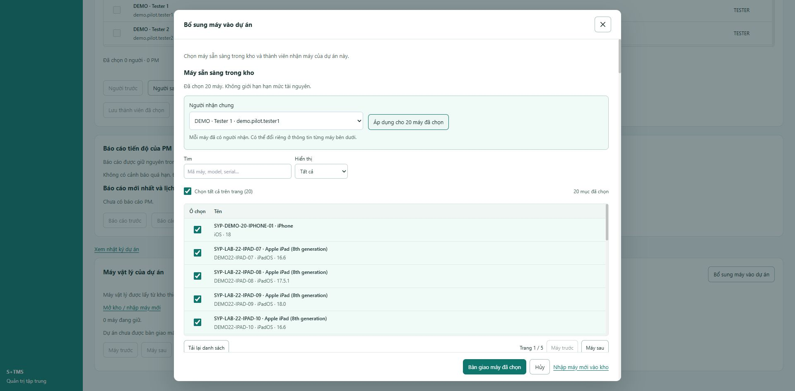

# Kiểm tra lại toàn bộ nút thao tác — 11/10/2026

Yêu cầu: rà thêm một lần các nút, bảo đảm thao tác hợp lệ có kết quả/phản hồi, lỗi có cách xử lý và nút bị khóa có điều kiện rõ. Đây là lượt tiếp theo của [audit trước](2026-10-11-action-buttons-audit.md), trên `system-design`; giữ thay đổi đã có, không commit/push/merge/deploy. S11 vẫn `IN_REVIEW`.

## Những lỗi đã sửa thêm

| Nhóm | Tình huống trước sửa | Kết quả sau sửa |
|---|---|---|
| Phân trang phạm vi retest | Đã chọn case và nhập lý do, bấm **Tiếp** vô tình gửi form xác nhận phạm vi | Nút trước/tiếp có `type="button"`; đổi trang không ghi dữ liệu. Nút retry dùng chung cũng có loại nút tường minh |
| Bàn giao máy thành công một phần | Máy đã giao vẫn còn trong danh sách AVAILABLE cũ và có thể bị chọn lại | Tải lại kho sau phần đã thành công; giữ người nhận/ghi chú của máy lỗi và chưa gửi. Test xác nhận thứ tự gọi `[1,2,2,3]`, máy 1 không bị gửi lại |
| Tạo dự án trả kết quả muộn | Người dùng đã rời trang nhưng callback vẫn đổi route | Callback kiểm tra màn hình còn tồn tại; không chiếm điều hướng mới |
| Bàn phím popup | Shift+Tab từ tiêu đề hoặc thông báo lỗi thoát ra trang nền | Giữ focus trong popup; vẫn di chuyển tự nhiên giữa các trường, trả focus về nút mở khi đóng |
| Lưu retest | Lỗi ở phía trên form dài, người dùng bấm bên dưới không thấy phản hồi | Đưa focus tới lỗi, giữ bản nháp để sửa/thử lại |
| Tải lại ticket | Nội dung cũ còn đó nhưng nút không thể hiện đang tải | Có nhãn đang tải và khóa bấm lặp đến khi có kết quả |
| Đăng bình luận | Không có pending/thành công tại form; lỗi xa nút | Phản hồi cạnh form, focus lỗi, giữ nội dung và request key khi thử lại, khóa gửi trùng |
| Popup chuyển trạng thái | X còn bật nhưng gọi hàm rỗng trong lúc lưu | X bị khóa rõ ràng khi lưu; Escape/backdrop tuân theo cùng trạng thái; lỗi trả quyền đóng |
| Tìm nguồn AI | Retry tải metadata/history nhưng không gọi lại API nguồn đang lỗi | Lỗi nguồn có nút retry đúng API; giữ các guard và request key của yêu cầu sinh nội dung |
| Liên kết Redmine | Refresh không có pending; khi refresh lỗi vẫn cho gửi theo quyền đã tải trước đó | Có pending/hoàn thành/lỗi; chặn gửi đến khi tải lại quyền thành công, giữ lý do, giải thích điều kiện gửi |
| Giới hạn chọn case | Quá 100 mục chỉ khóa xác nhận mà thiếu giải thích | Hiện số đã chọn/100 và hướng dẫn bỏ bớt, tại cả scope thủ công và coverage retest |
| Ô kết quả tài liệu | Một số trạng thái khóa chỉ có lý do chung chung | Nêu đúng lý do: đang tải, đang xuất file, lỗi đọc kết quả, thiếu mã dòng, case/dự án lưu trữ, quyền chỉ xem |
| Lịch sử sửa ô | Đọc lịch sử lỗi ở phần thu gọn, chỉ phục hồi bằng đóng/mở editor | Mở phần lỗi và có retry ngay trong editor; giữ nội dung chưa lưu, retry không gọi API lưu |

Các sửa lỗi có test hành vi thất bại trước sửa rồi PASS. Tổng suite tăng từ 822 lên 842 test; một số test cũ được bổ sung kiểm tra focus/giữ bản nháp. Không đổi backend, schema, quyền nghiệp vụ hoặc ràng buộc dữ liệu trong lượt này.

## Phạm vi kiểm kê và review

AST phân tích 141 file frontend ngoài test, 133 file trong cây import từ entry. Trong cây này có **370 khai báo native button**, **81 chỗ dùng Button/IconButton/ResultCycleButton**, **42 form**, 11 click-control và 16 disclosure. Không còn ứng viên thiếu cả handler lẫn đường submit trong inventory.

Đây là số khai báo source, có thể bao gồm wrapper và implementation của cùng một nút hoặc export không được render. Không được diễn giải thành 451 nút khác nhau đã bấm tay, hoặc thành chứng minh mọi nhánh handler đều đúng.

Các nhóm đã đọc handler/điều kiện khóa/submit/validation/pending/thành công/lỗi/retry:

- Admin: dự án, thành viên, vòng đời, tài khoản, kho máy/bàn giao/thu hồi, nhật ký, báo cáo PM, dropdown và bộ chọn.
- Cấu hình dự án: thông tin chung, danh mục, handbook, rules, thành viên/thiết bị, đổi phạm vi dự án.
- Test: thư viện, case/suite, import Excel/batch, bảng tài liệu, chu kỳ kết quả, sửa ô/lịch sử/test lần 2; đợt/scope/phân công/thực thi/NA; công việc theo file/range/session/inbox; retest/coverage/đóng lỗi.
- Công việc: Kanban/danh sách, tạo/sửa, chuyển trạng thái, tham chiếu, bình luận, chứng cứ, QA/handoff, tổng quan/tiến độ/báo cáo/export.
- Auth/AI/integration: đăng nhập/session/logout, nguồn AI/kết nối/chat/draft/tìm kiếm/retry, trạng thái/publish/retry/reconcile Redmine. Không gửi thử yêu cầu trả phí hoặc công bố ra ngoài.

Inventory chi tiết: [JSON từng khai báo](../../var/ui-audit/button-action-recheck-inventory.json). Ma trận kiểm tra độc lập: [admin/project](../../var/ui-audit/button-recheck-admin.md), [test/execution/file/retest](../../var/ui-audit/button-recheck-workflows.md), [work/QA/report/auth/AI](../../var/ui-audit/button-recheck-actions.md).

## Kiểm chứng cuối cùng

- **842/842 frontend test, 76 file PASS**, chạy toàn bộ với coverage sau khi các thay đổi đã ổn định: [log](../../var/ui-audit/button-recheck-full.log).
- Coverage toàn bộ phạm vi frontend trong cấu hình Vite: statements **86.85%**, branches **83.95%**, functions **81.35%**, lines **86.65%**. [Báo cáo](../../var/ui-audit/button-recheck-full-coverage/coverage-summary.json). Không loại file chưa có test để nâng số; bootstrap legacy `src/index.js` được cấu hình loại từ trước.
- Redmine component riêng: 11 test PASS, coverage 95.49/88.65/96.15/100. Thử bỏ guard `loadFailed` làm test thất bại như dự kiến, sau đó khôi phục source; full suite cuối PASS. Không có request tới Redmine ngoài thật.
- **Build PASS**, còn cảnh báo bundle >500 kB đã có: [log](../../var/ui-audit/button-recheck-build.log).
- **Contract/reference checker PASS**, kiểm tra cấu trúc, không phải xác thực HTTP/OpenAPI đầy đủ. `git diff --check` PASS. Frontend JavaScript không có lệnh lint/typecheck riêng trong package scripts. Backend/migration không đổi trong lượt này nên không chạy lại Maven/JDT/native; kết quả cũ giữ tại audit trước, không báo như kiểm tra mới.

## Browser Chrome local

Tài khoản demo Admin, dữ liệu dự án đang có; chỉ điều hướng/đọc/chỉnh bản nháp, không ghi fixture vào `tms`.

1. Popup bàn giao: chọn 20 máy, bấm khi thiếu người nhận → lỗi 20 máy nhận focus. **Điền người nhận còn thiếu** đưa focus tới select còn thiếu. Chọn người nhận chung/áp dụng 20 → hết lỗi và nút bàn giao bật. Hủy bản nháp sau kiểm tra; không thực hiện bàn giao thử vào database sử dụng.
2. Shift+Tab từ tiêu đề → liên kết cuối bên trong popup; hủy → focus trở lại nút mở. Kiểm chứng trên desktop và viewport 390×844. Mobile dialog clientWidth/scrollWidth cùng 366px, nút cao 44px nằm trong viewport; reset viewport sau kiểm tra.
3. Ticket thật: phóng to/thu nhỏ/đóng hoạt động. **Tải lại chi tiết** chuyển thành **Đang tải chi tiết…**, disabled, giữ nội dung cũ rồi trở lại trạng thái sẵn sàng.
4. Mở và tải lại phần Redmine → thông báo đang tải rồi đã tải; dự án hiện chưa cấu hình kết nối nên không thực hiện publish/reconcile ra ngoài.

## Skills và giới hạn kết luận

Đã đọc hai bản `using-superpowers`, `brainstorming`, `ponytail-review`, `prompt-master` theo yêu cầu. Phạm vi là rà/sửa hành vi hiện có đã được người dùng yêu cầu; không thiết kế subsystem mới. Áp dụng thêm `systematic-debugging`, `code-review-and-quality`, `tdd-workflow`, `verification-loop` và hướng dẫn stack trong repository. `prompt-master` tự giới hạn cho công việc viết prompt, không áp dụng vào sửa code này.

Không còn lỗi hành vi/phản hồi đã xác nhận chưa xử lý trong lượt review. Kết luận dựa trên source, regression và các bước browser ghi trên; không khẳng định mọi tổ hợp dữ liệu/quyền trên mọi thiết bị đều không có lỗi. UAT người dùng, thiết bị thật, OAuth/model trả phí và delivery Redmine live vẫn là các gate riêng của S11. Không dùng tỷ lệ coverage hoặc số test để thay nghiệm thu những phần đó.

## Ponytail — nhận xét độ phức tạp, không áp dụng

`Frontend/src/app/modules/ProjectOverview.jsx:L16: delete: notice/setNotice, notify prop và nhánh notice không được HomePage gọi; bỏ nhánh thừa và tham số notify không dùng.`

`Frontend/src/app/features/projects/CatalogPage.jsx:L61: delete: guard thiếu project lặp trong ProjectCatalog; CatalogPage bên ngoài đã return trước khi mount. Không cần thay thế.`

`net: -4 lines possible.` Những phần xóa trong cùng dòng không được tính thành dòng giảm. Không gộp dọn code tùy chọn vào sửa lỗi nút.
