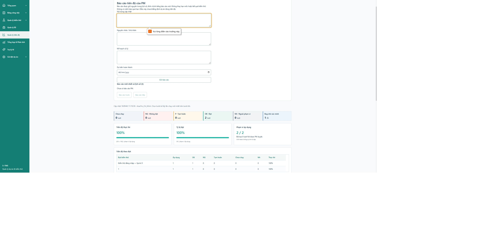

# Rà soát source, thao tác và liên kết dữ liệu — 11/10/2026

Yêu cầu: đọc lại toàn bộ source sản phẩm, đi qua từng khai báo điều khiển và lần theo UI → handler → API → quyền → ghi dữ liệu → tải lại. Giữ nhánh `system-design`, giữ các sửa đổi đang có; không commit/push/merge/deploy.

## Phạm vi và cách xác nhận

Đọc toàn bộ file production JavaScript/JSX/CSS trong `Frontend/src` và Java/SQL/YAML/properties trong `Backend/src/main`, bao gồm code cũ không còn được route sử dụng. Không tính dependency, build output hay mã sinh tự động. Ledger có đường dẫn, phạm vi dòng và SHA-256 của bản đã đọc; việc quét AST chỉ lập danh sách, không thay thế đọc source hoặc chứng minh thao tác chạy được.

Kết quả đối chiếu hash cuối: **354/354 file, 29.224 dòng**, không còn file thiếu bằng chứng đọc. Inventory có **1.012 khai báo điều khiển/form/input**; đồ thị import đang dùng có 371 button HTML, 82 custom action, 11 click control, 42 form và 16 disclosure. Không tìm thấy button trong đồ thị này thiếu cả handler, submit hoặc đường truyền callback. Những con số này không phải số lượt thao tác đã chạy trên trình duyệt.

Skills: đọc `prompt-master` và `brainstorming` theo yêu cầu; prompt-master không áp dụng mẫu viết prompt cho việc sửa code. Dùng code-review-and-quality với reviewer độc lập, phân tích lỗi, test hành vi RED→GREEN và verification-loop. Quyết định Admin toàn quyền, phân công theo file/khoảng case, test lần 2 và đồng bộ kết quả một chiều giữ theo yêu cầu đã chốt.

Ledger đầy đủ và ma trận chi tiết:

- `var/ui-audit/deep-review-inventory.json`: toàn bộ source và khai báo điều khiển.
- `var/ui-audit/deep-review-root.json`: hạ tầng UI, router, API client và module dùng chung.
- `var/ui-audit/deep-review-admin-ledger.json`, `deep-review-admin.md`: quản trị, thành viên, thiết bị, danh mục, báo cáo và migration.
- `var/ui-audit/deep-review-testing.json`, `deep-review-testing.md`: tài liệu/case, import, đợt, file, phân công và kiểm thử lại.
- `var/ui-audit/deep-review-work-ai.json`, `deep-review-work-ai.md`: công việc, QA, báo cáo kết quả, chứng cứ, AI, Redmine và đăng nhập.
- `var/ui-audit/deep-review-reachability.json`: phân biệt điều khiển nằm trong cây import hiện dùng với prototype không còn route.

## Lỗi được tìm và sửa trong lần rà soát này

| Lỗi | Hành vi sau sửa | Kiểm chứng hồi quy |
|---|---|---|
| Tải lại chi tiết quản trị chỉ cập nhật số liệu, để quyền sửa dự án đã lưu trữ bị cũ | Làm mới đồng thời chi tiết quản lý, thành viên và tổng hợp | Dự án bị lưu trữ từ bên ngoài → tải lại → khóa đúng thao tác |
| Admin gửi báo cáo tiến độ có thể lỗi 500 vì thiếu membership dùng ghi tác giả; UI không cho đăng báo cáo | Dùng attribution hợp lệ, giữ quyền Admin và lịch sử/idempotency | Unit lỗi NPE/canPost RED→GREEN; native ghi và đọc lại lịch sử |
| Màn quản trị báo cáo không có đường vào nơi nhập báo cáo | Liên kết mở đúng workspace và project đang xem | Test điều hướng + trình duyệt |
| Giao lại từng run của nhóm file bỏ qua điều kiện phiên đang chạy và làm lệch người được giao | UI đưa về giao lại file; API giao lẻ từ chối run thuộc nhóm | FE điều hướng + native nhóm file |
| Retest tải lại lỗi vẫn giữ quyền ghi cũ | Không cho ghi dựa trên dữ liệu quyền cũ; giữ draft và cho tải lại | Test refresh lỗi/phục hồi |
| “Thử lại” sau lỗi thêm cấu hình/phạm vi gọi sai thao tác; lỗi đọc còn hiện khi đổi chế độ | Phân biệt lỗi đọc với lỗi ghi; retry đọc đúng nguồn, giữ draft để gửi lại thao tác ghi | Test thêm cấu hình lỗi và đổi chế độ |
| Retry upload cùng chứng cứ tại giới hạn 100 bị từ chối | Nhận lại bản đã lưu theo hash; vẫn chặn file mới vượt giới hạn | Test retry thành công và cap mới |
| Lưu trạng thái kiểm tra AI thất bại làm kẹt GENERATING trong bộ nhớ | Chỉ công bố trạng thái sau khi lưu thành công; có thể thử lại | Vault lỗi một lần, giữ trạng thái trước và retry thành công |
| Worker Redmine từ chối Admin hợp lệ nhưng có thể nhận Dev đã bị thu hồi quyền | Kiểm tra quyền hiện tại nhất quán với thao tác đưa vào hàng đợi | 7 native test với remote giả lập |
| “Xem cases” giữ số trang cũ, làm danh sách suite hiện rỗng | Reset trang khi vào suite | Test đang ở trang 2, mở suite một trang |
| Xuất Excel có thể kẹt sau khi nhận header nếu body dừng truyền | Timeout/hủy bao gồm tải toàn bộ body, giữ tên file từ server | Test body không kết thúc, hủy và tải lại đúng byte |
| Lưu/duyệt case thành công nhưng GET tiếp theo lỗi để lại dữ liệu cũ và không có retry | Tách lỗi đọc/ghi; có nút tải lại, khóa mutation dựa trên dữ liệu cũ; retry không gửi lại POST đã thành công | Test POST thành công → GET lỗi → retry thấy revision mới, POST chỉ gọi một lần |

## Ma trận hạ tầng dùng chung

| Nhóm thao tác | Luồng được đối chiếu | Phản hồi và giới hạn |
|---|---|---|
| Header, Sidebar, chọn dự án, router | AuthProvider/ProjectProvider → routeInfo/legacyRoutes → màn thực tế; Admin vào workspace với projectId | Loading/lỗi/chọn dự án; không coi prototype `IssuesPage`, `IssueForm`, `CreateProjectDialog` là màn đang dùng |
| SelectionTable, checkbox toàn trang, TableScroll | Selection controlled bởi màn cha; disabled không tính vào chọn toàn trang; paging/filter không tự gửi mutation | Phân biệt chọn cục bộ với lưu thật; test component và các form sử dụng |
| Dialog, focus, Escape và nút đóng | useDialogFocus → dialog trên cùng, phần tử khả dụng, phục hồi focus khi đóng | Test focus/keyboard; chỉ các kích thước đã kiểm tra mới có bằng chứng responsive |
| TestSpecs, suite/case paging/filter | testCases API → TestCaseService, current revision/scope → refresh list | Đã sửa reset trang; đọc/lưu lỗi có phản hồi riêng |
| Dashboard, overview, progress/analysis | reports/projects API → reporting queries; project/role scope, build/cycle filters → dữ liệu nguồn | Loading/error/retry, bảng tổng hợp và export; không suy kết quả thống kê từ dữ liệu mock cũ |
| HTTP và download | CSRF/session, AbortController, timeout, JSON lỗi → caller notice; tải blob hoặc download có tên server | Timeout kéo dài qua body; retry không được ghi trùng; không dùng raw Response cho file-work export nữa |
| Backend nền, cycle/release/config | Spring security/session, validation, project lock, Flyway, error mapping | Đối chiếu source và tests; chẩn đoán DB vẫn ở công cụ phát triển, không thêm UI sức khỏe hệ thống |

## Dữ liệu và giới hạn bằng chứng

Database ứng dụng được kiểm tra chỉ đọc: 76 bảng, 185 khóa ngoại không có orphan; 10 đối chiếu nghiệp vụ không có bản ghi sai liên kết. Bao gồm group/source, run/revision, latest attempt, retest/case, QA và imported row. Khác người được phân công với Admin thực thi thay không tự bị coi là lỗi dữ liệu: đây là quyền đã chốt.

Test ghi/xóa dùng schema `tms_docstest_*` đã có, có guard tên schema; không chạy fixture trên `tms`. Không thay migration đã áp dụng. Không gửi Redmine hoặc gọi AI trả phí thật.

Đọc đủ source, có handler và test pass **không chứng minh mọi nút ở mọi trạng thái đều đúng**. Các ma trận ghi riêng bằng chứng static, component test, native integration và trình duyệt; không đánh dấu runtime PASS cho điều khiển chỉ được truy vết source. UAT nhiều thiết bị, mọi tổ hợp vai trò/dữ liệu và tích hợp dịch vụ thật vẫn là gate riêng của S11.

## Kết quả kiểm chứng cuối

- Frontend: **856/856 test, 78 file PASS**, chạy lại sau chỉnh sửa cuối. Coverage toàn phạm vi cấu hình FE: statements **86,98%**, branches **84,22%**, functions **81,65%**, lines **86,83%**. Các module API mỏng được mock ở component tests nên không suy coverage thành bảo đảm HTTP đầu cuối. Log: `deep-review-frontend-final.log`.
- Backend: **552/552 test thuộc 57 lớp unit/security PASS**; lượt kết hợp sửa đổi **120/120 PASS**, gồm 75 test trùng với bộ unit và 45 native. Thêm **15/15 native workflow/member/device PASS**. Như vậy có **60 native test** riêng trong các lượt cuối, không cộng trùng 75 test unit. Logs: `deep-review-unit-final.log`, `execution-document-deep-final.log`, `execution-document-deep-workflow-green.log`.
- Lượt native mở rộng đầu tiên thất bại 1/15 vì test dùng `expectedVersion=3` sau khi execution đã đúng nghiệp vụ tăng document version lên 4. Đã sửa fixture đọc version hiện tại và thêm assertion hai chiều: execution OK → document OK; manual document NG không đổi execution OK. Giữ log thất bại `execution-document-deep-workflow-final.log` để đối chiếu.
- Build frontend PASS; còn cảnh báo bundle JS **668,49 kB** vượt khuyến nghị 500 kB. Đây là giới hạn hiệu năng đã biết, không được đánh dấu là lỗi thao tác đã sửa.
- Java diagnostics: **264 file, 0 errors / 0 warnings**. Contract checker PASS về cấu trúc route/schema/reference; không coi là HTTP test toàn bộ endpoint. `git diff --check` PASS.
- Test Redmine có remote mock; test AI có provider/vault giả lập. Các bài Testcontainers chưa được chạy lại toàn bộ trong lượt này. Những expectation Redmine cũ phủ nhận toàn quyền Admin đã được đổi thành kiểm tra PM ngoài dự án/PM bị thu hồi membership; hành vi quyền mới được chạy trên SQL thật qua NativeRedminePermissionTest, không coi bài Testcontainers đã PASS.

Kiểm tra trình duyệt và khởi động local được ghi bổ sung bên dưới; kết quả hồi quy không thay cho UAT mọi nút trên mọi thiết bị. Không đo lại backend coverage từ đầu trong lượt này vì JaCoCo đang cộng dữ liệu nhiều lần chạy; không công bố tỷ lệ từ dữ liệu cộng dồn đó.

## Runtime và trình duyệt

- Backend local đã khởi động lại bằng `Start-Backend.ps1`, PID 25148, health HTTP 200/UP trên 8080, native MySQL 3307/schema `tms`, Flyway V29. Frontend 5173 đã reload với bản sửa cuối.
- Đối chiếu hash trước/sau khởi động: **7.270 dòng dữ liệu cũ trên 72 bảng giữ nguyên**, bao gồm byte workbook nguồn; không thêm dòng nghiệp vụ. Loại session/login bucket khỏi phép so sánh vì có thay đổi vận hành bình thường. Evidence: `deep-runtime-preservation.json`.
- Chrome Admin: liên kết từ quản trị mở đúng `#/progress?workspace=1&projectId=1`; sau restart có form và nút gửi báo cáo. Bấm gửi trống đưa focus vào nội dung bắt buộc và hiện “Vui lòng điền vào trường này.”, không ghi báo cáo thử lên DB sử dụng.
- Form ở desktop không tràn ngang. Kiểm tra màn nhỏ có `innerWidth=390`, client/scroll width cùng 385 do scrollbar và zoom trình duyệt, nút gửi cao 44px, lỗi bắt buộc vẫn focus đúng. Đã reset viewport sau kiểm tra.
- Dialog bàn giao: chọn 20 máy rồi bấm khi thiếu người nhận hiện lỗi cụ thể “20 máy chưa có người nhận hợp lệ…”, focus vào alert; desktop dialog không tràn ngang. Không thực hiện bàn giao thử trên dữ liệu ứng dụng. Hành vi ghi thành công/rollback và thành viên được kiểm chứng bằng native test riêng.
- Console trước reload có lỗi context Auth trong lúc HMR các module (17:57–17:58); không có error/warn mới kể từ reload cuối 18:09:40. Không tuyên bố HMR mọi tổ hợp đã được kiểm chứng. Evidence: `deep-console-evidence.json`.
- Lưu DOM và kích thước tại `deep-browser-evidence.json`. Ảnh toàn viewport chụp được; một lần chụp crop timeout, không dùng làm bằng chứng.

Không còn lỗi đã tái hiện trong phạm vi review này bị để lại chưa sửa. Các khoảng trống UAT/dịch vụ thật, cảnh báo bundle và phạm vi chưa chạy Testcontainers đã ghi riêng; **S11 vẫn IN_REVIEW**.
