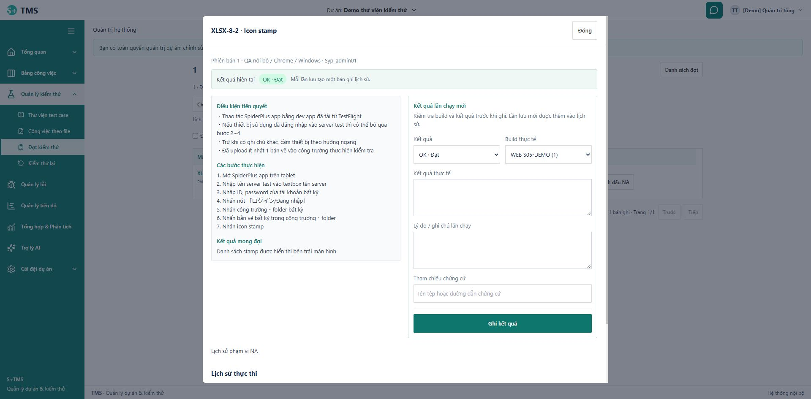

# Sửa kết quả thực thi và đồng bộ bảng tài liệu — 11/10/2026

## Yêu cầu và nguyên nhân

Người dùng xác nhận lấy **lần ghi thực thi mới nhất của case**, thường từ người test lần 2, để cập nhật cột iPad. Sửa trực tiếp iPad không sửa lượt thực thi. [Quy tắc đã chốt](../planning/2026-10-11-execution-document-results.md).

- Nhãn kết quả hiện tại đọc đúng OK, nhưng `AttemptDialog` khởi tạo form bằng NG cố định. Không phải dữ liệu OK bị đổi thành NG khi chỉ mở hộp thoại.
- `ExecutionService.recordCanonical` trước đây chỉ thêm attempt và đổi con trỏ kết quả run, chưa cập nhật `import_rows.result_status`.
- Cột test lần 2 ghép tên đợt và trạng thái thành chuỗi ngắn khó hiểu; popup chưa phân biệt rõ kết quả hiện tại/lần chạy mới.

## Đã sửa

- Form mở theo kết quả hiện tại OK/NG/P; chưa chạy để trống với lựa chọn bắt buộc. Giữ bản nháp khi tải lại sau xung đột. Nhập NG/P vẫn yêu cầu nội dung/lý do tương ứng.
- Attempt mới cập nhật mọi dòng import đã commit của đúng dự án/case trong cùng transaction. Tăng version, ghi actor/time và lịch sử kết quả tài liệu. Replay attempt cũ không ghi đè kết quả mới hơn hoặc chỉnh sửa tay. Không đổi workbook/ô nguồn, không backfill lịch sử cũ, không thêm migration.
- Lưu thực thi trong ngữ cảnh tài liệu tải lại kết quả tài liệu; điều hướng về tài liệu đọc dữ liệu server. Kết quả trong cột Người test lần 2 vẫn lấy từ lượt đã giao, không bị sửa khi bấm iPad.
- Popup tách kết quả hiện tại và lần chạy mới; nội dung giữ xuống dòng, tiêu đề/nút ghi kết quả hỗ trợ cuộn, nút/ô chọn cao 44px. Test lần 2 ghi rõ tên đợt và kết quả lượt được giao, nút có viền/trạng thái thao tác rõ hơn.
- Cập nhật contract API và hướng dẫn sử dụng cho đồng bộ một chiều.

## Bằng chứng kiểm chứng

- Frontend RED: callback tải lại tài liệu không được gọi và thiếu nhãn đợt/kết quả riêng. GREEN 38 test tài liệu/kết quả đạt. Nhóm thực thi thêm RED cho OK/P/chưa chạy; GREEN 42 test.
- Native RED: 8 ca mới, 6 lỗi hành vi và 1 xung đột phiên bản do chưa có projection; ca case không import đạt. GREEN 32 test ở 3 class, schema riêng `tms_docstest_202610100016` V29, fixture rollback. [RED](../../var/ui-audit/execution-document-red-behavior.log), [GREEN](../../var/ui-audit/execution-document-green.log).
- Native kiểm tra OK/NG/P, nhiều đợt/cấu hình, cùng case trong nhiều tài liệu, bỏ qua preview/dự án/case khác, source bytes/raw JSON giữ nguyên, tăng version/lịch sử, từ chối dữ liệu sai và replay không ghi đè chỉnh sửa tay. Test second-test cũ được cập nhật để xác nhận tay NG vẫn giữ lượt được giao OK.
- Review độc lập đọc transaction/lock/idempotency/source preservation và FE refresh/draft: không phát hiện lỗi có thể hành động trong phạm vi thay đổi.
- Full frontend **846/846 test, 76 file PASS**, lệnh `npm exec -- vitest run --maxWorkers=2`, exit 0. [Tóm tắt terminal](../../var/ui-audit/result-sync-frontend-verified.txt). Lượt song song đầu gặp timeout; lượt cuối giảm worker đạt mà không tăng timeout hay sửa các test bị timeout. Không đo lại coverage toàn frontend.
- Lượt backend cuối **127/127 PASS** gồm 119 unit liên quan và 8 native mới; 8 native này trùng nhóm 32 phía trên, không cộng thành số test độc lập. [Log](../../var/ui-audit/execution-document-verified.log). Helper projection đạt 100% instruction/branch/line trong phạm vi test; không suy ra toàn backend đạt 100%. [Chi tiết](../../var/ui-audit/execution-document-review.md).
- Eclipse/JDT **263 source, 0 lỗi, 0 cảnh báo**. Frontend build PASS, còn cảnh báo bundle 667.15 kB >500 kB đã có. Contract/reference checker PASS ở mức cấu trúc, không thay thế kiểm tra HTTP/OpenAPI đầy đủ. `git diff --check` PASS theo cấu hình CRLF hiện hành của repository; không đổi định dạng dòng của các file cũ.

## Browser và runtime

- Backend 8080 không chạy trước kiểm tra; đã khởi động lại bằng `Start-Backend.ps1`, MySQL native 3307/tms V29, không migration mới. Frontend 5173 đang phục vụ bản sửa.
- Chrome, đúng case **XLSX-8-2 · Icon stamp**, đợt **1** như ảnh người dùng: nhãn hiện tại OK và dropdown mở với **OK · Đạt** được chọn; form/lịch sử hiển thị riêng. Chỉ mở/chỉnh focus/đóng, không ghi kết quả thử vào `tms`.
- Desktop đã quan sát và lưu ảnh. 390×844: dialog clientWidth/scrollWidth cùng 364px, các nút/select cao 44px; Tab tới nút Ghi kết quả nằm trong viewport (y482–526); Escape đóng, reset viewport. Screenshot mobile timeout hai lần, nên chỉ có chứng cứ DOM/keyboard cho mobile, không tuyên bố đã đối chiếu ảnh mobile.
- Hash **7.268 dòng cũ / 72 bảng**, gồm byte workbook nguồn, giữ nguyên sau khởi động và kiểm tra. Có thêm **1 identity_audit** do đăng nhập demo; session/login buckets được loại khỏi phép so sánh. [Bằng chứng](../../var/ui-audit/result-sync-preservation.json).

## Giới hạn

Chỉ kết quả được ghi mới sau bản sửa mới đồng bộ sang tài liệu. Không tự sửa các kết quả tài liệu đang có bằng lịch sử cũ. Không khẳng định mọi nút/mọi tổ hợp dữ liệu của toàn hệ thống không còn lỗi từ các test trong phạm vi này. Không commit/push/merge/deploy; S11 vẫn IN_REVIEW cho các gate nghiệm thu riêng.

Skills: `using-superpowers`, `systematic-debugging`, `tdd-workflow`, `verification-loop`, `code-review-and-quality`, `ui-ux-pro-max`; giữ hướng dẫn stack của repository. UI skill search script không chạy được vì môi trường không có Python; áp dụng các quy tắc đọc từ skill và kiểm tra browser riêng. Các skill đã đọc theo yêu cầu trước đó giữ trong báo cáo rà nút; không coi việc đọc skill là bằng chứng kiểm thử.
