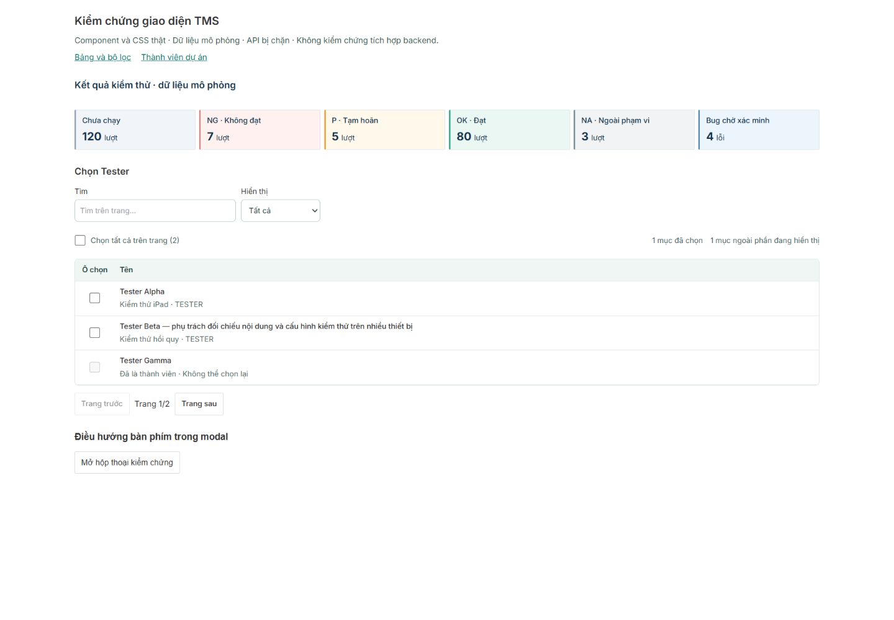

# Tinh chỉnh UI/UX — 17/10/2026

Ghi chú bàn giao mới17/10: sau khi nhận báo cáo, người dùng yêu cầu commit và push lên nhánh hiện tại. Cho phép đưa source/test/docs và bằng chứng liên quan lên `system-design`, không merge/deploy. Các câu “chưa commit/push” và JSON snapshot bên dưới mô tả thời điểm kiểm chứng trước yêu cầu mới; không sửa lại bằng chứng lịch sử.

Đã triển khai các cải tiến UI-R1–R3, đo/đối chiếu UI-R4 và hoàn tất phần kiểm chứng độc lập của UI-R5: **884 test/82 file frontend và build PASS**. Đã kiểm tra Chrome thật với component/CSS thật, dữ liệu mô phỏng và API bị chặn. **Tích hợp backend, zoom200%, cảm ứng/AT và UAT còn mở; S11 vẫn IN_REVIEW.** Không kết luận toàn bộ ứng dụng/mọi nút/mọi trạng thái đã được nghiệm thu.

Nguồn bàn giao: [audit16/10](2026-10-16-workflow-audit.md); kế hoạch/checklist duy nhất tại [plan](../../tasks/plan.md) / [todo](../../tasks/todo.md). Nhánh `system-design`, HEAD `c42e3f0ab87403cf39122c85fe63bc267368b7ad`; baseline là **working tree audit chưa commit**, lưu [snapshot](../../var/uiux-2026-10-17/baseline.json) và [patch](../../var/uiux-2026-10-17/baseline.patch). Không ghi đè bằng chứng cũ. Ngày báo cáo theo Asia/Saigon; timestamp JSON dùng UTC nên một số ghi ngày16/10.

Runtime trước sửa:8080/5173 ECONNREFUSED ([kiểm tra mới](../../var/uiux-2026-10-17/runtime-before.json)). Chrome profile Nguyên Giáp được dùng qua CUA. Fixture frontend riêng4173 nhập component/CSS source hiện hành, dữ liệu tổng hợp/API doubles, middleware chặn `/api` và `/actuator`; không đăng nhập hoặc ghi database. Không start/restart backend, container, app service hay chạy scratch script lịch sử. Không commit/push/merge/deploy/PR, không sửa API/backend/schema/dependency/brand/navigation. Frontend-only fixture là công cụ kiểm thử; không thay ứng dụng thật hoặc thêm màn mock vào sản phẩm.

## Baseline / acceptance

| Màn/luồng | Vấn đề quan sát | Tác động | Bằng chứng | Hướng sửa / tiêu chí |
| --- | --- | --- | --- | --- |
| SelectionTable | Count không giải thích selection ngoài phần nhìn thấy; filter selected chỉ local page nhưng nhãn chung, không clear/recovery | Dễ tưởng mất selection hoặc không có dữ liệu | Source, browser baseline và2RED | Scope label/hidden count/live feedback/clear chỉ local, giữ selection, không submit, focus vềfilter. |
| Modal focus | Danh sách focus tính control trong closed details/CSS-hidden, bỏ summary; marker disabled không fallback | Tab wrap sai/bỏ sót disclosure |2RED và Chrome trước sửa | Chỉ current available controls, summary hợp lệ, giữ explicit initial target/return-focus/busy/nested-modal. |
| ScopeSetup/CoverageEditor | fetch lỗi vẫn loading={!data} | Lỗi và 'đang tải' xuất hiện đồng thời, khó biết retry |2RED aria-busy expectedfalse | Read-error kết thúc loading, nói chưa tải được, retry đúng state/draft. |
| Admin/member picker | Role/remove không success notice; pager không context, nhiều nút cùng accessible name | Khó nhận biết kết quả, khó chọn đúng bằng bàn phím/AT |3RED UI | Awaited success + focus, pager/tổng, Bỏ chọn+tên; giữ failed drafts/audit cleanup. |
| Report KPI | Candidate global palette tương phản thấp bị loại khi import đủ reports.css | Không chứng minh lỗi trên báo cáo đang dùng | browser-before.json là diagnostic fixture thiếu scoped CSS, không baseline production; source reports.css override và actual computed pairs | Giữ nguyên global.css; đo cặp màu đang render, không đổi palette theo false positive. |

## Đã thay đổi và lợi ích

| Nhóm | Triển khai | Nguồn / tiêu chí đã kiểm |
| --- | --- | --- |
| Chọn dữ liệu và lọc | Nhãn “Đã chọn/Chưa chọn trên trang”, tổng lựa chọn và số mục ngoài phần hiển thị được thông báo polite. Thêm “Xóa bộ lọc trong bảng”; giữ lựa chọn xuyên trang và filter do caller quản lý, không submit form cha; trả focus về filter. Phân biệt không khớp local với nguồn rỗng/lỗi tải. | [SelectionTable:14](../../Frontend/src/app/components/SelectionTable.jsx#L14), [CSS:8](../../Frontend/src/app/components/selection-table.css#L8), [3 test mới](../../Frontend/src/app/components/selection-ux.test.jsx); Chrome filter/reset/page. |
| Bàn phím trong modal | `summary` hợp lệ được nhận Tab; bỏ control disabled/hidden/inert/aria-hidden/CSS-hidden và nội dung details đang đóng. Initial marker không khả dụng được fallback; heading chủ động `tabindex=-1` vẫn được focus. | [useDialogFocus:20](../../Frontend/src/app/hooks/useDialogFocus.js#L20), [test hook](../../Frontend/src/app/hooks/useDialogFocus.test.jsx). Chrome Shift+Tab tới summary, Tab wrap, Escape và trả focus nút mở. Các nhánh wrap/busy/nested đã có được giữ lại, không gán là tính năng mới. |
| Lỗi tải phạm vi | ScopeSetup và CoverageEditor ngừng báo đang tải khi request đã thất bại; hiển thị “Chưa tải được…” và retry. Retry quay lại busy rồi có dữ liệu; không mất selection/config/assignee/reason. | [ScopeSetup:55](../../Frontend/src/app/features/test-execution/ScopeSetup.jsx#L55), [CoverageEditor:17](../../Frontend/src/app/features/retest/CoverageEditor.jsx#L17), [2 test mới](../../Frontend/src/app/features/test-execution/read-state.test.jsx); Chrome retest error→pending→recovered. |
| Phản hồi thành viên | Role-save/gỡ member có success notice theo người, chỉ sau awaited API success và focus về phản hồi sau readback. Giữ xử lý failed draft và bản sửa audit chỉ dọn role draft của người vừa gỡ. | [AdminProjectDetail:38](../../Frontend/src/app/features/admin/AdminProjectDetail.jsx#L38), [test feedback](../../Frontend/src/app/features/admin/admin-member-feedback.test.jsx); Chrome lưu/gỡ/giữ draft Beta, readiness mở lại sau hoàn nguyên draft. |
| Chọn thành viên nhiều trang | Có `Trang X / Y · Z người`; nút bỏ chọn có accessible name kèm tên. Selection và page size/API giữ nguyên. | [MemberPicker:19](../../Frontend/src/app/features/admin/AdminProjectForm.jsx#L19), test hai trang giữ đúng người đã chọn; cập nhật query của [test quản trị](../../Frontend/src/app/features/admin/admin-management.test.jsx) theo accessible name mới. |

Phạm vi source sản phẩm mới: **7 file production +5 file test** trong bảng trên (test hook sửa, admin-management sửa và3 test file mới). Các file audit đang dirty khác được giữ; không tính lại các sửa409/role-draft/work-item/SQL là thành quả UI/UX mới. Tài liệu cập nhật: báo cáo này, tasks/plan.md, tasks/todo.md, docs/planning/README.md và STATUS.json. Artifact/preview chỉ nằm trong thư mục bằng chứng riêng.

Khảo sát rộng trước khi khoanh sửa: quản trị/dự án/thành viên/máy, shared controls/dialog/table/filter, thư viện/tài liệu/phân công lần2, execution/file-work, ticket/QA/retest, report/export. [Khảo sát admin](../../var/uiux-2026-10-17/admin-source.md) và [khảo sát testing/workflow](../../var/uiux-2026-10-17/testing-source.md) phân biệt rõ source-observed candidate với lỗi đã tái hiện. Không mặc định mọi candidate đều cần hoặc đã được triển khai.

## RED → GREEN và kiểm chứng mới

Chạy từ canonical `Frontend`, kiểm tra scripts hiện có trước; full coverage đã chạy toàn bộ suite nên không chạy thêm một lượt full test trùng lặp.

| Kiểm tra | Kết quả / bằng chứng |
| --- | --- |
| Shared hành vi trước sửa | **RED4/9**: thiếu2 hành vi selection và2 hành vi focus. [shared-red.log](../../var/uiux-2026-10-17/shared-red.log). |
| Shared sau sửa | **PASS49/49,7files**,8.00s, [shared-green-final.log](../../var/uiux-2026-10-17/shared-green-final.log). Lượt trung gian48/49 bắt được hồi quy heading initial focus; đã sửa trước GREEN, giữ [log trung gian](../../var/uiux-2026-10-17/shared-green.log). |
| Nguồn rỗng đang giữ local filter | Bổ sung test thứ3 selection: **RED1/3** đúng message caller bị che ([log](../../var/uiux-2026-10-17/selection-error-red.log)), sửa một điều kiện `filtered && rows.length>0`; GREEN nằm trong full884. Không dùng lượt49 chạy trước đó làm bằng chứng cho dòng cuối này. |
| Read error/retry | **RED2→PASS79/79,5files**,24.73s. Bao gồm execution/retest/document-conflicts/document-editing. [Owner record](../../var/uiux-2026-10-17/testing-source.md); lỗi selector trùng region ban đầu là lỗi harness, không tính là product RED. |
| Member feedback/pager | **RED3/5→PASS31/31,5files**,9.74s.2 failure guard đã PASS ở RED; [owner record](../../var/uiux-2026-10-17/admin-source.md). Lỗi selector busy/status đầu tiên không tính là product RED. |
| Full frontend + V8 coverage | **PASS884 tests/82 files**,130.41s, exit0. `rtk proxy npm run test:coverage -- --maxWorkers=2`; [log mới](../../var/uiux-2026-10-17/frontend-final-coverage.log), [coverage JSON](../../var/uiux-2026-10-17/coverage-summary.json). Tổng12 test hành vi mới so với baseline872; targeted suite có overlap nên không cộng các số79/31/49. |
| Coverage thực đo | Statements **87.09% (6552/7523)**; branches **84.22% (6178/7335)**; functions **81.77% (2199/2689)**; lines **86.96% (3470/3990)**. Không suy coverage từ số test PASS, không coi đây là browser/UAT coverage. |
| Build | **PASS**,5.39s, exit0; `rtk proxy npm run build`, [log](../../var/uiux-2026-10-17/frontend-final-build.log). Bundle674.42KB/minified192.16KBgzip vẫn có advisory>500KB. Chưa có đo render/request/latency để mở code-splitting diện rộng. |
| Backend/native | **NOT_RUN** trong đợt UI-only này;552 test lịch sử không phải kết quả mới. HTTP Unicode/nativeV29 của audit còn nguyên gate. |
| Lint / JS typecheck | **NOT_CONFIGURED** trong package scripts; không suy không lỗi từ build. Dependency scan/JDT **NOT_RUN**. |
| Contract structural / diff / bảo toàn baseline | **PASS**, exit0:113operations,19file-work+14QA/handoff,52document local links; `git diff --check` chỉ cảnh báo LF/CRLF.19file tracked dirty baseline:14hash giữ nguyên,5thay đổi đúng AdminProjectDetail/planning/task; không unexpected change, branch/HEAD không đổi. [Summary](../../var/uiux-2026-10-17/verification-summary.json), [contract](../../var/uiux-2026-10-17/contracts-final.log), [diff](../../var/uiux-2026-10-17/diff-check-final.log). Kiểm structural không thay thế API/HTTP runtime. |

P0 được bảo vệ trong full suite hiện tại: AdminProjectLifecycle/role-draft không xóa nháp người khác hoặc khóa readiness sai; document-conflicts giữ nháp409, active source/run/cycle/config/revision và không duyệt bản chưa xem; WorkItemDetail khóa commands khi authoritative read chờ/lỗi, giữ draft/file và refresh dùng được. Không đổi server permission, ownership, project scope, version/idempotency/history hay quy tắc latest execution→iPad một chiều. Các kiểm quyền/409/busy-submit ở đây là automated component regressions; không tuyên bố browser đã chạy đủ các vai trò thật.

## Browser và hình ảnh

Công cụ thực chạy: **Chrome qua CUA**, dùng viewport override; không chạy một Playwright E2E suite riêng. [15 bản ghi trạng thái/đo](../../var/uiux-2026-10-17/browser-after.json), [focus trước sửa](../../var/uiux-2026-10-17/focus-before.json), [console cuối](../../var/uiux-2026-10-17/browser-final-console.json). Synthetic member flow mô phỏng ADMIN, retest mô phỏng PM; shared picker không cần auth. Không có session/role-data backend thật.

| Viewport / trạng thái | Trước | Sau / kết quả |
| --- | --- | --- |
|1440×1000, shared picker, trang1/2,1 lựa chọn ngoài trang, filter rỗng | [Ảnh trước](../../var/uiux-2026-10-17/before-1440.jpg) | [Ảnh sau](../../var/uiux-2026-10-17/after-1440.jpg): cùng dữ liệu/trạng thái; bổ sung câu giải thích lựa chọn ngoài phần hiển thị. KPI giữ palette cũ. |
|375px, cùng dữ liệu picker | [Ảnh trước](../../var/uiux-2026-10-17/before-375.jpg) | [Ảnh sau](../../var/uiux-2026-10-17/after-375.jpg). Có chênh vị trí cuộn dọc ảnh; dùng để kiểm responsive, không so pixel cùng scroll. |
|768px, shared picker | Không có baseline ở cỡ này | [Ảnh sau](../../var/uiux-2026-10-17/after-768.jpg). |
|PM mô phỏng: retest lỗi tải | Không có ảnh trước cùng state | [Ảnh lỗi](../../var/uiux-2026-10-17/retest-read-error.jpg), aria-busy=false; retry→true→false, giữ reason và checkbox. |
|ADMIN mô phỏng: member mutation | Không có ảnh trước cùng state | [Ảnh phản hồi](../../var/uiux-2026-10-17/member-feedback.jpg), success/focus sau response; draft người khác còn. |

Đã thao tác: chọn Alpha→lọc không khớp→xóa local filter (giữ Alpha/Delta, focus search), đổi trang và lựa chọn Delta còn; modal Shift+Tab→summary/Tab wrap/Escape→nút mở; retest failure→retry pending→data, giữ reason/selection; member save/remove→notice+focus, giữ Beta draft và readiness đúng sau hoàn nguyên.375/768/1440 **không tràn ngang toàn trang trong shared fixture**; ô search/select375px cao44px, vùng checkbox label48×44px. Nội dung tên Tester dài được xem. Không mở rộng kết luận sang mọi màn production, mọi chuỗi dài hoặc máy cảm ứng thật.

Contrast đo computed foreground/background của control đã thay đổi: reset **12.63:1**, summary **6.45:1**. Sáu KPI ở ngữ cảnh Reports scoped CSS **11.80–12.43:1**, không cần sửa palette. File `browser-before.json` là chẩn đoán ban đầu thiếu reports.css, **không phải baseline contrast production**. Các ảnh baseline sau đó đã nạp đủ CSS/Tailwind. Không có chứng nhận WCAG toàn app, không đo mọi màu hover/focus/disabled và không chạy screen reader.

Zoom200% **NOT_VERIFIED**: đã thử shortcut browser nhưng DPR/viewport/visualScale không đổi; không gọi một viewport hẹp là zoom200%. Physical touch, Safari, assistive technology và sticky focus trên toàn bộ ứng dụng **NOT_RUN**. Viewport override đã reset sau kiểm tra.

Console giữ nguyên3 entry lịch sử của fixture:1 thiếu React-refresh preamble lúc bootstrap và2 cảnh báo createRoot khi HMR chạy lại. Sửa bootstrap/context trước chốt baseline và dùng lại root trong fixture; production bootstrap không đổi. Sau full reload **2026-10-16T18:04:56.568Z** tới mốc quan sát **18:05:07.890Z** không có warn/error mới. Không xóa log hoặc tuyên bố toàn phiên/toàn app không lỗi console. Fixture không gọi business API; không có bằng chứng request backend thật từ lần browser này.

## Skill → công việc → bằng chứng

Đã xác nhận/đọc file skill trước khi áp dụng; reuse phần đã đọc trong cùng phiên, không chạy lại discovery/context launcher hoặc tạo kế hoạch trùng. Không dùng skill như một danh sách đánh dấu hình thức.

| Skill / nhóm | Áp dụng thực tế | Đầu ra / giới hạn |
| --- | --- | --- |
| Matt ask-matt, codebase-design, implement | Route audit→bounded plan→sửa shared/caller; phân trách nhiệm hook/selection/async/member. | UI-R1–R5,7 production files; giữ stack/state/API. Không mở prototype/business discovery mới. |
| Matt tdd + Superpowers systematic-debugging/test-driven-development | Một vòng RED→GREEN cho từng nhóm; tìm nguyên nhân false loading/hidden focus/thiếu notice; xác nhận lỗi harness riêng. | Tests/log/owner record ở trên; không đếm lỗi selector là product finding. |
| Superpowers using-superpowers, brainstorming, writing-plans | Cân nhắc thay đổi nhỏ rồi triển khai theo quyền user; dùng tasks hiện có, owners không chung file. | Plan/todo, phase checkpoint; không chờ duyệt chung hoặc dựng plan thứ2. |
| Matt code-review + Superpowers requesting/receiving-code-review | Review Spec+Standards độc lập, kiểm diff/ảnh và empty-source boundary cuối; loại KPI false positive. | [Independent review](../../var/uiux-2026-10-17/independent-review.md): chưa phát hiện critical/P1/P2 trong phần đã review; reviewer không tự chạy browser/test hoặc ký UAT. |
| Impeccable Operate; craft-floor/clarify/adapt/harden/polish | Giữ teal/density/Vietnamese; rõ scope chọn, feedback/error/retry; xem rendered path và breakpoint. |5nhóm cải tiến, trước/sau, contrast; context launcher đã chạy một lần trong phiên audit (`var/review-2026-10-16/ui-context.log`), dùng product/source hiện có, không tạo PRODUCT/DESIGN trùng. Không chạy thêm detector để gọi UI đạt. |
| frontend-ui-engineering, frontend-patterns; design-system refs trong owner testing | Native semantics, accessible names/live counts, focus availability/return, phân loading/error/empty, giữ controlled draft. |12test mới, callback/API giữ nguyên; source-only candidates tách khỏi visual pass. |
| ui-ux-pro-max | Kiểm Python bằng PATH và registry; không có executable khả dụng. Dùng hướng dẫn tĩnh từ SKILL làm fallback. | **Local search NOT_RUN**; không khai có kết quả search, không cài toolchain. |
| Superpowers verification-before-completion / verification-loop, Matt handoff | Full suite/coverage/build mới, ghi rõ source vs mocked Chrome vs integration/UAT. | Báo cáo này, STATUS, artifact index/summary; S11 IN_REVIEW. |
| e2e-testing / playwright / performance / api-design / security-review | Không chạy workflow riêng không cần thiết. Browser dùng công cụ CUA tương đương; API/payload/permission không đổi; chưa có số đo performance. | Không tuyên bố chạy Playwright E2E, backend/security scan hoặc tối ưu hiệu năng. Giữ regression quyền/409 bằng suite hiện có. Coding-standards/code-simplification không tạo đợt refactor riêng ngoài phạm vi. |

## Review, giới hạn và bàn giao

[Review độc lập](../../var/uiux-2026-10-17/independent-review.md) đã xem source/test,1440 trước/sau, ranh giới baseline audit và sửa empty-source cuối: không finding critical/P1/P2 được xác nhận còn lại trong diff đã review. Một lượt kiểm thị giác theo lô và xác nhận vùng sửa; không mở vòng polish vô hạn. Các ảnh không thay cho integrated UAT hoặc bảo đảm mọi button trên mọi màn.

Việc còn lại, theo thứ tự:

1. Khi có runtime được phép phục vụ: chạy lại các luồng đã sửa trong app thật với ADMIN/PM/TESTER và dữ liệu test tách biệt; permission loss/409/busy-submit bằng browser, long document/sticky focus, report/export. Không tự khởi động backend hoặc ghi fixture vào database sử dụng.
2. Kiểm zoom200% với công cụ có tác dụng, screen reader/Safari/cảm ứng thật; mở rộng responsive từ shared fixture sang từng màn chính. UI source + Chrome mock hiện tại không đóng các gate này.
3. Tái hiện trước khi chọn các source-only candidates trong2owner report: pending form fields còn sửa được; FileWork field-error link không tìm thấy target; copy disabled/recovery thành công đang dùng alert lỗi; phân trang sau xóa hàng cuối. Chưa sửa hàng loạt hoặc tự thêm quy tắc nghiệp vụ.
4. Giữ nguyên audit nativeV29/HTTP Unicode/concurrency/projection và S11 UAT/live integration gates. Không chuyển sprint DONE chỉ vì frontend suite/build PASS.

Artifact có [hướng dẫn tái hiện và chỉ mục](../../var/uiux-2026-10-17/README.md). Frontend fixture riêng được dừng sau kiểm tra, không để dịch vụ demo thay app thật. Chưa commit/push; mọi sửa chữa audit trước đó còn trong working tree.
