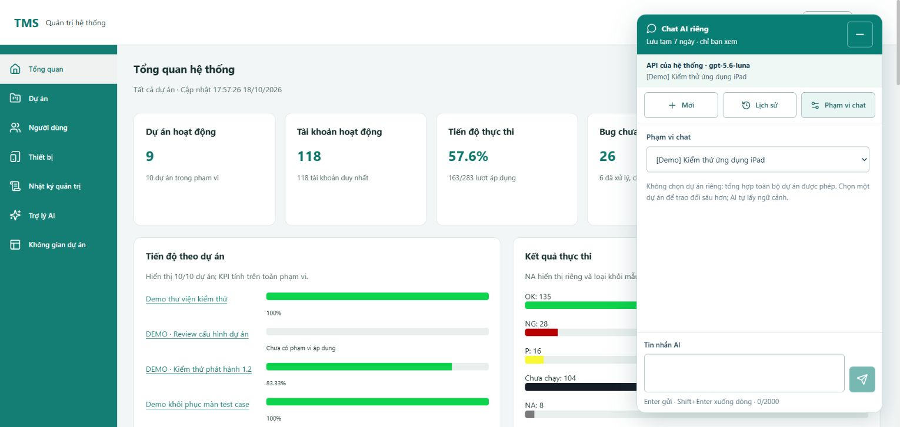

# Chat chỉ chọn phạm vi dự án — 18/10/2026

Đã thực hiện yêu cầu: panel chat chỉ chọn **Phạm vi chat**, bỏ tác vụ, tìm nguồn và chọn file/ticket. Mặc định **Toàn bộ dự án được phép**; chọn một dự án thì AI tự nhận ngữ cảnh riêng của dự án đó. Bốn gợi ý vẫn gửi ngay và người dùng vẫn tự nhập câu hỏi. Nhánh `system-design`; không commit/push, S11 giữ IN_REVIEW.

## Giao diện và khả năng tương thích

- Nút **Phạm vi chat** mở đúng một dropdown: toàn phạm vi hoặc một dự án. Loại bỏ các state/effect/API metadata/targets khỏi `AiChat`; không chỉ ẩn control rồi vẫn bắt chọn ngầm.
- Thiết lập nguồn/model chuyển về màn Trợ lý AI hiện có. Chat vẫn hiển thị provider/model đã ghim; nếu chưa sẵn sàng có liên kết **Mở thiết lập AI**. Không sửa key, kết nối hoặc provider.
- Gợi ý đổi nội dung theo phạm vi: **Tổng quan dự án**, tiến độ, việc/case, bug của dự án đang chọn; toàn phạm vi dùng bộ câu hỏi tổng hợp. Gửi dùng cùng lock/pending/idempotency/retry và giữ bản nháp tự viết.
- Đổi phạm vi bắt đầu hội thoại mới, giữ nháp; không trộn lịch sử của hai dự án. Mới đóng phần Lịch sử và trở về bộ chọn phạm vi. Sửa thêm trường hợp chọn dự án lưu trữ cho hội thoại tương lai làm khóa nhầm hội thoại General cũ vừa mở từ lịch sử.
- General và hội thoại theo tác vụ cũ vẫn đọc/gửi theo scope đã ghim, không đổi dữ liệu đã lưu. Giao diện tạo mới chỉ dùng MY_PROJECTS/PROJECT_CHAT. Màn soạn báo cáo/tác vụ theo vai trò riêng không bị xóa.

## Backend và quyền

`PROJECT_CHAT` nhận projectId được phép, targetId=null; server tự tạo `project-chat-v1:<SHA256>` từ quyền hiện tại của đúng dự án đó. Không thêm enum tác vụ vào màn phân tích hoặc schema migration: constraint V30 đã cho phép tổ hợp dự án/purpose/reference này. MY_PROJECTS giữ contract và fingerprint toàn phạm vi đã có.

Ngữ cảnh dự án riêng tái sử dụng KPI `ReportMetrics`, công việc theo trạng thái, mẫu công việc/case của chính người hỏi. Bổ sung tổng thành viên theo vai trò, tối đa8 đợt,10 tên file **COMMITTED**, tổng máy đang bàn giao. Không lấy file PREVIEW, workbook BLOB, toàn bộ nội dung file hoặc công việc riêng của người khác. Dữ liệu vẫn có thời điểm, giới hạn và ngân sách16KB; AI phải nói rõ phần thiếu/rút gọn. Đây không phải công cụ tìm kiếm mọi nội dung tài liệu theo câu hỏi.

Member chỉ dùng dự án có membership hoạt động; ADMIN toàn quyền dự án kể cả không có membership. Phân biệt `accessRole` với `myRole`; không gán Admin thành PM/Tester giả. List/detail/history/reserve/complete kiểm tra lại scope. Gỡ quyền/đổi role hoặc version của dự án đang chat chặn đọc, replay và lưu output; thay đổi một dự án khác không làm mất hội thoại riêng của dự án này. Dự án lưu trữ chỉ đọc lịch sử, không tạo/gửi mới. Chat vẫn riêng theo chủ sở hữu.

List so sánh scope không dùng exception bị bắt qua transaction để bỏ qua dòng đã mất quyền, tránh lỗi500 rollback-only đã phát hiện ở portfolio trước. Scope và phiên được kiểm tra trước/sau inference; không giữ transaction qua provider call.

## Kiểm chứng

| Kiểm tra | Kết quả |
| --- | --- |
| RED frontend | Hai test fail đúng control cũ còn hiển thị/prompt dự án riêng chưa có. Hai hồi quy bổ sung tái hiện Mới không đóng lịch sử và General bị khóa theo lựa chọn dự án lưu trữ tương lai; đều GREEN sau sửa. |
| RED native | 9 test cũ PASS,4 test mới fail vì PROJECT_CHAT còn bị422; không fixture vào database sử dụng. |
| Full frontend | **896/896**,82file PASS, coverage thực đo. Lượt này trước hai sửa nhỏ cuối về Mới/General; không gọi đây là full suite của revision cuối. |
| Frontend cuối | **60/60**,4file AI PASS sau hai sửa cuối, gồm35test AiChat. Coverage scoped thực đo lại. Build cuối PASS, JS675,61KB; cảnh báo bundle trên500KB còn như trước. |
| Backend AI unit | **165/165** PASS, không failure/error/skipped, Maven verify/package. |
| Native API/MySQL | **13/13** PASS trên `tms_docstest_bab5ba2349be` V30: scope riêng không cần target, không lẫn dự án khác được phép, không lộ PREVIEW, không ảnh hưởng bởi membership dự án khác đổi; private owner, foreign/target/empty-project denial, revoke/list/replay, đổi quyền trong inference, archived read/write và ADMIN không membership. Giữ9kiểm tra portfolio cũ, không cộng lượt trùng. |
| Browser mock | Component/CSS thật với API inject, fetch network bị chặn. Một dropdown; chọn dự án B và bấm gợi ý gửi `{projectId:72,purpose:PROJECT_CHAT,targetId:null}`; trở về toàn phạm vi gửi MY_PROJECTS/nullproject. Không gọi provider/DB thật. Fixture đã gỡ khỏi Frontend, tab đã đóng. |
| Browser ứng dụng thật | Admin trên5173/8080: chọn dự án iPad, chỉ1combo, không còn tác vụ/tìm nguồn/target; đóng cấu hình thấy4gợi ý đúng dự án. Không bấm gửi snapshot thật.320px dialog clientWidth=scrollWidth=302, select272,8px; viewport reset, tab kiểm tra đã đóng. |

Coverage đo mới:

| Phạm vi | Statements/instructions | Branches | Functions/methods | Lines |
| --- | --- | --- | --- | --- |
| Full frontend, trước2sửa nhỏ cuối | 87,12% | 84,30% | 81,80% | 87,00% |
| AiChat.jsx, revision cuối | 92,61% | 87,89% | 91,66% | 93,33% |
| AiPortfolioContext, unit | 96,67% | 93,18% | 92,31% | 94,12% |
| AiPortfolioContext, native | 98,00% | 93,18% | 100% | 97,06% |

Không cộng XML unit/native thành coverage toàn backend. Backend/native suites không gọi model thật. Lint/typecheck JavaScript riêng chưa được cấu hình, không thêm dependency.

Kiểm tra cuối `git diff --check` và `Check-Contracts.cjs` PASS cấu trúc/JSON/liên kết. Scan1.058file source/build/docs/tasks/scripts và artifact mới bằng key giữ trong bộ nhớ không có match, kiểm cả UTF-8/UTF-16; `secret-scan.json` chỉ chứa số lượng/path. Không quét dependency hoặc tuyên bố kiểm toán mọi secret.

Các lượt trung gian được ghi riêng: mock Mockito ban đầu đọc varargs mở rộng sai kiểu, đã sửa harness sang raw arguments; một test OAuth deadline trả mã reconnect thay unavailable khi chạy đồng thời FE, chạy lại nguyên test trong suite riêng thì165PASS, không sửa OAuth. Schema test giữ nhiều fixture làm dự án mới vượt cap30 của Admin; sửa assertion để kiểm tra rõ truncation thay vì giả định dự án đó luôn được gửi. Native cuối13PASS; không reset schema để né giới hạn. Log RTK stderr có thể làm wrapper PowerShell hiển thị NativeCommandError; JSON ghi explicit exit thực unit/native/frontend đều0.

## Runtime và dữ liệu

Đã backup rồi restart đúng TMS PID26956 thành **PID28580**,8080. Backend khởi động17:57:05 ngày18/10/2026, health HTTP200 `UP`; MySQL native3307/tms vẫnV30, không migration mới. Không seed/reset hoặc chạy fixture trên `tms`.

Backup trước/sau ở thư mục Gitignored `var/mysql-native/backups/`; session rows được loại theo công cụ hiện có.65INSERT nghiệp vụ ở mỗi bản, loại Flywayhistory, sắp xếp và SHA256 giống nhau: `3407e276da96cd43521e6343f1890e12e8c1901d38ae3441eb59f991ce1ee1a9`. Không công bố SQL. Xem `var/ai-chat-scope-2026-10-18/main-preservation.json`, `runtime.json`, log startup, unit/native/fullFE và JSON/coverage/browser.

Backend được giữ chạy cho người dùng thử. Chưa nghiệm thu chất lượng mọi câu hỏi sâu trên dữ liệu thật, mọi vai trò qua browser hoặc thiết bị thật; không gọi live provider mới trong tác vụ này. Các gate S11 còn mở, không tuyên bố toàn bộ hệ thống đã nghiệm thu.

Skills áp dụng: `api-design`, `security-review`, `frontend-patterns`, `tdd-workflow`, `verification-loop`. Contract [private chat](../api/ai-chat.md), hướng dẫn [UI](../ai-assistance-ui.md).
