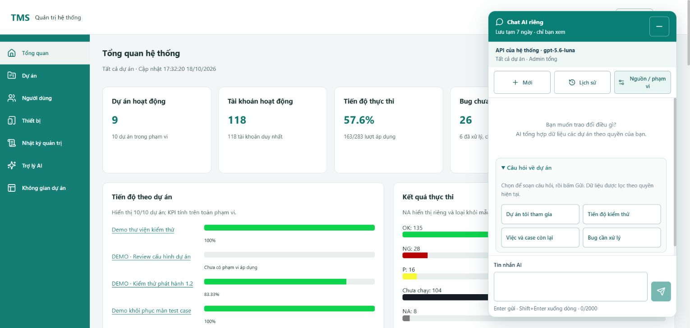

# AI tổng hợp các dự án của tôi — 18/10/2026

**Cập nhật tiếp theo cùng ngày:** người dùng yêu cầu bấm gợi ý phải gửi ngay. Hành vi điền nháp trong ảnh/bằng chứng ban đầu dưới đây đã được thay bằng gửi trực tiếp qua luồng send chung; xem [kiểm chứng gửi ngay](2026-10-18-ai-preset-send.md). Các kết quả backend/quyền/migration dưới đây không thay đổi.

Đã triển khai và kiểm chứng local theo lựa chọn của người dùng: tổng hợp các dự án của tài khoản trong một câu trả lời. Nhánh `system-design`, baseline `caf075af7231f207259b6a62808bff5c8445f6af`; giữ các sửa màu, kết nối Caheo và phản hồi gửi chat đã có. Không commit/push/merge. S11 vẫn **IN_REVIEW**; kết quả dưới đây chỉ nghiệm chứng phạm vi AI mới.

## Hành vi sử dụng

Chat mới mặc định **Các dự án của tôi**, có bốn câu hỏi:

| Câu hỏi | Nội dung yêu cầu |
| --- | --- |
| Dự án tôi tham gia | Tóm tắt tên, vai trò và tình trạng dự án. |
| Tiến độ kiểm thử | Tổng hợp KPI, thời điểm và dữ liệu còn thiếu. |
| Việc và case còn lại | Phân nhóm công việc/case được giao cho chính người hỏi; nêu giới hạn danh sách. |
| Bug cần xử lý | Dựa trên trạng thái và ưu tiên đã ghi; không suy đoán hạn chưa có. |

Chọn gợi ý chỉ điền ô soạn. Người dùng bấm **Gửi** hoặc Enter mới gọi AI; có thể sửa câu hỏi trước khi gửi và hỏi tiếp trong hội thoại. Khi đã có bản nháp, các gợi ý khóa kèm giải thích để tránh ghi đè nội dung. Mở panel hoặc đổi phạm vi không tự gọi provider. Hội thoại General/Project cũ giữ scope ban đầu; vẫn chọn được Trao đổi chung hoặc một dự án cụ thể.

Ảnh kiểm tra Chrome với Admin tổng:

## Dữ liệu và quyền

- Scope mới `MY_PROJECTS` dùng contract chat hiện có; server tự tính fingerprint từ role hệ thống và tập project/role/membership ID/version đang hoạt động. Client không được chọn project IDs để tự mở quyền.
- PM/Tester/Dev nhận các dự án còn membership hoạt động; ADMIN nhận toàn bộ dự án theo quyền quản trị hiện hành. `accessRole` biểu diễn quyền truy cập, `myRole` là vai trò membership thực tế: Admin không có membership không bị mô tả là thành viên PM/Tester.
- Snapshot có thông tin nhận diện dự án, phân bố công việc theo trạng thái và KPI thực thi theo `ReportMetrics`. KPI dự án đếm lượt ở các đợt không phải DRAFT; NA loại mẫu số, P chưa thực thi. Mẫu công việc/case chỉ lấy những mục đang được giao cho người hỏi; lượt cá nhân chỉ tính đợt ACTIVE. Dự án lưu trữ chỉ có thông tin nhận diện.
- Ngữ cảnh ban đầu tối đa 30 dự án; mỗi dự án tối đa 5 mẫu công việc và 5 mẫu case. Ngân sách prompt hiện có 16 KB có thể rút gọn thêm. `totalProjects`, `includedProjects`, `truncated`, thời điểm và limitations theo snapshot thực gửi; không gọi mẫu là toàn bộ backlog. Không suy chậm tiến độ hoặc năng lực từ phần trăm.
- List/detail/history/reserve/complete kiểm tra lại quyền. Tập quyền thay đổi, kể cả thêm dự án, đổi role hoặc membership version, làm hội thoại portfolio cũ bị ẩn/404; tạo hội thoại mới. Đây là lựa chọn bảo thủ để không gửi lịch sử có dữ liệu đã mất quyền. Kiểm tra trước và sau inference chặn lưu câu trả lời khi quyền đổi trong lúc AI đang chạy.
- Hội thoại vẫn riêng theo chủ sở hữu; Admin không được đọc chat riêng của người khác. Provider/model cố định theo hội thoại, schema output vẫn được kiểm tra nghiêm ngặt. Nội dung AI chỉ là câu trả lời, không tự cập nhật trạng thái, phân công hoặc thực hiện lệnh nghiệp vụ.

Không thêm dữ liệu khách/nhân sự nhạy cảm, lịch rảnh hoặc xếp hạng năng lực vào snapshot. Key chỉ ở cấu hình server local được bảo vệ, không đưa vào React, source hoặc log.

## Thay đổi source

`AiPortfolioContext` dựng scope và snapshot; `AiChatStore` kiểm tra fingerprint ở vòng đời hội thoại; `AiChatService` chọn task/chỉ dẫn theo scope và cập nhật số dự án khi rút gọn prompt. React `AiChat` cùng `aiProjectPrompts.js` thêm mặc định, nhãn và câu hỏi có sẵn; CSS gợi ý chuyển một cột dưới 360px.

Flyway **V30** chỉ thay constraint tổ hợp scope trong `ai_chat_threads`, giữ General/Project hợp lệ và mở tổ hợp portfolio với reference hợp lệ. Không thay migration cũ hoặc ghi lại dữ liệu nghiệp vụ.

## Kiểm chứng đã chạy

| Kiểm tra | Kết quả và phạm vi |
| --- | --- |
| Frontend toàn suite | **893/893**, 82 file; build PASS. Cảnh báo bundle lớn vẫn có như trước. |
| Backend AI unit | **162/162**, không failure/error/skipped; Maven verify/package PASS. Đây là suite AI được chọn, không phải toàn bộ backend. |
| Native HTTP/MySQL | **9/9** cuối cùng trên schema test riêng V30: membership/ADMIN, chat riêng, idempotency, revoke/list/detail/replay/send, đổi quyền trong inference, chống scope giả/anonymous/CSRF, phân biệt assignment của PM/Tester/Dev và lọc case ACTIVE. Provider giả lập trong suite này. |
| Migration | Schema riêng `tms_docstest_bab5ba2349be`: nâng V29→V30 giữ dữ liệu tất cả bảng cũ, chạy lại không migration; fresh áp dụng 28 migration còn trong source tới V30 và validate PASS. Số phiên bản cao nhất không phải số file migration. Lượt migration/fresh cũng chạy 9 test; không cộng các lượt trùng thành số test mới. |
| Guard runner Node | **14/14**: schema/mode/version/selector giới hạn; schema V28 bị từ chối, không tự nâng cấp qua preflight sai. |
| Caheo live | **1/1** với `gpt-5.6-luna`, hai dự án hoàn toàn giả lập; trả lời đề cập cả hai dự án, đúng schema. Provider báo 3.031 input/291 output token. Không gửi snapshot DB hoặc dữ liệu dự án thật trong probe. |
| Browser tích hợp | Chrome trên app 5173/backend 8080: Admin có đúng scope, bốn gợi ý, chọn gợi ý chỉ điền nháp, chọn được General rồi trở lại MY_PROJECTS. Không bấm Gửi dữ liệu dự án thật trong kiểm tra này. |
| Responsive | 320×844: cả bốn gợi ý enabled, nằm trong dialog; clientWidth/scrollWidth đều 302px. Đã reset viewport và đóng tab kiểm tra riêng. Không suy thành nghiệm thu cảm ứng/AT/Safari. |

Bằng chứng trong `var/ai-portfolio-2026-10-18/`: `frontend.log`, `unit-final.log`, `native-final.log`, `native-upgrade-fresh-final.log`, `live.log`, coverage XML/JSON, `browser-proof.json` và ảnh. Log PowerShell redirect là UTF-16; RTK ghi cảnh báo hook vào stderr có thể làm wrapper báo exit1 dù Maven/Vitest PASS. Runner unit/live đã ghi **explicit exitCode=0**; kết luận test dựa trên summary và trạng thái Maven, không bỏ qua lỗi test.

Kiểm tra cuối: `git diff --check` PASS, `Check-Contracts.cjs` PASS cấu trúc/JSON/liên kết; nhánh vẫn `system-design`. Scan 1.049 file source/build/docs/tasks/scripts và artifact mới không thấy key người dùng, kiểm cả UTF-8 và UTF-16; cấu hình local chứa key được loại khỏi phạm vi scan công bố và Git. Bằng chứng `secret-scan.json` chỉ có số lượng/path, không chứa key. Đây không phải kiểm toán mọi loại secret hoặc quét dependency.

Coverage thực đo, không cộng gộp XML của các lượt:

| Phạm vi | Statements / Instructions | Branches | Functions / Methods | Lines |
| --- | --- | --- | --- | --- |
| Toàn frontend, Vitest | 87,16% | 84,32% | 81,86% | 87,03% |
| AiPortfolioContext, unit JaCoCo | 97,66% | 96,15% | 85,71% | 93,88% |
| AiPortfolioContext, native JaCoCo | 98,60% | 88,46% | 100% | 97,96% |
| AiChatService, unit JaCoCo | 79,00% | 82,61% | 86,67% | 89,53% |
| AiChatStore, native JaCoCo | 76,58% | 42,86% | 90,48% | 72,82% |

Các lỗi tìm thấy trong quá trình kiểm tra đã sửa: gợi ý/default scope thiếu ở frontend; thêm chỉ dẫn vào mọi scope làm vượt ngân sách prompt chứa control characters; bỏ quyền rồi list bắt exception trong transaction gây `UnexpectedRollbackException`/HTTP500. List hiện so sánh fingerprint trực tiếp, không dùng exception bị bắt để bỏ qua dòng. Test revoke cuối cùng PASS. Các vướng harness (mock sai kiểu CurrentAccount, snapshot bảng một cột, đếm nhầm số migration và khóa kho ChatGPT cá nhân) được tách khỏi lỗi nghiệp vụ; native test tắt ChatGPT/Ollama cá nhân, không sửa/reset kho thật.

## Runtime và bảo toàn dữ liệu local

Đã backup trước khi restart. Backend cũ PID7000 được kiểm tra đúng ứng dụng/port rồi dừng; backend mới **PID26956**, 8080, khởi động 17:30:51 ngày18/10/2026. MySQL native3307/tms nâng đúng một migration V30; health HTTP200 `UP`. Không tạo server/container, seed hoặc chạy fixture vào `tms`.

Hai backup trước/sau đặt tại `var/mysql-native/backups/`, thư mục đã Gitignore; session rows được loại theo công cụ backup. So sánh toàn bộ INSERT nghiệp vụ, loại `flyway_schema_history`, sắp xếp và SHA256: **65 câu INSERT ở cả hai bản, hash giống nhau** `c9d33269e9917db470295d1ace56c3917517cccee55b04f91f8a0491c8c46476`. Không công bố nội dung SQL. Bằng chứng: `main-data-preservation.json`, `runtime.json` và startup log. Backend mới được giữ chạy để người dùng thử.

## Giới hạn bàn giao

Đã kiểm chứng implementation, regression và một câu trả lời live nhiều dự án giả lập. Chưa nghiệm thu chất lượng mọi loại câu hỏi với dữ liệu dự án thật, mọi vai trò trên browser, tải lớn hoặc thiết bị thật. Không có streaming token; giữ phản hồi gửi tức thời/pending của bản sửa trước. Snapshot là dữ liệu tại thời điểm gửi, không phải subscription tự cập nhật.

Nguồn kế hoạch/contract: [thiết kế phạm vi](../planning/2026-10-18-ai-my-projects.md), [private chat API](../api/ai-chat.md), [hướng dẫn UI](../ai-assistance-ui.md). Skill áp dụng: `api-design`, `security-review`, `tdd-workflow`; RED→GREEN theo hành vi, native chỉ trên schema được guard. Không tuyên bố mọi button toàn hệ thống đã được nghiệm thu bởi tác vụ này.
