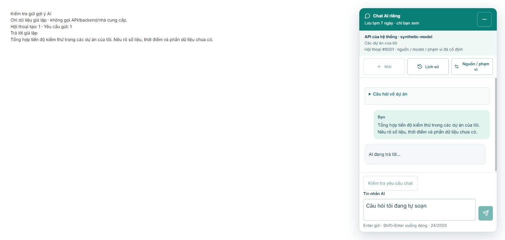

# Câu hỏi AI có sẵn gửi ngay — 18/10/2026

Người dùng yêu cầu bấm một gợi ý là gửi ngay, không điền ô nhập rồi yêu cầu Enter/Gửi lần nữa. Thay đổi này thay hành vi UI trong [bản portfolio ban đầu](2026-10-18-ai-my-projects.md); quyền, snapshot, API, model/provider và dữ liệu không đổi. Nhánh `system-design`, không commit/push; S11 giữ IN_REVIEW.

## Kết quả

Bốn gợi ý gọi trực tiếp `send(false,prompt.text)` đang dùng cho gửi lại tin nhắn, với cùng admission/lock, scope, idempotency, lỗi và phản hồi tức thời. Bấm gợi ý hiển thị câu hỏi và **AI đang trả lời…** ngay, kể cả trước khi tạo hội thoại xong. Mỗi thao tác hợp lệ tạo đúng một yêu cầu; các gợi ý khóa theo `canSend` khi nguồn chưa sẵn sàng, đang tải/gửi, còn pending hoặc không còn quyền.

Cho phép bấm gợi ý khi đang có câu hỏi tự viết; giữ nguyên bản nháp và vẫn gửi bản nháp đó bằng Gửi/Enter sau khi phản hồi trước kết thúc. Timeout dùng nút kiểm tra cùng request key, không tự tạo yêu cầu có tính phí khác. Nội dung lỗi/đã gửi vẫn được giữ theo luồng chat hiện có. Caption trên UI đã đổi thành **Bấm câu hỏi để gửi ngay** và giải thích giữ bản nháp.

Source hành vi chỉ đổi một đoạn JSX của `AiChat.jsx`; không thay hàm send hoặc backend. Hướng dẫn UI và thiết kế portfolio cập nhật theo yêu cầu mới. Review trước được đánh dấu là bằng chứng hành vi cũ, không sửa số liệu lịch sử.

## Kiểm chứng

- RED: 7 test mới/thay đổi thất bại đúng hành vi trước sửa; 28 test cũ PASS. Bốn gợi ý chỉ điền composer, gợi ý khóa khi có nháp và vẫn enabled khi provider không sẵn sàng.
- GREEN: **35/35 test AiChat** PASS; bao gồm đủ bốn gợi ý gửi ngay, trạng thái trước await tạo thread, chặn bấm trùng, giữ nháp/tự gửi tiếp, timeout cùng key và provider unavailable. Không bấm gợi ý khi chỉ mở panel.
- Hồi quy toàn phần AI frontend: **60/60 test, 4 file**, exit0. Không chạy lại toàn bộ frontend hoặc backend/native vì không đổi các phần đó; kết quả 893/162/9 trong báo cáo trước là lượt riêng, không cộng vào lượt này.
- Coverage chỉ `AiChat.jsx`, thực đo mới: statements **92,45%**, branches **87,26%**, functions **91,20%**, lines **93,98%**. Không suy coverage toàn app.
- Build PASS, exit0; cảnh báo bundle trên500KB còn như trước (JS677,31KB). JavaScript hiện không cấu hình lint/typecheck riêng; không thêm TypeScript hoặc dependency.
- Chrome: component React/CSS thật, API được inject hoàn toàn giả lập, fetch network bị chặn. Bấm **Tiến độ kiểm thử** khi có nháp tạo đúng1thread/1request, câu hỏi/pending hiện ngay, cả4gợi ý khóa; phản hồi giả lập tới giữ nháp, Enter gửi tiếp nháp thành request2 trong cùng thread. Không gọi AI có tính phí hoặc ghi database thật. Fixture đã gỡ khỏi Frontend, tab kiểm tra đã đóng; bản sao và JSON/ảnh nằm trong artifact.

Bằng chứng: `var/ai-preset-send-2026-10-18/ai-tests.log`, `build.log`, `exits.json`, `coverage/coverage-summary.json`, `browser-proof.json`, ảnh và fixture source. Log redirect PowerShell là UTF-16; cảnh báo RTK stderr không phải failure. `exits.json` ghi riêng exit thực của test/build đều0.

Kiểm tra cuối `git diff --check` và `Check-Contracts.cjs` PASS; nhánh giữ `system-design`. So sánh snapshot trước sửa xác nhận ngoài đoạn JSX gợi ý, production AiChat giữ nguyên; các test cũ sau nhóm preset không đổi. Scan source/build/docs/tasks và artifact mới bằng key trong bộ nhớ không thấy key; JSON bằng chứng chỉ ghi số lượng/path, không chứa key. Không quét dependency hoặc tuyên bố kiểm toán mọi secret.

## Giới hạn

Browser chứng minh thao tác UI bằng dữ liệu giả lập; không phải nghiệm thu thêm chất lượng trả lời model hoặc mọi thiết bị/role. Không gọi lại live provider cho thay đổi một đoạn UI này. Backend đang chạy từ tác vụ portfolio trước, không restart hoặc thay key/schema. Các gate chất lượng câu hỏi trên dữ liệu thật, UAT và thiết bị thật của S11 vẫn riêng.

Skills áp dụng: `frontend-patterns`, `tdd-workflow`, `verification-loop`. Hướng dẫn sử dụng: [AI UI](../ai-assistance-ui.md).
