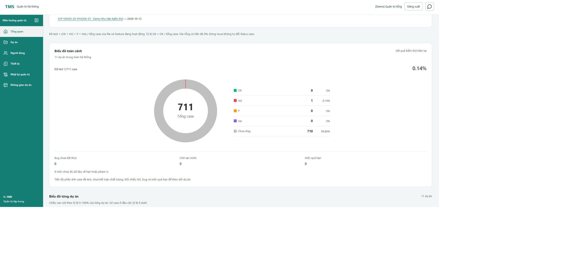
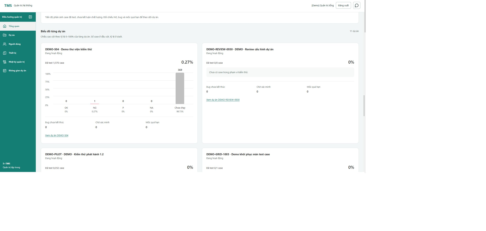

# Đổi biểu đồ Admin thành tròn và cột — 19/10/2026

Theo phản hồi mới của người dùng, thay biểu đồ thanh phân bố bằng donut ở khối toàn cảnh và cột đứng ở từng dự án. Quyết định màu cuối: **Chưa chạy là xám bạc #C0C0C0**, thay cho phương án xám đậm trước đó.

## Kết quả

- Donut lấy `overview.metrics` toàn phạm vi, có tổng case ở giữa và chú giải số lượng/tỷ lệ cho từng trạng thái.
- Cột dự án cùng thang 0–100%, số case ở đầu cột và tỷ lệ dưới tên trạng thái; cột 0 giữ chiều cao 0. Mẫu main 1/370 vẫn chỉ có cột NG 0,27%, không phóng đại để làm đẹp.
- Màu riêng cho khu biểu đồ: OK `#10B981`, NG `#F43F5E`, P `#F59E0B`, NA `#8B5CF6`, Chưa chạy `#C0C0C0`. Chữ/số liệu dùng màu văn bản tối. Không thay token kết quả ở màn nghiệp vụ khác.
- Giữ trạng thái rỗng, lỗi/thử lại, phạm vi, phân trang đầy đủ và link chi tiết dự án. Tổng bằng 0 không vẽ phân bố giả; một trạng thái chiếm 100% tạo vòng tròn đầy đủ.
- Không thêm đường tăng trưởng: contract hiện tại là snapshot, chưa có chuỗi lịch sử theo thời gian. Người dùng cho phép chọn cột hoặc đường; chọn cột phù hợp dữ liệu hiện có.

## Skill và kiểm chứng

| Skill | Áp dụng | Bằng chứng |
|---|---|---|
| frontend-ui-engineering | Donut/legend, cột responsive, palette riêng, nhãn không phụ thuộc màu | Chrome thật, đo bốn chiều rộng, ảnh cuối |
| test-driven-development + writing-good-tests | Kiểm tổng toàn phạm vi, tỷ lệ nhỏ/zero/full, mô tả truy cập | RED 3 ca mới do thiếu chart → GREEN 12/12; test phân trang/retry/scope cũ giữ nguyên |
| code-review | Agent độc lập đọc DTO, công thức tested và implementation cuối | Không thấy lỗi cụ thể chặn bàn giao; yêu cầu kiểm 320px đã thực hiện |
| verification-before-completion | Chạy hồi quy, build cuối, diff và đối chiếu source | 1.192/1.192 test trong 128 file; build và diff check đạt |
| computer-use | Kiểm Chrome tại 127.0.0.1:5173, không ghi nghiệp vụ | Palette computed RGB(192,192,192), đủ 11 card, 4 dự án có case vẽ cột |

- Full frontend: `rtk proxy node var/uiux-dashboard-testing-2026-10-19/run-check.cjs chart-redesign-full test --maxWorkers=1 --reporter=default --reporter=json --outputFile=../var/uiux-dashboard-testing-2026-10-19/chart-redesign-tests.json`, đạt 1.192 test, 262,65 giây.
- Sau điều chỉnh màu bạc và khoảng cách nhãn mobile bằng CSS, build cuối `chart-redesign-final-build` đạt. JavaScript/component và test không thay trong lượt full suite.
- Chrome DOM ở chiều rộng CSS thực 320/768/1024/1440: không tràn ngang trang hoặc nhãn. Ở 320px, nhãn Chưa chạy xuống dòng và được chừa khoảng cách với đường phân cách chỉ số. Đã reset viewport và đóng tab kiểm thử riêng.
- Console tab kiểm tra không có warning/error được ghi nhận. Chưa chạy screen reader, touch thật hoặc đo coverage. Không suy coverage từ số test.
- API chụp ảnh có lúc timeout và chế độ clip trả sai vùng cuộn; ảnh desktop bên dưới được chụp bằng API mặc định và đã xem. Kiểm 320px dựa trên DOM đo thực tế; không ghi ảnh 320px là đã chụp thành công.

## Phạm vi bảo toàn

Chỉ sửa nhóm biểu đồ frontend và tài liệu kiểm chứng. Không sửa backend, dữ liệu, API, schema, dependency hoặc cấu hình; không restart, gọi provider AI, commit/push/merge/deploy. S11/FR-12 vẫn IN_REVIEW cho các gate đã ghi trước đó. Lỗi AI phía provider ở báo cáo trước không thuộc thay đổi biểu đồ này.

## Ảnh

