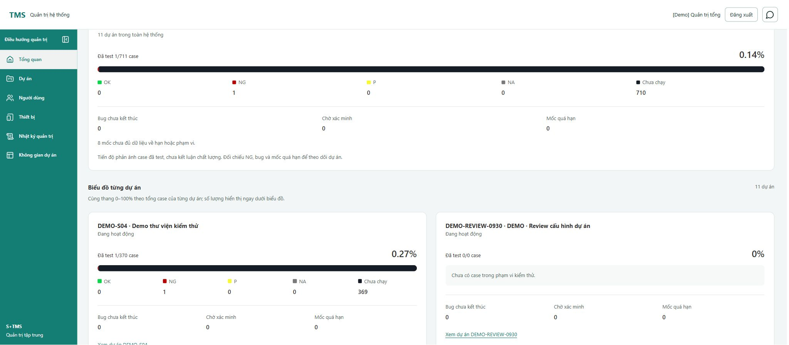
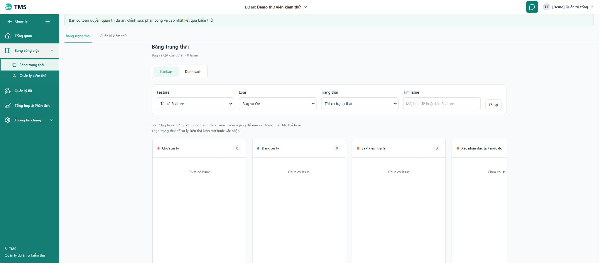
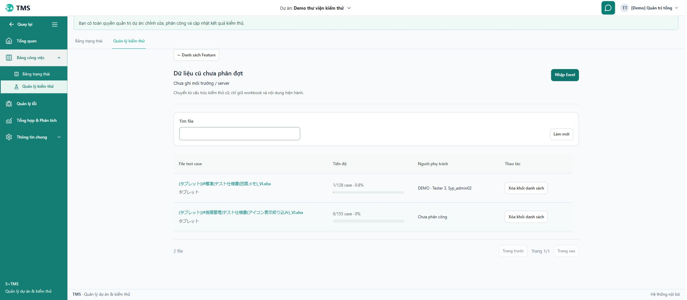
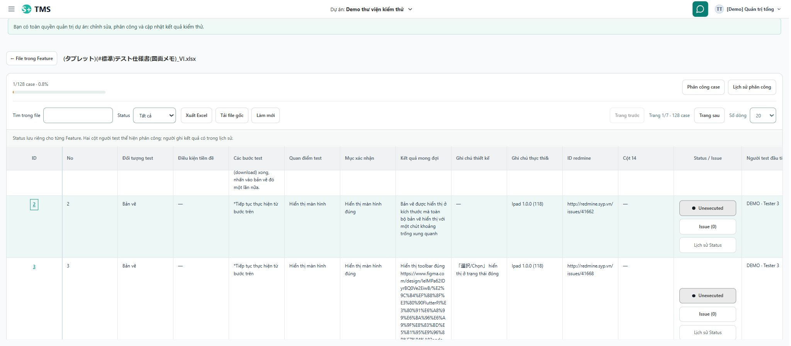

# Admin, Kanban, kiểm thử và gợi ý báo cáo AI — 19/10/2026

**Cập nhật sau báo cáo:** theo phản hồi mới, biểu đồ tổng đã đổi thành donut, từng dự án thành cột, Chưa chạy dùng xám bạc. Xem [bản cập nhật và kiểm chứng mới](2026-10-19-admin-chart-redesign.md); ảnh và mô tả phân bố thanh bên dưới là checkpoint trước thay đổi này.

Nhánh `system-design`. Phạm vi là các phản hồi UI/UX và nút AI trong yêu cầu kèm ảnh mới nhất. Giữ các khối Tổng quan hiện có, nghiệp vụ Feature/Issue, quyền và các màu kết quả người dùng đã chọn. Không coi lần sửa này là nghiệm thu toàn hệ thống.

## Kết quả theo yêu cầu

| Yêu cầu | Thay đổi | Kiểm chứng / trạng thái |
|---|---|---|
| Quay về Admin từ Không gian dự án | Link **Quay lại** ở đầu sidebar, cùng hàng với hamburger khi menu mở; có tên truy cập đầy đủ khi thu gọn; chỉ hiện với ADMIN. Bỏ link quản trị rời trong vùng nội dung. | Test role, desktop/mobile/collapsed, AppEntry điều hướng hai chiều; Chrome quay về `#/admin`, xác nhận heading Tổng quan hệ thống. Đạt. |
| Biểu đồ toàn cảnh và từng dự án | Thêm khối tổng toàn phạm vi ở cuối Tổng quan, sau đó các card dự án hai cột desktop/một cột hẹp. Thể hiện năm kết quả, số case đã test, bug, chờ xác minh, mốc quá hạn và thiếu dữ liệu. | Chrome hiển thị đủ **11 dự án**, gồm Spider Plus; test 101 dự án/phân trang, lỗi/thử lại, scope cũ. Không lấy trung bình tỷ lệ dự án hoặc bịa điểm sức khỏe. Đạt. |
| Kanban giống bố cục cũ, có khoảng trắng | Đối chiếu bản `bd7e482`; khôi phục cột trắng 320px, khoảng cách 20px, header/dấu màu/count, thân cột có chiều cao ổn định, tách metadata thẻ. | Hồi quy work-items 86 test. Chrome main hiện không có Issue: xác nhận trạng thái rỗng, cuộn và kích thước 320/1440. Thẻ có dữ liệu và xác nhận chuyển trạng thái được kiểm bằng component test; chưa thao tác chuyển Issue thật. |
| Khoảng trắng danh sách kiểm thử | Nhóm tìm kiếm, checkbox, hành động; tăng khoảng cách hàng và phân trang, thống nhất table/list. | Component tests và ảnh Chrome danh sách Feature/file. Đạt trong phạm vi đã kiểm. |
| Status/Issue/Lịch sử cân đối, dịu hơn | Ba nút cùng chiều rộng/cùng trục giữa; dùng nền pha nhẹ và chấm màu từ năm token cũ, thay nền đen đặc. Popup Issue có khoảng cách và vùng cuộn. | Chrome đo ba nút cùng rộng 148px/cùng tâm; popup mở bằng bàn phím, Escape đóng, nằm trong viewport. Không đổi Status thật. Đạt. |
| Header/toolbar chi tiết file | Bỏ dải tiêu đề xanh đặc; phân nhóm tiến độ/phân công, tìm kiếm/hành động và phân trang. Desktop hai hàng; màn hẹp cuộn ngang toolbar để giữ chỗ cho bảng. | Chrome: bảng còn khoảng 358px ở 320×800, 554px ở 768×900, 562px ở 1024×900, 504px ở 1440×900. Không tràn ngang cả trang. Đạt. |
| Bỏ tab thừa trong chi tiết file | File detail không còn nav Bảng trạng thái/Quản lý kiểm thử; nút quay lại vẫn giữ đúng Feature/project. | RED→GREEN route test; Chrome xác nhận không còn outer nav. Đạt. |
| Tiến độ cam, đủ case chuyển xanh | TestProgress dùng chung trên Feature/file/detail; rỗng hiển thị Chưa có case. Chỉ đủ case mới 100%/xanh. Không thay năm màu kết quả. | 1/128→0.8%; 199/200→99.5%; 9999/10000→99.9%; 29/100→29%. Unit và integration tests; Chrome thấy thanh ở danh sách/file. Đạt. |
| Tạo gợi ý AI | Kết quả hợp lệ tự điền vào editor rỗng chưa bị sửa, thông báo chưa lưu; giữ tiêu đề/nháp đang viết, chỉ áp dụng gợi ý theo thao tác chủ động. Giữ request key khi chưa rõ kết quả. Prompt backend nêu đầy đủ JSON contract/giới hạn/citation. | Frontend/backend tests đạt. **Chưa xác nhận tạo báo cáo thật thành công:** provider đang trả HTTP402, `error.type=insufficient_balance` với key/model đang cấu hình. Người dùng xác nhận tài khoản vẫn còn số dư/hạn mức; cần đối chiếu phía nhà cung cấp, không kết luận số dư tài khoản bằng lỗi này. |

## Lỗi AI: bằng chứng và giới hạn

- Trước sửa backend, một lượt Chrome ổn định trả `AI_INVALID_RESPONSE`. Không lưu raw output nên không xác định được trường cụ thể đã bị từ chối. Code có khoảng thiếu thật: validator yêu cầu các trường/giới hạn mà prompt chưa nêu đầy đủ; đã sửa prompt `feature-report-v2`, giữ strict validation.
- Một số lượt khi code đang Fast Refresh không giữ được phản hồi; đã dừng cập nhật frontend trong lượt chẩn đoán tiếp theo. Không dùng các lượt đó để kết luận lỗi provider.
- Sau khởi động lại, provider trả HTTP402 cho cả phạm vi toàn dự án và một Feature. Chẩn đoán trực tiếp với **dữ liệu tổng hợp giả lập công khai**, cùng key/model/base URL, nhận `insufficient_balance` và thông báo “Số dư đã hết”. Không đưa dữ liệu dự án vào lượt chẩn đoán này.
- Với mã `insufficient_balance` đã biết: trả `AI_QUOTA_EXHAUSTED`; với HTTP402 chưa rõ mã: `AI_PAYMENT_REQUIRED`. HTTP400 vẫn được phân biệt. UI không còn hướng dẫn sai rằng chỉ cần sửa nội dung/model cho lỗi thanh toán/hạn mức.
- Không đổi key/model/nhà cung cấp, không nạp tiền, không tự retry provider. Không lưu báo cáo AI vào nghiệp vụ. Các lượt preview có tạo bản ghi AI draft/usage theo cơ chế hiện hành; không tuyên bố database hoàn toàn không phát sinh ghi.
- Nguồn bằng chứng: `var/uiux-dashboard-testing-2026-10-19/provider-error-probe.json`, `backend-diagnostics.log`, `report-ai/findings.md`. Không có key hoặc raw provider output trong báo cáo.

## Skill → cách dùng → bằng chứng

| Phần việc | Skill đã đọc/áp dụng | Kết quả/bằng chứng |
|---|---|---|
| Phạm vi và cách hiểu | brainstorming | Đối chiếu yêu cầu ảnh; giữ nội dung Tổng quan, không tự đặt điểm sức khỏe/rule mới; review hướng thực hiện trước sửa. |
| Sidebar, chart, Kanban, testing | frontend-ui-engineering | Phân cấp, khoảng trắng, responsive, focus/keyboard, màu và trạng thái rỗng; các ảnh và `browser-measurements.json`. |
| Lỗi AI/điều hướng | systematic-debugging | Tách lỗi UI, output contract và HTTP402; log chỉ status/mã allowlist, không log prompt/key/raw nội dung. |
| Thay đổi hành vi | test-driven-development, writing-good-tests | RED trước khi sửa cho nav/chart/progress/AI; kiểm count/permission/draft/retry/pagination thay vì chỉ kiểm classname. |
| Contract/quyền AI | api-design, security-review | Giữ authorization/citation/strict output; schema trong instructions, mã lỗi an toàn; local HTTP tests và offline AI regression. |
| Chrome thật | computer-use | Dùng cua_repl với tab riêng, tài khoản Demo Admin hiện có; đo viewport theo CSS, thử bàn phím/điều hướng, chụp UI; không sửa dữ liệu case/Issue để tạo ảnh. |
| Chốt và review chéo | verification-before-completion | Full frontend + build, backend AI verify/package, review độc lập, hash bảo toàn source. |

Chi tiết skill và RED/GREEN từng nhóm nằm trong `admin-charts/review.md`, `kanban/implementation-notes.md`, `testing/implementation-notes.md`, `report-ai/findings.md`, `review/cross-ui-review.md` dưới thư mục bằng chứng.

## Kiểm chứng cuối

- Frontend toàn bộ trên source cuối: **1.189/1.189 test, 128 file**, không test lỗi; thời gian 276,26 giây. Build cuối đạt. Bằng chứng: `frontend-final-tests.json`, `frontend-final.log`, `frontend-final-build-result.json`.
- Backend AI offline cuối: **183/183**, không failure/error/skip; verify/package đạt. Không chạy live-provider hoặc database tests từ Maven.
- Hồi quy bổ sung: Admin185/185; work-items86/86; Testing45/45; navigation/AppEntry61/61; review chéo51/51. Đây là các bộ có giao nhau, không cộng thành tổng test độc lập.
- Chưa đo coverage ở lượt này. Không suy coverage từ số test PASS.
- Chrome có ảnh cuối cho Admin, Kanban, file list và file detail. API chụp có lúc timeout; các ảnh cuối đã chụp và xem được. Đo viewport nhỏ bằng DOM read-only, không giả lập việc đã xem mọi ảnh mobile.

## Bảo toàn và việc còn lại

- Checkpoint 2.096 file trước các sửa product; không mất file. 15 file sửa có sẵn được bảo vệ bằng hash đều giữ nguyên; test Admin landing chỉ bổ sung một scenario. 42 file dưới docs/reports có trong checkpoint đều giữ nguyên.
- Không đổi migration/dependency/config; không thêm dữ liệu Issue/case/Feature test vào main. Chỉ restart đúng backend loopback8080 để nạp sửa AI; frontend5173 giữ PID. Backend cuối kiểm health UP. Không commit/push/merge/deploy.
- Chưa UAT đầy đủ mọi role/trạng thái, thiết bị cảm ứng, screen reader, 200% zoom, Issue nhiều thẻ và thao tác ghi nghiệp vụ. Chưa xác nhận AI thành công với provider thật do lỗi key/request nêu trên.
- S11/FR-12 tiếp tục **IN_REVIEW**; không đóng các gate cũ ngoài phạm vi lần này.

## Ảnh kiểm chứng

