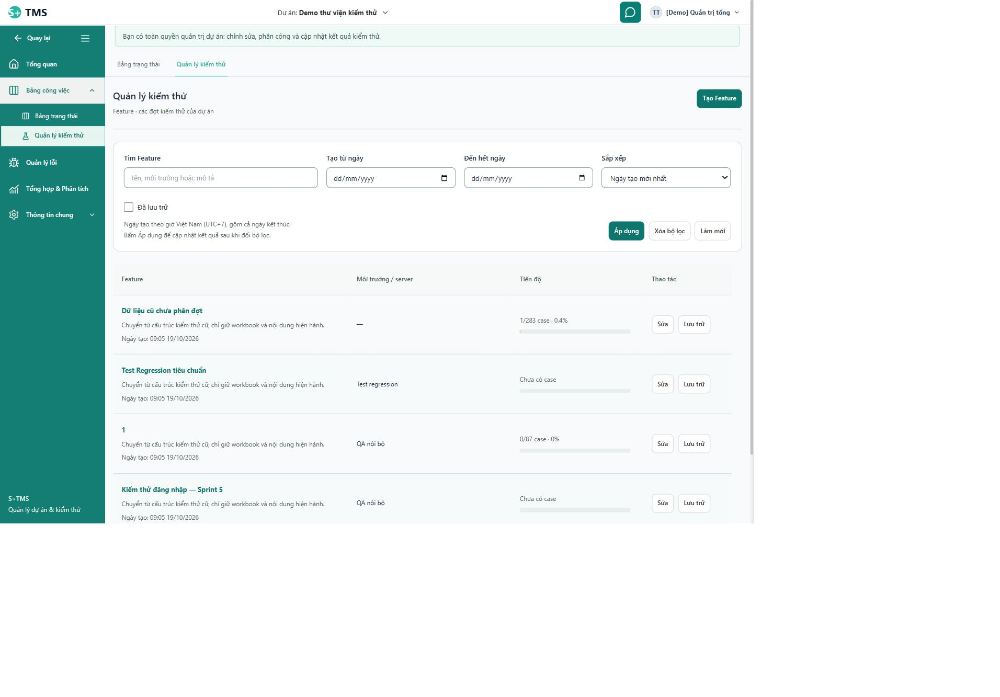

# Bộ lọc Feature, độ đậm tên và khoảng cách tiêu đề — 19/10/2026

Phạm vi theo ảnh và yêu cầu mới: danh sách Quản lý kiểm thử, danh sách file trong Feature và các tiêu đề có cùng lỗi CSS trong Bảng trạng thái/Quản lý lỗi. Không đổi luồng chi tiết file, trạng thái case hoặc dữ liệu nghiệp vụ.

## Thay đổi

- Tên Feature và file dùng font-weight 700, cỡ chữ nội dung; hover/focus có gạch chân, focus bàn phím rõ. Mô tả rỗng không sinh đoạn văn trống. Hiện ngày/giờ tạo dưới tên Feature.
- Thêm ngày tạo từ–đến, sắp xếp ngày mới nhất/cũ nhất/tên A–Z; giữ tìm tên/môi trường/mô tả và lựa chọn Đã lưu trữ. Nút Áp dụng gửi bộ lọc, Xóa bộ lọc khôi phục mặc định, Làm mới tải lại bộ lọc đã áp dụng. Nhắc rõ cần bấm Áp dụng sau khi sửa.
- Lọc/sắp xếp thực hiện trên backend trước count và phân trang. Áp dụng/Xóa trở về trang đầu. Ngày được tính theo Asia/Ho_Chi_Minh, bao gồm cả ngày kết thúc. Ngày hiển thị diễn giải đúng `createdAt` UTC không có offset của contract hiện hành.
- Khoảng ngày đảo bị chặn tại form, báo lỗi và đưa focus về ngày bắt đầu; backend cũng từ chối ngày không hợp lệ hoặc sort ngoài whitelist. Không ghép giá trị input trực tiếp vào SQL; quyền đọc dự án giữ nguyên.
- Nguyên nhân tiêu đề sát đường kẻ: global `.cat-container` ghi đè padding dọc của `.testing-page`. Dùng selector kết hợp chỉ cho `padding-block`, 24px desktop/16px mobile; không tăng specificity của max-width hoặc thay document-focus. Áp dụng cùng cách cho `.feature-issues-page`.
- Review phát hiện thêm race phân trang trong lúc Lưu trữ/Khôi phục: khóa hai nút trang khi mutation đang chạy, tránh reload trang cũ đè vào nhãn trang mới.

## Skill → mục đích → bằng chứng

| Skill/tài liệu | Áp dụng | Bằng chứng |
|---|---|---|
| frontend-ui-engineering | Hệ phân cấp chữ, khoảng cách, bộ lọc responsive, hover/focus | Chrome, computed weight700, khoảng cách24/16px, ảnh desktop |
| api-design | Query tùy chọn, ngày địa phương, count/pagination và sort ổn định | Kiểm thử controller/service/MySQL thật |
| test-driven-development + writing-good-tests | RED trước sửa hành vi, UTC boundary, thao tác người dùng và race deferred | RED frontend5, UTC1, pager1; backendRED4; các lượt GREEN có log |
| security-review (backend) | Quyền dự án, bound parameters, allowlist sort, validation | Outsider404, project isolation, malformed input422 |
| verification-before-completion | Hồi quy, build, diff, preservation và giới hạn kiểm chứng | Các log/receipt trong thư mục evidence |
| computer-use | Chrome hiện có tại127.0.0.1:5173, chỉ thao tác đọc/lọc | Một ngày4Feature, ngày ngoài dữ liệu0, A–Z, search, clear, validation |

Agent độc lập đã review CSS cascade và trạng thái draft/applied; phát hiện race pager được tái hiện bằng test thất bại rồi sửa. Review không được coi là thay thế kiểm thử thực tế.

## Kiểm chứng

- Frontend targeted trước sửa pager: **44/44 trong11 file**; pager RED đúng lỗi nút chưa disabled → GREEN **8/8** của TestingFeaturesPage. Build source cuối PASS.
- Full frontend lượt đầu chạy đồng thời lúc bổ sung test pager RED: 1.198 pass/1 fail; lỗi duy nhất chính là test pager mới. Sau sửa, lượt cuối trên source đóng băng đạt **1.199/1.199 test trong129 file**, 0fail/skip, kết thúc20:33:03 giờ Việt Nam, thời gian250,93s. Log/JSON `feature-filters-full-final.log` và `feature-filters-tests-final.json`; build cuối `feature-filters-build-final` PASS.
- Backend native **39/39**, offline **655/655 trong75 suite**, verify/package PASS. Offline loại52 suite native/live/Testcontainers; không phải toàn bộ test backend vật lý. Lượt native đầu có2 lỗi assertion do giả định timestamp có offset, đã sửa assertion theo contract thực rồi chạy lại PASS.
- Native ghi fixture chỉ tại schema riêng `tms_docstest_2060e04c986c`, không ghi fixture vào main. Không đổi schema/migration/dependency/config.
- Đã restart riêng backend8080 bằng script kiểm tra PID/loopback/repo/profile/migration trước khi dừng; PID24228→26980. Cấu hình giữ nguyên, FlywayV33 không migration mới, health UP. Frontend5173 giữ PID15612.
- Chrome: khoảng ngày21/10/2026→21/10/2026 trả0; ngày19/10→19/10 trả4; A–Z đúng thứ tự; tìm Sprint5 trả1; Xóa trở về4 và mặc định; ngày ngược báo lỗi, focus đúng và giữ4 hàng. Không tạo/sửa/lưu trữ dữ liệu main trong browser.
- Responsive CSS320/768/1024/1440: không tràn ngang trang/bộ lọc, grid1/2/4/4 cột; khoảng cách tiêu đề16/24/24/24px. Danh sách file có tên weight700; Bảng trạng thái cách đường kẻ24px. Chi tiết trong `feature-filters-browser.json`; bảng rộng giữ cơ chế cuộn ngang nội bộ. Console tab không ghi warn/error. API screenshot từng timeout, retry desktop thành công; ảnh mobile chưa chụp được, kiểm mobile dựa trên DOM. Không suy từ timeout rằng Chrome thiếu quyền. Đã reset viewport và đóng tab kiểm thử riêng.
- Coverage **NOT_MEASURED**; chưa chạy screen reader, thiết bị cảm ứng thật hoặc toàn bộ role/state UAT. Không dùng số test PASS để tuyên bố mọi nút của hệ thống đã được bấm.

## Evidence và bảo toàn

- Frontend/browser/runtime: `var/uiux-dashboard-testing-2026-10-19/feature-*`, `backend-feature-filters*`.
- Backend: `var/feature-filter-2026-10-19/backend-review.md`, `backend-final-receipt.json`, logs, XML, offline-selection.json.
- Bảo toàn source so với hash baseline686 file trước task: 677 nguyên SHA-256,9 thay đổi+2 mới đúng allowlist,0 mất file/0 thay ngoài phạm vi. Bằng chứng `feature-filters-preservation.json` giới hạn ở Frontend/src và Backend/src, không phải snapshot database. Giữ nguyên các thay đổi Admin/chart/AI/Auth/General và báo cáo trước đó. `git diff --check` PASS.
- Không commit/push/merge/deploy. S11/FR-12 vẫn IN_REVIEW; các gate ngoài phạm vi hiện tại không tự đóng.

