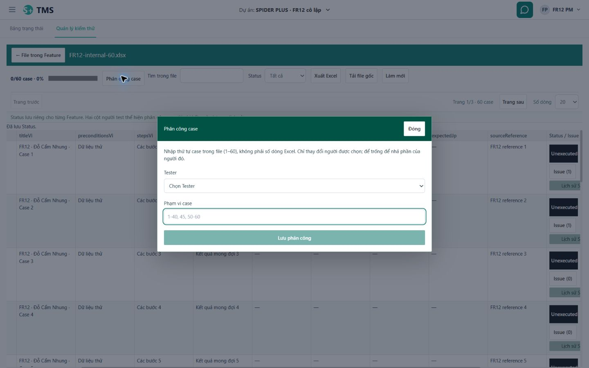
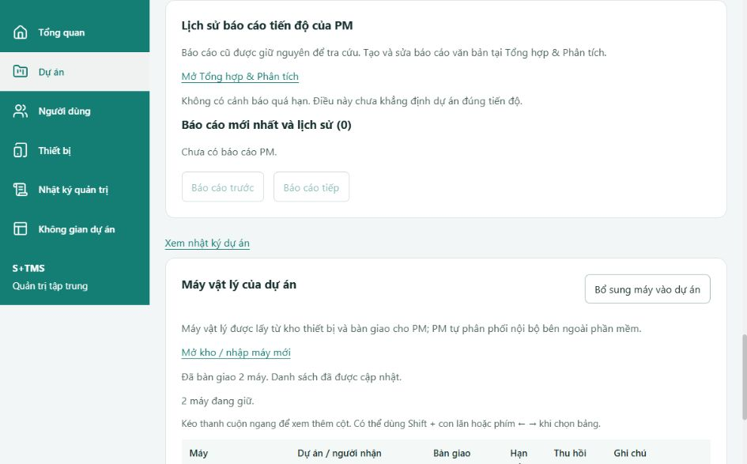

# FixReports — triển khai và kiểm chứng ngày 19/10/2026

> Cập nhật tiếp sau phản hồi người dùng: [kiểm tra UI/Chrome và lỗi runtime5173](2026-10-19-fixreports-ui-followup.md). Đã sửa thêm7lỗi, finalFE980; main đã được user cho phép chuyển V30→33/restart8080 và API mới trả200;7.374 hàng main giữ nguyên. User xác nhận quyền fileURL đã bật, nên không coi thông báo tool là bằng chứng user chặn quyền. Các con số975 dưới đây là checkpoint trước follow-up.

Trạng thái: **đã triển khai FR-00–FR-11 trên môi trường cô lập; FR-12 IN_REVIEW với checkpoint kiểm chứng/bàn giao và các mục NOT_RUN nêu dưới**. R01–R08 có bằng chứng theo tầng; A01/A20 chưa hoàn tất phần upload qua browser. Source đã review và runtime chính đã nâng cấp sau xác nhận người dùng; chưa nghiệm thu UAT. Báo cáo không kết luận hệ thống hoàn toàn không lỗi.

## Phạm vi và quyết định

- Thực hiện FR-00–FR-12 theo [kế hoạch](../planning/2026-10-19-fixreports-implementation-plan.md), [bản làm rõ](../planning/2026-10-19-fixreports-clarification.md) và [contract](../api/fixreports-contract.md).
- Làm trên `system-design`, nền `caf075af7231f207259b6a62808bff5c8445f6af`; lưu baseline của 53 file thay đổi/có sẵn ngoài `var/`. Không reset, stash, clean hoặc chuyển nhánh.
- Dùng React JavaScript, Spring Boot và MySQL/Flyway hiện có. Không thêm server/container, toolchain hay dịch vụ sản phẩm.
- Người dùng cho phép bổ sung Spider Plus và tự chọn PM: đã tạo dự án thật `SPIDER-PLUS`, ID12, PM `syp.lab.pm03`, qua API nghiệp vụ rồi đọc lại. [Bằng chứng](../../var/fixreports-2026-10-19/spider-plus-project.json).
- Main `tms` đã nâng V30→V33 và restart đúng backend8080 sau khi người dùng cho phép; healthUP,12GET200,7.374 hàng cũ ngoài session giữ nguyên. Bằng chứng mới trong [follow-up](2026-10-19-fixreports-ui-followup.md); [checkpoint SELECT-only cũ](../../var/fixreports-2026-10-19/main-final-readonly.json) chỉ là lịch sử trước cutover. Không commit/push/merge hoặc triển khai ngoài local.

## Hành vi đã thay đổi

Feature là đợt kiểm thử của một dự án, có tên, môi trường/server tự do và mô tả. Trong Feature là các file Excel độc lập; file, case, revision, chỉnh sửa ô, phân công, Status và Issue không dùng chung phần mutable với Feature khác. PM dự án và Admin quản lý Feature/file; archive giữ dữ liệu và có thể khôi phục Feature. Xóa file là ẩn khỏi danh sách hoạt động.

PM/Admin phân công theo dải case. Tester tự nhận hoặc sửa phần của mình, kể cả file đã có người; giao trùng, sai phạm vi hoặc phiên bản cũ bị chặn, giữ lựa chọn để điều chỉnh. Status đi theo vòng Unexecuted → OK → NG → P → NA → Unexecuted, có thông báo lưu và history của người thực sự ghi. Đổi assignee giữ Status, cột người test đầu tiên và người test gần nhất; không tạo run hay cột lần3. P/NA đều tính đã test, NA vẫn thuộc tổng case; file rỗng bằng0%.

Luồng hoạt động chỉ còn Bug/QA. Nút Issue tại case tự điền context hiện hành, lưu xong trở về đúng case và cập nhật badge gồm cả Issue đã đóng. Preview dùng được bằng focus/chạm. Bug monkey thuộc Feature, không bắt buộc case hoặc tiền tố tiêu đề; Tester quản lý lỗi mình tạo, Dev xử lý lỗi được giao, PM/Admin theo phạm vi. Xóa monkey là xóa mềm. Không tự đóng Bug khi case OK, không bắt build/device/run/NG attempt/retest request trong đường mới.

Điều hướng Bảng công việc có Bảng trạng thái và Quản lý kiểm thử; Kanban/danh sách bên trong vẫn giữ. Menu AI, kiểm thử và tiến độ cũ được thay đường mới có thông báo rõ cho bookmark không ánh xạ được. Thông tin chung giữ các tab cần thiết, thay Danh mục bằng Note. Overview chỉ gắn nội dung Spider Plus với đúng mã dự án; không thêm workflow CAT/nghiệm thu.

Admin chọn thành viên chưa thuộc bất kỳ dự án nào; membership cũ vẫn giữ. Mỗi lô máy giao cho một PM đang hoạt động, có máy/người nhận/ghi chú/lịch sử rõ ràng. Tester thực hiện case không cần phân máy nội bộ. Tổng quan Admin dùng dữ liệu Feature/Status mới và bỏ thống kê vai trò trùng. Tìm kiếm AND nhiều từ không phân biệt dấu, hoa/thường, thứ tự; `%`/`_` là ký tự dữ liệu. Nhật ký dùng giờ Việt Nam và bao gồm trọn ngày kết thúc, không có selector loại sự kiện/múi giờ.

Note cho PM/Admin ghi, member đọc, có version và xóa mềm. Tổng hợp & Phân tích và báo cáo quản trị chỉ dành cho PM dự án/Admin, enforce phía server. Markdown đã lưu là tài liệu riêng, tải đúng nội dung đã biên tập; không ghi ngược Issue/Status và không bị cleanup nháp AI xóa. Renderer hỗ trợ heading, list, code và liên kết HTTP(S); HTML/script được hiển thị như văn bản. Đây là renderer Markdown tối thiểu, không tuyên bố hỗ trợ toàn bộ CommonMark.

AI có phạm vi toàn bộ dự án được phép hoặc project/Feature cụ thể. PM/Admin có capability đọc liên dự án qua AI, không cấp thêm CRUD dự án cho PM. Tester/Dev nhận case/Issue/actor history, phần việc và tiến độ file trong quyền; báo cáo quản trị, Analysis-equivalent và bulk export bị chặn trước provider. Ngoài quyền chỉ đưa các nhóm kinh nghiệm đã tổng hợp an toàn. Retrieval có giới hạn mẫu rõ, lookup theo tên/ID trước khi giới hạn; không coi tên Tester nhập trong Excel là kinh nghiệm thực tế. Gợi ý không tự ghi assignment. Config nằm trong chat; giữ owner/history/draft/provider/model/thread guards.

## Source và contract chính

| Phần | Các điểm thay đổi chính |
| --- | --- |
| Feature/file/chuyển đổi | `Backend/src/main/java/vn/syp/tms/feature/`, `testcase/TestDocumentService.java`, `TestDocumentEditingService.java`, `TestCaseWorkbook.java`, `CustomerWorkbook.java`; migration V31 SQL, V32/V33 Java; `Frontend/src/app/features/testing/` |
| Phân công/Status | `TestDocumentDtos.java`, `TestDocumentController.java`, `Frontend/src/app/features/test-cases/TestDocumentPage.jsx`, các form/range trong testing và `reporting/ReportMetrics.java` |
| Bug/QA | `Backend/src/main/java/vn/syp/tms/workitem/FeatureIssueService.java`, controller/DTO cùng module; `FeatureIssueForm.jsx`, `FeatureIssueDetail.jsx`, `FeatureIssuesPage.jsx`, `CaseIssueAction.jsx` |
| Điều hướng/overview | `Frontend/src/app/routes/`, `components/Sidebar.jsx`, `modules/ProjectOverview.jsx`, `pages/WorkBoardPage.jsx` |
| Admin/search | `AdminOverviewService.java`, `AdminProjectService.java`, `DeviceInventoryService.java`, `AdminAuditService.java`, `AdminAuditLabels.java`, `MultiWordSearch.java`; các màn Admin/dialog tương ứng |
| Note/report | `Backend/src/main/java/vn/syp/tms/notes/`, `reporting/ManagementReportService.java` và controller/DTO; `Frontend/src/app/features/projects/`, `pages/AnalysisPage.jsx` |
| AI | `AiAccess.java`, `AiPortfolioContext.java`, `FeatureFacts.java`, `AiManagementReportGenerator.java`, `config/SecurityConfig.java`; `features/ai/AiChat.jsx` và toolbar/config dùng lại |
| Tài liệu | Contract FixReports, glossary, permissions, navigation, API/schema/user guide và kế hoạch/STATUS/task ledger |

Đường dẫn rút gọn ở cột trên nằm dưới cùng thư mục module được nêu. Test mới đặt cạnh UI và trong `Backend/src/test/java/vn/syp/tms/`. [Hash source cuối](../../var/fixreports-2026-10-19/final-source-hashes.json) phục vụ đối chiếu; [baseline](../../var/fixreports-2026-10-19/baseline.json) phân biệt các thay đổi có sẵn. Không coi toàn bộ working tree là code mới của tác vụ này.

## Kiểm chứng đã có

Các lượt dưới đây là những phạm vi khác nhau, có thể lặp test; không cộng thành một tổng số test duy nhất.

| Mức kiểm | Kết quả/evidence |
| --- | --- |
| Frontend toàn bộ bản source cuối | 975/975 test, 105 file; build PASS. [Coverage log](../../var/fixreports-2026-10-19/frontend-final-coverage.log), [build](../../var/fixreports-2026-10-19/frontend-final-build.log) |
| Frontend coverage toàn bộ | Statements86.10%, branches82.70%, functions80.33%, lines86.73%; không suy coverage từ số test |
| Backend diện rộng offline | 645/645 test, 74 class, không failure/error/skip; verify/package PASS. [Log cuối](../../var/fixreports-2026-10-19/backend-full-units-final-green.log), [selection](../../var/fixreports-2026-10-19/backend-unit-selection.json) loại riêng native/container/live, kể cả điều kiện thừa kế |
| Backend coverage offline | Instructions46.04%, branches45.57%, lines49.60%, methods42.93% của bundle388 class trong lượt offline; [JaCoCo](../../var/fixreports-2026-10-19/backend-full-units-jacoco.xml), [counters](../../var/fixreports-2026-10-19/backend-full-units-coverage.json). Chưa gộp native; không tuyên bố coverage toàn backend đạt80% |
| Core/AI hồi quy HTTP/native | 102/102 PASS gồm68 unit +34 HTTP/native V33; guard ngôn ngữ cuối16/16 PASS. [Checkpoint](../../var/fixreports-2026-10-19/fr09-final-checkpoint.md) |
| Admin native cuối | 14/14 PASS V33; gồm Unicode tổ hợp, AND/count/page, ngày VN, KPI60%, PM handover và nhãn audit mới. [Báo cáo](../../var/fixreports-2026-10-19/admin-kpi-retirement-report.md), [vocabulary](../../var/fixreports-2026-10-19/audit-vocabulary-report.md) |
| Note/report/Issue native cuối | 14/14 PASS: Notes5, Report3, Issue6; actual expired draft đã bị purge, report vẫn giữ; sửa10→8 nhưng nguồn10 Issue và Status không đổi. [Log](../../var/fixreports-2026-10-19/final-native.log), [coverage theo scope](../../var/fixreports-2026-10-19/final-native-coverage.json) |
| Migration fixture | V30→32, V32→33 và fresh đến33 PASS; padded header14/trailing17 và original/current-content/replay đã kiểm. [Core checkpoint](../../var/fixreports-2026-10-19/fr02-03-report.md) |
| Backup/restore fixture | 86 bảng của fixture V32 restore sang schema mới có count/hash trùng, nguồn không đổi. [Manifest](../../var/fixreports-2026-10-19/restore-rehearsal.json) |
| Bản sao backup main V30 | PASS: V30→33, 76 bảng/7.362 dòng cũ giữ nguyên, 10 bản file/711 case đối chiếu workbook/current revision/overlay/mapping,9 source padded phục hồi, replay0. Một source thiếu workbook và120 case không file giữ nguyên. [Proof](../../var/fixreports-2026-10-19/snapshot-proof.json), [log](../../var/fixreports-2026-10-19/snapshot-migration-resumed.log) |
| Browser | Chrome thực tế trên5174/8081/schema riêng206, bốn vai trò, 1440/768/390/320px. [Ledger](../../var/fixreports-2026-10-19/browser/evidence.json), [console](../../var/fixreports-2026-10-19/browser/console.json) |
| Báo cáo tải từ browser | File110 byte trùng từng byte với Markdown đã lưu; [SHA/proof](../../var/fixreports-2026-10-19/browser/report-download-proof.json) |
| Source/contract | `Check-Contracts` PASS structural; diff check PASS; scan887 source/docs/task file không thấy credential-shape;104 file mới không whitespace lỗi;53 baseline file còn đầy đủ, migration tracked cũ không đổi. [Checks](../../var/fixreports-2026-10-19/final-source-check.json), [handoff/local links](../../var/fixreports-2026-10-19/final-handoff-check.json). Không gọi structural check là đầy đủ OpenAPI/HTTP hoặc security scan toàn diện |

Java compile/package được kiểm qua Maven. Lint/typecheck JavaScript riêng: NOT_CONFIGURED. Không chạy lại test cũ có thể ghi/xóa trên các schema23/24/25 hoặc main. Coverage native từng lượt và offline có denominator khác nhau; không cộng/averaging thành coverage toàn backend.

## Nghiệm thu A01–A20

| ID | Kết luận hiện tại | Bằng chứng/phần còn lại |
| --- | --- | --- |
| A01 | API PASS, UI phần đã chạy PASS | Core native quyền CRUD/import/hide; browser Admin không membership tạo Feature. UI upload chưa kiểm xong do tool từ chối dù user xác nhận quyền đã bật |
| A02 | PASS trên API/DB/export và browser | Hai format, clone độc lập; browser sửa title/Status/assignmentA, B vẫn nguyên và badge0 |
| A03 | PASS bảo toàn; exception dữ liệu được giữ riêng | Fresh/upgrade/restore và bản sao main PASS;7.362 dòng cũ không đổi/711 case chuyển; source1 thiếu workbook và120 case không file không bị xóa hoặc tạo nguồn giả |
| A04 | PASS | Native tranh chấp/version + browser A1–40/B41–60, Tester overlap bị chặn và giữ draft |
| A05 | PASS | Native history/actor; browser đổiA→B giữOK, firstA/latestB |
| A06 | PASS | Core/native/AI/Admin/report cùng công thức; browser Feature3/5=60%, empty Feature0% |
| A07 | PASS tự động và browser phần chính | Đúng context/đã đóng/khácFeature; browser chạm, lưu vềcase, badge1→2 và focus; lỗi/nháp/retry có public UI test |
| A08 | PASS | Native ownership/forged IDs/retirement; browser Tester monkey không case, sửa và xóa mềm có xác nhận |
| A09 | PASS trong phạm vi đã kiểm | Router/deep/project-race tests; browser Back qua Feature/file/case, Kanban/detail, bookmark cũ có thông báo |
| A10 | PASS source/data/browser | Project thật12 đúng mã và PM; bản copy riêng Spider Plus; không thêm tích hợp/duyệt NA |
| A11 | PASS | Admin native + browser lưu member, thiếu PM có phản hồi, bàn giao2 máy cho1 PM; Tester ghiStatus không máy riêng |
| A12 | PASS | Query/native NFD/đ/literal/date/count/page + browser keyword đảo thứ tự không dấu và lọc ngày VN |
| A13 | PASS | Notes native5, UI38; browser PM lưu exact text, Tester chỉ đọc |
| A14 | PASS policy/context/API | PM/Admin AI global đọc, PM ordinary CRUD scope giữ; private/secret không là nguồn; live model chưa thử |
| A15 | PASS tự động; live NOT_RUN | Worker positive facts và negative403 trước provider, anonymous projection; browser chat Tester chỉ có project156 |
| A16 | PASS retrieval/service; chất lượng model chưa UAT | Native actual audit actors, requested older file/Title12, personal12/7, target/background, không tự assign |
| A17 | PASS hồi quy và browser cấu hình/scope | 975FE, các guard BE và native; owner switch, personal prompts, config320px; live connection không bật trong fixture |
| A18 | PASS | Native10→8/source10/Status giữ/actualpurge; browser reopen/download exact110bytes, safe text |
| A19 | PASS | Native file hide giữ liên kết; browser Feature archive→restore giữOK/badge/assignment, monkey softdelete |
| A20 | HTTP/native và hành trình bốn role đã chạy; browser import NOT_RUN | Khởi đầu tạo Feature/import qua API; browser phân công/test/Issue/DEV/report/member/device. Upload qua Chrome chưa kiểm xong do tool từ chối; không suy quyền user tắt |

## Review và các lỗi đã sửa

| Finding | Cách sửa và bằng chứng |
| --- | --- |
| PM-form gửi nhầm PM membership vào assignment Tester | Bỏ scope mặc định sai, giữ scope người được chọn; RED→GREEN3 |
| Source ID nội bộ trống/dài bị cắt âm thầm | Reject trước preview, không tạo identity giả; native RED→GREEN |
| Customer header13 nhưng dòng padded14 bị migration từ chối | V33 additive phục hồi source hợp lệ; không sửa V31/V32 đã áp dụng; fresh/upgrade PASS |
| Export hiện hành không import lại đúng | Chỉ nhận internal11 hoặc exact14 metadata của hệ thống; Customer tái dùng cột đã map; roundtrip native/parser8 PASS |
| Case popup dùng Status/tên Tester từ raw Excel | Dùng current Status và actual assignment columns; public UI RED→GREEN4 |
| Issue cap/archive/DEV scope và Back filters | Server capability authoritative, guard UI, giữ query khi Back; native/router/board regressions |
| AI worker thiếu phần việc, tiến độ file và actual actor history; explicit Analysis chưa chặn | Retrieval có quyền trước giới hạn, actor từ audit; pre-provider capability guard; 102/16 PASS theo scope |
| AI count/sample còn Issue của file đã ẩn | Cùng predicate active Feature/document với danh sách Issue, giữ monkey không document; native RED→GREEN |
| Admin KPI còn tính run/loại NA, legacy report POST còn gate cũ | KPI theo Feature/Status, deadline giữ metadata có thật; POST cũ410 sau auth, GET history giữ, worker403; native/unit PASS |
| Unicode NFD không khớp ai_ci LIKE | Bỏ combining marks trong source expression, dùng chung predicate/count; native RED→GREEN |
| Modal phân công/Feature nằm dưới bảng vì không có CSS overlay được tải | CSS scoped trên testing route, fixed/backdrop/scroll, không phụ thuộc execution CSS; RED5→GREEN14, browser1440/390 và editor320 hợp lệ |
| Chat render ký tự0 từ archived numeric0 | Boolean normalization; RED1→GREEN90 AI/nav, browser320 looseZeros0 |
| Audit mới hiện mã kỹ thuật | Nhãn known codes/25 Status pairs dùng chung display/search; raw codes vẫn giữ; unit/native PASS |
| Test harness bị MVC config không liên quan lọt vào slice | Chỉ mock guard ngoài scope ở5 slice, không tắt security filters; 18 slice tests PASS |
| OAuth deadline test có race settlement sát hạn | Latch điều phối actual discovery và terminal-vault settlement; giữ assertion timeout/reconnect/admission/single-refresh, không đổi production mapping; bounded3 và full645 PASS |
| Snapshot harness chưa nạp local demo và chưa phân biệt pending | Chẩn đoán SELECT/validate-only xác nhận V20/V22 nằm ở `db/demo`; corrected location chỉ còn đúng31/32/33 pending. Guard đúng5 lỗi trước và3 pending sau, info xác nhận đúng3 pending, migrate vẫn validate rồi post-validate sạch; không ignore/repair. Before và firstFAIL được giữ hash/archival; resume đối chiếu lại toàn76 bảng trước migrate |

Các review độc lập: [core](../../var/fixreports-2026-10-19/core-independent-review.md), [AI](../../var/fixreports-2026-10-19/fr09-backend-independent-review.md), [report](../../var/fixreports-2026-10-19/fr10-backend-independent-review.md). Các finding được kiểm bằng counterexample trước khi sửa. Hai Medium AI đã đóng bằng test; không suy kết luận chất lượng live model từ mock.

## Skill → phần áp dụng → evidence theo task

| Task | Skill thực dùng → mục đích → đầu ra |
| --- | --- |
| FR-00 | using-superpowers, grill-with-docs/grilling, codebase-design, writing-plans → đọc rule, chỉ hỏi identity/PM/schema thật sự thiếu, bảo toàn baseline → baseline/audit/ma trận R→A |
| FR-01 | domain-modeling, to-spec, api-design, security-review, deprecation-and-migration, brainstorming, impeccable → cùng identity/quyền/contract và lựa chọn tái sử dụng → GLOSSARY, contract, core proposal |
| FR-02 | implement, tdd/test-driven-development, api-design, deprecation-and-migration, security-review, frontend-patterns → clone/parser/transaction/roles/archive → migration/native/export/UI RED→GREEN trong core report |
| FR-03 | implement, tdd, test-driven-development, api-design, security-review, frontend-patterns, frontend-ui-engineering → stable range IDs, version/concurrency, actual actors, metrics → assignment6, native/browser dải/Status/history |
| FR-04 | implement, tdd, api-design, security-review, frontend-patterns, frontend-ui-engineering → case context, caps, monkey, draft/focus/badge/softdelete → native6, detail/form/board/router tests, browser PM/Tester/DEV |
| FR-05 | frontend-patterns, frontend-ui-engineering, impeccable, ui-ux-pro-max, tdd → điều hướng có ngữ cảnh và approved copy → routing101/overview/browser/identity12 |
| FR-06 | api-design, security-review, tdd, frontend-patterns, frontend-ui-engineering, impeccable → unassigned picker, one-PM handover, sticky nav/KPI → Admin native14, FE150, browser lưu member/giao2 máy |
| FR-07 | api-design, tdd, security-review, frontend-patterns → AND Unicode/literal và ngày VN/count/page → helper/native NFD/audit labels + browser keyword/date |
| FR-08 | api-design, security-review, tdd, frontend-patterns, frontend-ui-engineering → Note scoped CRUD/version/plain safe text →18 service/policy/controller, native5, FE38/browser |
| FR-09 | api-design, security-review, tdd, frontend-patterns, frontend-ui-engineering, code-review → minimized retrieval/capabilities/actual history/owner-pins/config → native34+unit68/16, FE64+90, browser scoped chat |
| FR-10 | api-design, security-review, tdd, frontend-patterns, frontend-ui-engineering, impeccable, ui-ux-pro-max → report text tách dữ liệu, safe preview/explicit apply/edit/save/download → native3, FE24/generator3, actualpurge/download |
| FR-11 | deprecation-and-migration, codebase-design, code-simplification, security-review, code-review → retire writes/gates có chủ đích, giữ history/source →410/403 tests, QA27 historical bodies giữ, docs/backup manifests |
| FR-12 | e2e-testing, code-review, requesting/receiving-code-review, impeccable, systematic-debugging, verification-loop, verification-before-completion, handoff → test theo tầng, sửa finding thật, không che NOT_RUN → full suites, browser screenshots, source checks, snapshot/restore và ledger này |

`coding-standards` áp dụng tại phần code thay đổi; `code-simplification` chỉ bỏ state/ref thừa có kiểm hồi quy. `dispatching-parallel-agents` chia tối đa3 owner, một owner migration, một người điều khiển browser và một slot Maven. Không coi việc có cài skill là đã thực hiện review. [Ledger UI](../../var/fixreports-2026-10-19/fr-final-ui-ledger.md) và các report module ghi lệnh/phạm vi chi tiết.

## Giữ dữ liệu và chuyển runtime

V31 thêm schema/ownership; V32 copy từ nguồn cũ; V33 sửa các source Customer hợp lệ trước đó bị từ chối do padding. Workbook gốc, revision hiện hành và cell overlay được giữ. Bản Feature mới có identity riêng, Status Unexecuted và chưa phân công; không suy tên Tester trong source thành actual actor. Graph cũ, kết quả/history/Issue cũ, user/project/device/config/chat vẫn giữ, không hard-delete hoặc giả mapping sang Feature. Source thiếu/hỏng/quan hệ không chứng minh được phải có exception, không tạo file hoặc case giả để đủ số lượng.

Diễn tập trên backup main trước project12: **11 source committed;10 source hợp lệ được copy thành10 file/711 case;9 source Customer được phục hồi bởiV33**. Source document1/project1 thiếu workbook được ghi `SOURCE_CONTENT_UNAVAILABLE`, giữ nguyên dữ liệu cũ. **120 case không có import row** vẫn ở graph cũ, không bịa workbook hoặc chuyển sang project khác. Muốn đưa các nội dung này vào luồng Feature mới cần tìm lại nguồn/quan hệ chứng minh được; phần này chưa giải quyết bằng migration. Đây là việc dữ liệu cần review trước cutover, không phải mất dữ liệu.

Guard snapshot đã kiểm toàn bộ hash PK/giá trị các cột cũ của7.362 dòng; sau migration có thêm row/schema cần thiết nhưng không đổi row cũ. Các bản copy có case/revision/row ID mới, workbook hash/current-content/overlay khớp, Status reset và assignment rỗng đúng quyết định. [Before bất biến](../../var/fixreports-2026-10-19/snapshot-before.json), [diagnostic](../../var/fixreports-2026-10-19/snapshot-location-validation.json). Flyway standalone validate báo cả pending; phân loại đúng ba pending theo [tài liệu Flyway](https://documentation.red-gate.com/fd/flyway-ignore-migration-patterns-setting-277579002.html), không sử dụng cấu hình ignore trong bài kiểm này.

Backup main sau khi tạo Spider Plus: `var/mysql-native/backups/2026-10-18T19-02-48-762Z-tms.sql` và manifest; SHA256 `8e1534c68e67fc6e8da0d16b66f01ce10602b759881e92173a5f18e87f6856fc`. Session rows loại theo script backup hiện có, DDL giữ. Bản sao migration dùng backup sớm hơn trước project12, SHA/provenance riêng trong manifest; không coi hai thời điểm này giống nhau.

Đã áp dụng thật sau khi người dùng cho phép nâng main và restart8080: backup mới khi writer dừng, đối chiếu7.374 hàng cũ ngoài session,10file/711case, cấu hình local không đổi. Dùng đúng location `db/migration` và `db/demo`, không chạy SQL từng file, sửa checksum/repair hoặc cleanup graph cũ. [Kết quả cutover](2026-10-19-fixreports-ui-followup.md) có main proof riêng, tách với diễn tập7.362 hàng ở trên.

Preview cô lập tại **http://127.0.0.1:5174**, backend8081/schema206 V33 vẫn giữ nguyên. Main8080 đã khởi động source hiện tại trên`tms`V33 theo quyền người dùng; **localhost:5173 đã được kiểm trực tiếp** với Feature/file/case/form phân công/Issue/Analysis và reload Admin. Không trỏ5173 sang dữ liệu test. Backend chính PID30588/UP; các listener5173/5174/8081 không đổi PID trong cutover.

## Phần chưa kiểm hoặc cần người dùng

- Upload Excel qua Chrome: tool từ chối `setFiles` dù người dùng xác nhận **Allow access to file URLs đang bật**. Chưa phân giải lỗi công cụ; không kết luận người dùng chặn quyền hoặc ứng dụng upload hỏng. Không đổi quyền/bypass Chrome. Nhập, validation, commit, export và roundtrip qua HTTP/native có evidence riêng.
- Browser tải workbook gốc đã bấm nhưng chưa xác nhận được file local; không thay bằng kết luận API download. Báo cáo Markdown download thực đã kiểm byte riêng.
- Live AI/provider và chất lượng câu trả lời trên tài liệu thật: NOT_RUN; môi trường cô lập tắt provider/Redmine/bootstrap và cron cleanup, không gửi dữ liệu dự án thật ra ngoài.
- UAT có người dùng, Safari/Firefox/thiết bị thật, pilot và NFR vận hành: NOT_RUN. Không đánh S11 DONE.
- Chưa hoàn tất bộ ảnh trước/sau cùng role/data/viewport cho mọi trạng thái hoặc kiểm manual tất cả control. Ba checkbox rộng đầu FR-12 vẫn mở; các luồng thực đã chạy và UI regression không bị hạ thành NOT_RUN.
- Inventory source99 component/289 control giúp tìm đường không có handler; không có nghĩa289 nút đã được bấm trên browser. [Inventory](../../var/fixreports-2026-10-19/fr12-validation-inventory.md) và ledger phân biệt control tests với hành trình thực.
- MySQL native9.7/Flyway có advisory về phiên bản server; các kết quả trên là môi trường đã chạy, không suy compatibility cho mọi phiên bản.
- Fresh dependency/CVE scan và lượt IDE/JDT riêng: NOT_RUN trong checkpoint này; compile/package thực tế dùng Maven. Không có dependency sản phẩm mới được thêm để xử lý FixReports.

