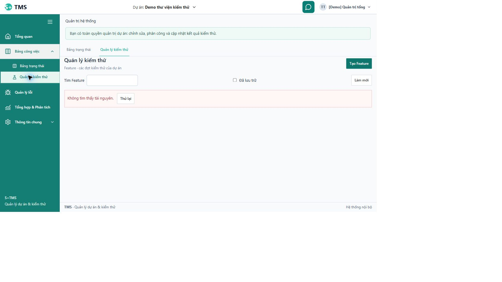
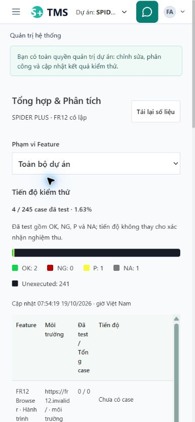
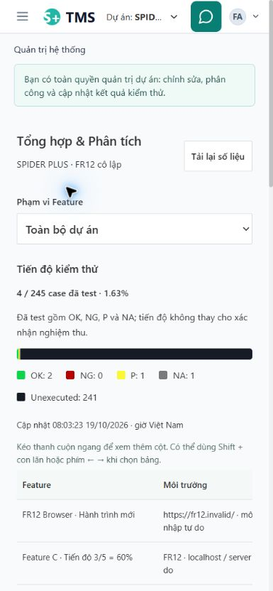
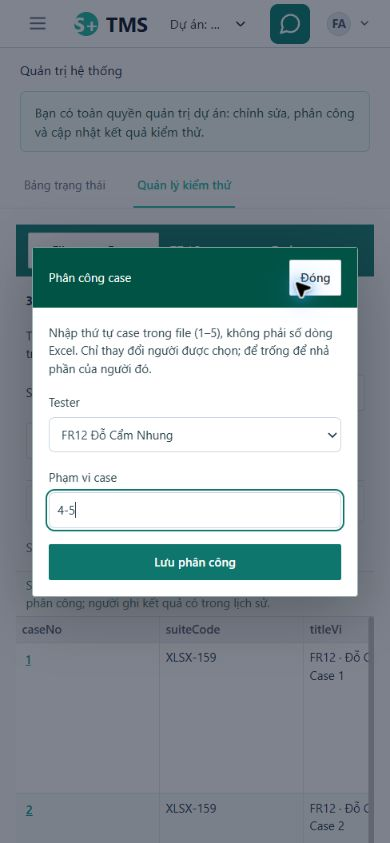
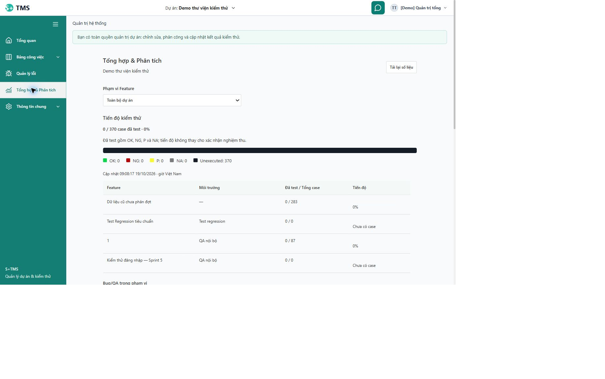

# FixReports — kiểm tra lại UI và Chrome ngày 19/10/2026

Yêu cầu tiếp nối: người dùng báo còn nhiều lỗi tại **localhost:5173**, xác nhận không chặn kiểm thử Chrome và công tắc **Allow access to file URLs đang bật**. Đây là checkpoint tiếp của FR-12 trong [kế hoạch chính](../planning/2026-10-19-fixreports-implementation-plan.md), không phải một roadmap mới.

## Kết luận và phạm vi

Đã xác nhận một nguyên nhân lớn của bản người dùng đang mở: Vite5173 phục vụ source mới nhưng proxy sang backend8080 cũ/V30. Sau đăng nhập Admin thành công, GET dự án trả200, nhưng ba API mới Feature, Issue và management-report summary đều trả404. Cùng API trên preview5174/backend8081/V33 trả200. Đây là thiếu sót bàn giao môi trường, không phải bằng chứng người dùng chặn quyền hoặc không biết thao tác.

Đã sửa bảy lỗi UI/hành vi tại báo cáo, phân công và điều hướng Admin, có RED→GREEN và kiểm tra Chrome. **Sau khi người dùng cho phép, main đã được nâng V30→V33 và backend8080 khởi động lại thành công lúc09:05 ngày19/10.** API Feature/Issue/report trên5173 đã hoạt động; kiểm riêng7.374 hàng cũ giữ nguyên. Chi tiết và các giới hạn còn lại ở checkpoint cuối báo cáo.

## Các lỗi đã kiểm tra

| Mã trong checkpoint FR-12 | Tái hiện/nguyên nhân | Xử lý và bằng chứng |
| --- | --- | --- |
| UF01 — runtime không đồng bộ | Source mới gọi `/features`, `/issues`, `/management-reports/summary` nhưng main8080 không có handler; healthUP không chứng minh có API mới | Đã tái hiện bằng browser/HTTP, sau đó cutover main theo quyền người dùng:12GET200 ở3project, Chrome mở Feature/file/case/Issue/Analysis. Không ghi fixture main; bằng chứng ở checkpoint cuối |
| UF02 — bảng tiến độ mobile khó đọc | Bảng cố ép vào bề ngang nhỏ, cột “Đã test / Tổng case” vỡ thành từng ký tự | Bảng có chiều rộng tối thiểu và tỷ lệ cột rõ; cuộn trong vùng riêng, không tràn toàn trang. 390px: table672px, page385px/viewport390px; header cao42.4px sau sửa. Đã xem ảnh390/768/1440 |
| UF03 — phần trăm quá dài | Hiện `0.8333333333333334%` trực tiếp từ double | Nhãn tối đa hai chữ số thập phân (`0.83%`); aria-valuenow và thanh tiến độ giữ giá trị thật, không sửa dữ liệu/công thức. RED1/18→GREEN18 |
| UF04 — trạng thái kỹ thuật trên báo cáo | Các ô hiện `progress`, `open`, `closed` khác màn công việc | Dùng cùng nhãn trạng thái tiếng Việt hiện có; không đổi mã, state machine hoặc số lượng. RED1/19→GREEN19; Chrome xác nhận “Đang xử lý”, “Chưa xử lý”, “Hoàn thành” |
| UF05 — nút AI khóa không giải thích | “Tạo gợi ý AI” disabled khi provider không sẵn sàng, người dùng không biết vì sao | Lý do nguồn/model chưa sẵn sàng cạnh nút và aria-describedby; tên nguồn dễ đọc; hướng dẫn Cấu hình AI trong chat. Vẫn soạn/lưu thủ công được, không gọi provider ngầm. RED1/20→GREEN20 |
| UF06 — tải Tester lỗi không thể thử lại tại chỗ | Select bị khóa sau lỗi listMembers, muốn tiếp tục phải đóng form/mất nháp | Thêm trạng thái tải, lỗi riêng và nút tải lại; bỏ response của request cũ, giữ range và conflict hiện có; khóa save lúc danh sách đang tải. RED thiếu nút retry được quan sát |
| UF07 — chọn Tester xóa range đã nhập | Nhập range trước khi chọn Tester đầu tiên, handler choose thay bằng range rỗng từ dữ liệu | Giữ range đã nhập khi chọn Tester đầu tiên; đổi giữa những người đã chọn vẫn khôi phục scope riêng. Cùng test hành trình UF06 tiếp tục RED ở assertion giữrange rồi GREEN4. Chrome: nhập4-5 rồi chọn Tester vẫn4-5; Escape trả focus về nút mở, không lưu mutation test này |
| UF08 — Admin reload mất màn/dự án | URL `/analysis` không giữ opt-in workspace; remount chọn mặc định Admin và chuyển `#/admin` | Giữ marker workspace trên URL khi Admin đã chủ động vào khu dự án, bảo toàn project/case query; không dùng localStorage và không kế thừa opt-in giữa danh tính. RED1/16→GREEN16, gồm các deny/identity regressions; Chrome reload `/analysis?workspace=1` vẫn ở Phân tích |

Bộ lọc Feature được nghi ngờ làm mất lựa chọn đã được kiểm tra: backend trả catalog đầy đủ, trình duyệt vẫn có các Feature khác sau khi chọn C. **Không xác nhận lỗi và không sửa phần này.** Không thay bố cục/logic chỉ dựa trên phỏng đoán.

## Chrome: điều gì đã xác nhận được

- Công cụ chọn file mở được chooser và nhận `multiple=true`, nhưng `setFiles` hai lần trước/sau xác nhận của người dùng vẫn báo thiếu Allow access to file URLs. Người dùng nói công tắc đang bật. Vì vậy không kết luận công tắc thực sự tắt hoặc người dùng chặn.
- Công cụ trình duyệt tự từ chối URL `chrome://extensions` do chỉ cho HTTP/HTTPS. Không xem được cài đặt thực bằng công cụ này; không đọc Chrome profile/config qua đường khác hoặc tìm cách lách giới hạn. Không đổi quyền extension.
- Upload tự động end-to-end vẫn **NOT_RUN vì lỗi/giới hạn công cụ chưa phân giải**, không phải kết luận chức năng upload ứng dụng hỏng. Native/HTTP import/export đã PASS ở checkpoint trước; bằng chứng đó không thay thế browser upload.
- Kiểm tra đang dùng Chrome profile có tên “Nguyên Giáp” do inventory cung cấp. Không có bằng chứng để khẳng định profile/extension phía người dùng là cùng instance; không suy tên profile thành nhầm tài khoản.
- Có một vài timeout CDP trong lúc Vite hot reload; đọc trạng thái mới và điều hướng qua đường HTTP đã hiện trong menu giúp tiếp tục. Không gán timeout công cụ thành bug ứng dụng. Viewport được đo lại trên đúng tab; một ảnh screenshot bị scale sau reload đã được chụp lại, không dùng ảnh lỗi làm bằng chứng UI.

## Kiểm chứng bản source cuối

| Mức | Kết quả |
| --- | --- |
| Full frontend | **980/980 test,105 file PASS**, coverage và build PASS sau sửa UF08; lượt979 trước đó giữ riêng, không dùng thay lượt cuối |
| Coverage toàn frontend | Statements86.17%, branches82.78%, functions80.42%, lines86.77% |
| Hồi quy tập trung cuối | 40 test/3 file PASS: ManagementAnalysis20, DocumentAssignments4, AdminRouting16. Một đường dẫn test bổ sung không tồn tại không được tính là file đã chạy |
| Browser thật | Checkpoint đầu: main5173 báo lỗi tài nguyên; preview5174: nhập/đóng form, reload Admin, report390/768/1440, giá trị/nhãn/disabled reason; range trước/chọn Tester sau, Escape/focus. Console không warning/error trong cửa sổ quan sát cuối |
| Backend | Không đổi source/schema backend trong follow-up này, không chạy lại645 unit/native để tạo một claim mới; kết quả trước có phạm vi/thời điểm trong báo cáo gốc |
| Chưa kiểm | Browser upload, tải workbook gốc đã được nêu từ trước, live AI/model quality/UAT, tất cả tổ hợp nút và thiết bị thật. Không tuyên bố mọi nút/mọi trạng thái đều đã kiểm |

Artifacts: [HTTP comparison](../../var/fixreports-ui-followup-2026-10-19/endpoint-comparison.json), [full coverage log](../../var/fixreports-ui-followup-2026-10-19/frontend-final-coverage.log), [build log](../../var/fixreports-ui-followup-2026-10-19/frontend-final-build.log), [coverage counters](../../var/fixreports-ui-followup-2026-10-19/frontend-final-coverage-summary.json).

Files sửa: `Frontend/src/AppEntry.jsx`, `features/admin/admin-routing.test.jsx`, `features/reports/ManagementAnalysisPage.jsx`, test cùng tên và `management-analysis.css`, `features/testing/DocumentAssignments.jsx` và test cùng tên. Các đường rút gọn bắt đầu tại `Frontend/src/app/`. Giữ thay đổi có sẵn, không cài dependency/toolchain, không commit/push/merge/deploy.

## Skill → mục đích → bằng chứng

- `systematic-debugging` → tách lỗi môi trường, UI và công cụ → so sánh API200/404, reload thực, viewport thật và các finding bị bác bỏ.
- `tdd` + `test-driven-development` dùng chung một vòng → public UI/URL/keyboard/HTTP theo seam đã được prompt cho phép → năm regression mới với FAIL đúng lý do trước sửa; không kiểm private function hoặc tạo vòng test trùng.
- `frontend-patterns`, `frontend-ui-engineering` → nháp/retry, request cũ, markerURL, accessible disabled reason và bảng cuộn → source thay đổi, kiểm390/768/1440, Escape trảfocus.
- `security-review` → giữ identity boundary, không đổi role/capability, dữ liệu schema test tách main, không bật provider/đổi quyền Chrome → các identity tests giữ nguyên và PASS; API main chỉ GET ngoài login/logout.
- `verification-before-completion`, `verification-loop` → phân biệt lượt979/980, API/native/browser, PASS/NOT_RUN → log/coverage/build và báo cáo này; không lấy suite cũ để chứng minh main đã cập nhật.

## Phương án chuyển runtime để xử lý UF01 — đã thực hiện sau xác nhận

Đề xuất cụ thể: **đồng bộ backend8080 và main `tms` trên native3307 từV30 đếnV33 với source hiện tại**, giữ frontend5173 và URL đang dùng. Không đổi sang dữ liệu test5174 và không trỏ frontend thật sang schema cô lập.

1. Đã tạo backup SELECT/dump-only mới lúc08:00 ngày19/10: `var/mysql-native/backups/2026-10-19T01-00-03-809Z-tms.sql`,3.504.122byte, SHA256 `98be5f0e6a0d83d1da5fe0017460a993e3fdc090aa452cae5a6dd5ac12446410`,V30; loại session rows và giữ DDL. Sau khi được phép, trước migration sẽ chốt thêm backup/manifest lúc đã dừng writer chính; giữ các backup cũ.
2. Kiểm tra lại đúng process đang giữ8080, đúng workspace/cấu hình native và lịch sử Flyway trước khi dừng **chỉ process chính đó**. Khởi động bằng workflow local đã đọc `scripts/Start-Backend.ps1`, nạp lại cấu hình AI local hiện có, dùng cả `db/migration` và `db/demo`. Không kill tất cả Java, không reset DB hoặc sửa checksum/repair.
3. Áp V31–V33 additive; đối chiếu dữ liệu cũ/workbook/current content và mapping. Diễn tập trước đã giữ7.362 dòng cũ/76bảng, chuyển711case, replay0. Main phải được kiểm riêng sau chuyển; không suy từ fixture. Một source thiếu workbook và120case không gắn file giữ ở graph cũ, không tạo nguồn giả hoặc xóa.
4. Kiểm main health, ba endpoint mới, quyền/readback và màn5173 với dữ liệu hiện có; không seed fixture vào main. Nếu lỗi phải dừng tại lỗi và dùng manifest/backup cùng phiên bản ứng dụng tương thích để lập phương án khôi phục, không restore đè hoặc clean tự động. UAT/live provider vẫn tách riêng.

Quyền đã được chốt: người dùng trả lời **“Cho phép nâng cấp main và khởi động lại 8080”**, cho phép thực hiện phương án cụ thể này sau giới hạn restart tại [prompt mục6](../prompts/2026-10-19-fixreports-codex-prompt.md). Các bước trên là phương án đã trình trước khi chạy; kết quả thực ở checkpoint dưới.

### FR-12 — main đã nâng cấp theo quyền người dùng (19/10/2026, 09:05–09:09)

- [x] Người dùng xác nhận “Cho phép nâng cấp main và khởi động lại 8080”. Dừng đúng Java7016; không dừng Vite5173/5174 hoặc backend8081. Khởi động workflow local hiện có, backend mới PID30588, healthUP và không có ERROR khởi động.
- [x] Backup mới sau dừng writer: `var/mysql-native/backups/2026-10-19T02-04-46-677Z-tms.sql`, 3,504,332byte, SHA256 `159fe94ffd90539b1e1fc3cf8bf16347e8b259c189f651c67da771e03f8c2c2c`, V30; giữ backup cũ và DDL session, không mang session rows vào dump.
- [x] Flyway local nạp cả migration/demo, áp đúng V31/V32/V33; validate33 PASS, failed0, pending0. Không repair/clean/đổi checksum hoặc restore đè; không chạy replay ghi trên main, replay0 vẫn là bằng chứng của diễn tập cô lập.
- [x] Main được kiểm riêng: 76 bảng cũ có74 bảng ngoài session được so sánh từng hàng/cột cũ, **7.374 hàng giữ nguyên**; hai bảng session loại khỏi kiểm row như chính sách backup, không phải claim giữ mọi session. 10 bản sao/711case/workbook/currentrevision/overlay/mapping độc lập, StatusUnexecuted và assignee rỗng đúng kế hoạch; 9 nguồn padded phục hồi. Nội dung file bằng nguồn hiện hành, không chuyển kết quả/phân công/Issue cũ vào graph mới; graph cũ vẫn giữ.
- [x] Cấu hình local giữ nguyên (hash .env.mysql.local khớp; thư mục evidence mặc định được kiểm không có file nên không có claim hash mọi evidence ở đường dẫn tùy chỉnh). Không seed dữ liệu test vào main, không gọi AI với dữ liệu dự án; dùng cấu hình AI local hiện có.
- [x] HTTP đăng nhập Admin hiện có: project/Feature/Issue/reportsummary ở project1,3,12, **12/12 GET200**, failedmigration0. Chrome5173: Feature4, file2/283case, bảng128case, form phân công tải được Tester rồi đóng không lưu; Issue và Analysis370case tải xong; Admin reload giữ analysis/workspace. Console cuối không warning/error. Mobile đo thực391px/page386px/table672px, cuộn trong bảng; viewport đã reset. Không suy kích thước yêu cầu390 thành kích thước thực khi browser zoom tạo520px.
- [ ] Workbook gốc qua browser chưa xác nhận: thử chờ download hết30s làm reset phiên công cụ; đọc lại màn không có lỗi app/console, không gán nguyên nhân hoặc đánh dấu PASS. Upload tự động vẫn là giới hạn công cụ trước đó dù người dùng xác nhận fileURL đã bật. LiveAI/UAT/mọi tổ hợp nút/thiết bị thật giữ NOT_RUN/chưa đầy đủ.
- [ ] Source1/project1 thiếu workbook và120case không gắn file vẫn được giữ ở graph cũ, chưa chuyển; cần nguồn/quan hệ có thể chứng minh nếu muốn chuyển. Không tạo workbook giả.

Skill FR-12 bổ sung: `deprecation-and-migration` → backup khi writer dừng, áp migration additive đúng đích, giữ graph cũ → backup/stop/start và before/after proof; `verification-loop` → đối chiếu dữ liệu và kiểm API/UI thực trên5173 → 7.374row,711case,12GET và browser proof. Không đổi source sản phẩm trong bước cutover, không chạy lại suite để tạo số test mới; FE980/BE645 là kết quả source trước đó. S11/FR12 vẫn IN_REVIEW vì các gate được nêu, không commit/push/merge/deploy ngoài lần khởi động local được cho phép.

Evidence chính: [đối chiếu main](../../var/fixreports-main-cutover-2026-10-19/main-after-proof.json), [HTTP](../../var/fixreports-main-cutover-2026-10-19/main-http-proof.json), [Chrome](../../var/fixreports-main-cutover-2026-10-19/main-browser-proof.json), [runtime](../../var/fixreports-main-cutover-2026-10-19/main-runtime-final.json), [backup](../../var/fixreports-main-cutover-2026-10-19/main-backup.json).

