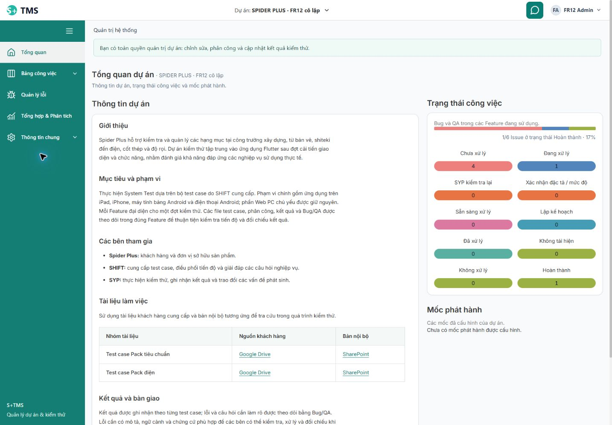

# Rà soát và hoàn thiện UI/UX — 19/10/2026

Trạng thái: **IMPLEMENTED_WITH_EXPLICIT_GAPS — đã sửa frontend và kiểm chứng theo từng phạm vi, chưa nghiệm thu toàn bộ giao diện**. Báo cáo này ghi lại đợt triển khai sau rà soát; giữ nguyên lịch sử của đợt rà soát chỉ đọc. Kết quả kiểm chứng cuối được ghi ở cuối báo cáo.

Yêu cầu mới là rà cả các điều khiển hiện/ẩn, chữ, màu, viền, ô nhập và trạng thái đang tải, lỗi, rỗng, bị khóa, nhận focus; đồng thời làm tương tác mềm hơn. Nhánh vẫn là `system-design`. Thư mục làm việc đã có nhiều thay đổi trước đợt này, nên toàn bộ phần khác biệt với HEAD không được tính là thay đổi của đợt hoàn thiện UI/UX. Giữ React JavaScript, font Inter, khung màu teal và mật độ bảng; không thay backend, database, migration, môi trường hay quyền nghiệp vụ để làm giao diện trông hoàn chỉnh.

Nguồn chi tiết: [bảng rà soát Admin/Auth/General](../../var/uiux-polish-2026-10-19/admin-general.md), [bảng rà soát Testing/Feature/Issue](../../var/uiux-polish-2026-10-19/testing-issues.md), [bảng rà soát Reports/AI](../../var/uiux-polish-2026-10-19/reports-ai.md). Đối chiếu [14 phát hiện của audit](2026-10-19-uiux-system-audit.md), [ma trận trước sửa](2026-10-19-uiux-system-coverage.md), [kiểm tra lại và đính chính Tổng quan](2026-10-19-uiux-recheck-and-overview-correction.md), [kế hoạch hoàn thiện UI/UX](../planning/2026-10-19-uiux-polish.md) và [ma trận kiểm tra Chrome](../../var/uiux-polish-2026-10-19/browser-matrix.md). Các bảng chi tiết giữ vị trí source, nơi gọi, kết quả RED/GREEN và kịch bản còn thiếu; báo cáo tổng hợp không thay chúng bằng một số PASS chung.

## Những thay đổi đã thực hiện

### Khung chung, Tổng quan và bàn phím

- Thống nhất bán kính bo góc 8 px cho điều khiển, 12 px cho khung nội dung; thời gian chuyển động 140/200/240 ms và đường cong ease-out. Rê chuột, nhận focus và nhấn nút có phản hồi ổn định, không dịch nút khỏi vị trí. Hiệu ứng mở khung chỉ thay đổi nhẹ độ mờ/vị trí, không chạy lần lượt trên các hàng bảng hay chặn cuộn/thao tác. Có chế độ giảm chuyển động.
- Tổng quan chỉ thay khối công việc gần đây bằng thông tin dự án theo yêu cầu đã đính chính; giữ các phần trạng thái công việc và mốc phát hành. Chữ trên các khối số liệu được root điều chỉnh tương phản; không đổi công thức hoặc màu nền kết quả.
- Khung ứng dụng có liên kết bỏ qua menu, chuyển focus vào nội dung khi điều hướng và giữ focus khi đổi bộ lọc; đã đối chiếu thứ tự bàn phím của header, chat, tài khoản và ngăn chi tiết. Hook dialog dùng chung không coi Chat không khóa nền là modal nằm trên cùng; bỏ qua điều khiển ẩn, bị vô hiệu hóa bằng `inert` và nội dung `details` đang đóng.
- `AuthBoundary` giữ các component đang mở để không xóa nháp khi hết phiên hoặc chưa xác nhận được phiên. Một context hiển thị dùng chung đi qua portal; modal/preview đưa ra `body` vẫn ẩn và không tương tác được lúc cần đăng nhập lại. Hook nhả giới hạn focus và khóa cuộn khi ứng dụng bị khóa, rồi khôi phục khi được phép. Quyền không được suy từ DOM; dữ liệu của tài khoản khác không được mở lại.
- Review độc lập tìm thêm lỗi đóng đồng thời hộp xác nhận bỏ nháp lồng nhau làm focus rơi về `body`. Đã có RED trên luồng monkey; root sửa hook dùng chung. Bộ kiểm tra dùng chung mới nhất có **33 test PASS**, gồm bộ chọn lồng nhau. Kết quả giả lập này không chứng minh hiển thị hay công cụ hỗ trợ truy cập thực tế.

### Admin, tài khoản, Note và thông tin chung

- PM có capability `users:create` nay có mục **Tạo tài khoản Tester** ngay menu tài khoản. Form của PM không có bộ chọn vai trò và chỉ gửi role TESTER; ADMIN dùng lại form với các vai trò hợp lệ của Admin. Không mở `/admin/users` cho PM, không tự thêm tài khoản vào dự án hoặc cấp quyền mới để thử.
- Note gặp lỗi 409 vẫn giữ nháp, khóa thao tác lưu phiên bản cũ, cho đọc và đối chiếu bản trên máy chủ rồi xác nhận giữ nháp để lưu với phiên bản mới. Không tự tăng version hay ghi đè; lỗi đọc, 404 và xung đột tiếp theo có hướng xử lý riêng.
- Khi sửa Handbook, textarea nhận focus; Hủy trả focus vào nút vừa được dựng lại. Login, form thông tin chung, Handbook đang chọn và phần đối chiếu Note có phân cấp chữ, focus, viền và bo góc rõ hơn. Nội dung dài có vùng cuộn bằng bàn phím.
- Form tạo tài khoản mở từ AccountMenu có kiểu chữ và điều khiển riêng, không phụ thuộc khung Admin bao ngoài. Tên đăng nhập/mật khẩu có hướng dẫn định dạng và nhãn truy cập ổn định. Thu hồi quyền khi phiên đang hoạt động sẽ đóng form; khóa phiên tạm thời vẫn giữ nháp trong phần ứng dụng không tương tác được.

### Feature, import, bảng case, phân công và Issue

- Modal Issue có CSS riêng; portal giúp hộp thoại không bị ô bảng cắt mất. Header nằm ngoài phần nội dung cuộn, hỗ trợ ngăn chi tiết thường/phóng to và chế độ giảm chuyển động. Root đã kiểm lại form monkey ở chiều rộng 390 px sau khi đặt lại viewport; phạm vi quan sát cụ thể nằm trong ma trận Chrome.
- Trạng thái đang xử lý/chưa lưu của form con được nối với Modal. Khi đang gửi, Escape/X/nhấn nền/Hủy không làm mất form; khi có nháp, người dùng chọn tiếp tục soạn hoặc bỏ nháp. Bộ chọn monkey không đổi Feature khi có nháp hoặc đang gửi. Trả focus từ xác nhận bỏ nháp và bộ chọn lồng nhau được kiểm trong bộ **33 test dùng chung**.
- Preview Excel nhận đúng `caseNo` từ Feature API bên cạnh `sourceCaseKey` cũ; ID Unicode và ID trông giống số hiển thị trước khi xác nhận import. Không đổi định danh hoặc quy trình import.
- Bộ lọc/trang Issue đồng bộ URL bằng `replaceState`; liên kết mở/đóng/đổi chế độ giữ `projectId`, `workspace` và phạm vi. Mỗi ký tự không tạo thêm một mục lịch sử trình duyệt. Chi tiết có liên kết Feature/file/case theo ID thật, cùng dự án; monkey không bị gán case giả. Mức ưu tiên đọc được bằng tiếng Việt dù không có quyền sửa.
- Nút case trước/sau đi theo thứ tự đang lọc và qua được ranh giới trang; chỉ khóa ở đầu/cuối. Đóng chi tiết trả focus về ID nguồn đã chọn. Không có `caseId` thì không tự đánh dấu hàng đầu do so sánh `undefined`.
- Preview Issue hỗ trợ Tab/ArrowDown từ badge vào các thao tác, Shift+Tab về badge và Tab cuối đi tới điều khiển kế tiếp. Escape/nhấn ngoài đóng preview; cuộn/đổi kích thước cập nhật vị trí neo. Preview ẩn và không tương tác được lúc đăng nhập lại.
- Có mục **Lịch sử phân công**, hiển thị người thao tác, case thật, người được giao cũ/mới, thời gian Việt Nam và các trang cũ hơn. Khi không đọc được tên, dùng ID thay thế. Màu trung tính chỉ áp dụng cho bảng phân công mới, giữ màu trước/sau của lịch sử nội dung.
- Lý do khóa Status phân biệt đang gửi, lỗi, tải dữ liệu, xuất file và chỉ đọc. Kiểm tra dự án lưu trữ được đặt ngoài nhánh ADMIN/PM để không hiện thao tác tạo Feature/import/sửa/ẩn mà máy chủ sẽ từ chối. Sửa Feature gặp 409 có phần đối chiếu giá trị hiện tại, giữ nháp và cho lưu chủ động với version mới; tạo Feature gặp 409 không hiện nút tải lại một Feature chưa có ID.
- Form, nút, phần ngữ cảnh, header, bộ lọc, tiến độ và nội dung dài được chỉnh trong phạm vi component. Bộ lọc dùng `min-width: 0` và đủ chiều rộng để bộ chọn dài không ép trang tràn ngang; quy tắc CSS của trường được ưu tiên đúng so với `.wi-field` cũ nạp sau. Chữ badge Issue đổi sang `#0f172a` dựa trên phép đo của root, giữ mọi màu nền và năm màu kết quả.

### Báo cáo quản lý và Chat AI

- `ReportDraftProvider` giữ nội dung soạn, bản gốc để đối chiếu, Feature và định danh bản đã lưu trong bộ nhớ theo tài khoản/dự án/báo cáo hoặc Feature của nháp mới. Rời trang/dự án rồi quay lại phục hồi đúng nháp; lưu thành công/bỏ nháp xóa đúng mục. Không tự lưu lên máy chủ, không dùng localStorage, không giữ credential, gợi ý AI hoặc yêu cầu trả phí đang chờ.
- Hết phiên/chưa xác nhận được phiên vẫn giữ component và bộ nhớ nháp của cùng tài khoản; đăng xuất/đổi tài khoản dọn dữ liệu của người cũ. Báo cáo được mở lại trong phần ứng dụng đang khóa sẽ chờ phiên hoạt động mới đọc nháp và dựng editor. Nháp của báo cáo đã lưu phải kiểm lại version bằng GET. Response muộn không đè editor; lưu xong trong lúc khóa không làm nháp cũ xuất hiện lại.
- Báo cáo phân biệt lỗi 401 với 403: sau khi đăng nhập lại cùng tài khoản, chỉ đọc lại để xác nhận quyền; từ chối 403 vẫn được giữ kể cả khi đến đồng thời với response 200. Không tự gửi lại tạo/sửa/tải file hoặc gợi ý AI. Lỗi đọc có nút thử lại; nháp và `expectedVersion` được giữ.
- Số liệu Feature/Issue ghi rõ phạm vi đang chọn; bảng so sánh ghi rõ áp dụng cho toàn dự án. Không đổi danh mục, truy vấn backend hoặc công thức P/NA. Lưu/mở/tải báo cáo có thông báo riêng; dự án lưu trữ có giải thích chế độ chỉ đọc.
- Khi tải tin nhắn cũ, Chat giữ vị trí đọc theo phần chiều cao được thêm, không kéo xuống cuối chỉ vì đang xử lý. Lỗi tạm thời khi mở lại giữ tin nhắn/nháp, khóa gửi và cho thử lại; 401/403/404 vẫn từ chối hoặc xóa dữ liệu tương ứng. Có nút tải lại danh mục/lịch sử tại chỗ; hội thoại hiện tại có `aria-current`; thông báo lỗi cũ được dọn sau khi đọc thành công.
- Chat, cấu hình nguồn, lịch sử, ô soạn và phần gợi ý được phân nhóm, xuống dòng, có focus và chuyển động nhẹ. Các reviewer không gọi provider/OAuth/probe hoặc gửi tin thật; nguồn xuất hiện trong danh mục không có nghĩa đã kiểm chứng kết nối thực tế.

## Kiểm kê điều khiển, biến thể và trạng thái

Kiểm kê AST cuối đếm **997 điều khiển trong 111 file**, gồm cả điều khiển xuất hiện có điều kiện và mã giao diện cũ/bản mẫu còn giữ lại. Rà **28 file CSS** không còn khai báo `transition: all` (**0**). Đây không phải 997 nút đã bấm, cũng không thay ma trận các route đang dùng. Audit trước có 92 route/biến thể/entry dùng chung, không phải 92 màn hình độc lập. Bảng Admin có 34 dòng; Testing có 32 biến thể; Reports/AI có các bảng riêng. Không cộng những số khác đơn vị để tuyên bố kiểm tra được 100%.

| Nhóm đang dùng / entry | Điều khiển chính và phụ đã rà source | Trạng thái/phạm vi được xét | Bằng chứng và khoảng trống |
| --- | --- | --- | --- |
| Login/reauth/account | Username/password/reveal/login/retry/logout, account disclosure, delegated Tester create | Anonymous/loading/invalid/busy/expired/unavailable/same hoặc khác user, grant/revoke | Mock Auth/Admin; retained portal/scroll-lock đã có regression. Browser mọi biến thể chưa hoàn thành. |
| Admin overview/projects | KPI/link/reload; search/scope/page/create/detail/edit; archive/reopen/history | Empty/read failure/partial/pending/409/denial/archived/readiness | Admin ledger AG-I03–12; archive legacy blockers còn mở, không archive main để chụp. |
| Bộ chọn thành viên dự án | Tìm kiếm/vai trò/phân trang/chọn tất cả/giữ lựa chọn ngoài trang/thêm/xóa/nháp vai trò | Đủ điều kiện/tương thích DEV/đang tải/không có kết quả/lưu một phần/lỗi | Source và test giả lập; bộ chọn lồng nhau có trong bộ 33 test dùng chung. Thao tác chạm/bàn phím thực tế còn cần kiểm. |
| Admin users/devices/audit | Filter/page/create/lock/unlock/grant; asset edit/assign/return/history; project/date/keyword audit | Self-lock, active PM, missing recipient, version/race/error/empty/returned | Ledger AG-I13–20; không cấp account/grant/handover thật trong reviewer. Page shrink asset còn risk. |
| General/members/held devices | Project fields/save/reload; read-only member list/central Admin link; supplement/return/history | Active/archived/permission/error/partial selection/conflict | Source + mocked tests; save-success/refresh-failed chưa được kết luận hết. |
| Notes/Rules/Handbook | List/page/create/edit/delete confirm,409 compare/rebase; rules draft/publish/history; handbook revision/history | Read-only, loading/error/empty/busy/late/409/404/dirty | Note/Handbook mới có RED→GREEN. Rules contract/copy legacy vẫn mở. |
| Feature list/form | Search/archive view/page/reload/open/create/edit/archive/restore; name/environment/description/save/close | Admin/PM active; archive, zero/no match/read fail, pending/save fail/edit409/create409 | Source + tests; idle dirty close và last-page shrink chưa bao phủ trọn. |
| Feature file/import | Back/search/page/import/hide/open; file input/template/rules/preview/replace/retry/confirm/finish | Single/batch, invalid/expired/committed/partial, authorization stop/late response | API mock, exact DTO test; workbook upload/download browser thật chưa đạt. |
| Document/case/detail | Search/status/page/font/export, editable cell/history, source ID/previous/next/close, deep link | Manager/Tester/self/DEV/read-only/archive, long/wide/zero/error/export/pending | Navigation/status mocks; missing valid row feedback còn thiếu. Bảng rộng có scroll là lựa chọn phù hợp, không tự là lỗi. |
| Assignment/Status/history | Tester/range/staged scope/save/reload; self receive/release; history actor/from/to/cursor; cycle/status reason | Range/overlap/stable rowID/permission/409/read error/older/empty/pending | Status/P/NA và history mocks. Assignment current-item compare, empty directory copy còn thiếu. |
| Issue badge/preview/create | Count/retry/hover/focus/Tab/open/page/create; Bug/QA fields/context/save/Hủy/discard | Empty/loading/error/no create/dirty/busy/revoked/late/auth locked | Behavior regressions; request fan-out chưa đo; physical touch/IME/low-height/AT chưa kiểm. |
| Board/list/issues/detail | View/filter/page/reload/key/title/allowed move; source links/priority/edit/DEV assignment/status reason/comment/history/delete | All readers + API caps, read-only/partial errors/dirty/version/deleted/nested modal | URL/keyboard/draft mocks; Issue route-exit draft còn mất, priority/assignee history diff chưa đầy đủ. |
| Báo cáo quản lý | Phạm vi/tải lại/bảng Feature và Bug/danh sách và phân trang báo cáo/tạo mới/soạn/lưu/tải/gợi ý AI/áp dụng | Chỉ PM/Admin; lưu trữ/rỗng/lỗi/nháp/409/đang gửi/401/403/đăng nhập lại/response đồng thời | Nhóm provider và báo cáo mới nhất có 45 test PASS; dữ liệu giả lập A/B phân biệt phạm vi. Sai khác backend về file đã ẩn chưa sửa. |
| Chat/nguồn/cấu hình/lịch sử | Mở/thu nhỏ/Escape/tạo mới/mở rộng/project/Feature/preset/lịch sử/tin cũ/sao chép/thử lại/kiểm tra/soạn/gửi/nguồn/model/OAuth/probe | READY/FAILED/GENERATING/UNKNOWN; đúng nguồn, phạm vi, quyền, chủ sở hữu và kiểm tra lại dữ liệu | Chat có 57 test PASS; nhóm 127 test trước các sửa bổ sung. Không gọi AI/OAuth/probe thật. Chrome đã quan sát Chat ở 320 × 568, chưa chứng nhận cuộn lịch sử hoặc mọi kích thước bàn phím. |
| Legacy/unknown adapters | `/tests/**`, `/board/new`, `/design*`, `/ai`, `/admin/ai`, catalogs/unknown fallback | Retirement explanation, explicit link đúng scope, malformed/denied/no project | Router mocks/source. Source còn giữ không đồng nghĩa route active; không khôi phục cycle/run/retest/task assistant cũ. |

Mỗi nhóm đã rà chữ, viền, focus và nội dung dài theo source; chưa thực thi toàn bộ tổ hợp quyền × viewport × mạng × cách nhập. Chi tiết thao tác chính/phụ, file nguồn và trạng thái nằm trong ba bảng rà soát liên kết ở đầu báo cáo.

## Đối chiếu 14 phát hiện cũ

Ý nghĩa trạng thái: **FIXED_SOURCE_MOCK** là đã sửa source, có test hành vi phù hợp nhưng chưa nghiệm thu toàn bộ trên trình duyệt; **PARTIAL** là còn phần của phát hiện chưa đóng; **OPEN** là nguyên nhân/contract chính còn nguyên. Không dùng “fixed” để che phần chạy thực tế chưa kiểm.

| ID / mức audit | Trạng thái hiện tại | Thay đổi và bằng chứng | Phần cần đóng tiếp |
| --- | --- | --- | --- |
| UX-001 / P1 modal Issue | **PARTIAL** | Portal và CSS riêng; test ô bị cắt/phóng to; context hiển thị và bộ 33 test focus dùng chung. Chrome quan sát form monkey ở 390 px, tạo Issue từ case và phóng to chi tiết DEV | Giữ ảnh 390 px thất bại ban đầu; không tái hiện sau khi đặt lại viewport và tải mới. Các entry/viewport khác vẫn theo giới hạn của ma trận Chrome; chưa kết luận chắc nguyên nhân lần quan sát cũ. |
| UX-002 / P1 có điều kiện, lưu trữ với dữ liệu cũ | **OPEN** | Đợt hoàn thiện frontend không đổi backend hoặc chính sách vòng đời | Quyết định Admin xác nhận ngoại lệ có lý do chưa được triển khai, kiểm quyền và lưu nhật ký. Không bỏ điều kiện chặn hiện hành khác hoặc mở lại luồng cũ. |
| UX-003 / P2 Note 409 | **FIXED_SOURCE_MOCK** | Đọc/đối chiếu/xác nhận giữ nháp và lưu với version mới; hai test hồi quy, nhóm Admin có 186 test PASS | Chrome đã mở/sửa/Hủy Note; hai người sửa đồng thời, 409 tiếp theo, 404 và mất quyền còn chờ. Máy chủ vẫn từ chối version cũ. |
| UX-004 / P2 mất nháp báo cáo khi rời trang | **FIXED_SOURCE_MOCK** | Bộ nhớ theo tài khoản/dự án/báo cáo; test khóa phiên/mount lại/lưu hoàn tất/response đồng thời; nhóm provider và báo cáo có 45 test PASS | Chrome có bằng chứng rời trang/quay lại phục hồi nháp; nghiệm thu đầy đủ và chính sách tải lại xem FINAL_VALIDATION. Bộ nhớ không giữ qua refresh/đăng xuất hoặc lưu gợi ý/yêu cầu AI đang chờ. |
| UX-005 / P2 ID nguồn trong preview | **FIXED_SOURCE_MOCK** | Hiển thị đúng `caseNo` và dùng `sourceCaseKey` cũ khi cần; dữ liệu giả lập kiểm đúng ID | Chưa xác nhận preview/upload workbook thật trên browser. |
| UX-006 / P2 URL/ngữ cảnh Issue | **FIXED_SOURCE_MOCK** | URL giữ bộ lọc/trang cùng `projectId`/`workspace`; có test query và liên kết Issue | Sao chép URL sau khi đổi dự án đã lưu, Back và refresh còn cần browser; mất nháp khi rời route là rủi ro riêng chưa sửa. |
| UX-007 / P2 case trước/sau | **FIXED_SOURCE_MOCK** | Test thứ tự đã lọc, ranh giới trang và trả focus; Chrome quan sát TESTER đi case 1 → 2 rồi đóng về nút case 2 | Bảng dài, thao tác bàn phím và đi qua trang trên browser chưa kiểm hết. |
| UX-008 / P2 bàn phím trong preview | **FIXED_SOURCE_MOCK** | Tab/ArrowDown vào portal, Shift+Tab/Tab cuối/Escape/nhấn ngoài/cập nhật vị trí neo; Chrome quan sát TESTER dùng ArrowDown vào Issue đầu | Chạm, cuộn, đổi kích thước và mọi tổ hợp chuyển focus còn cần kiểm; chưa chứng nhận công cụ hỗ trợ truy cập. |
| UX-009 / P2 thiếu lịch sử phân công | **FIXED_SOURCE_MOCK** | Có nút mở lịch sử, người thao tác/case/người cũ-mới/thời gian/trang cũ hơn; component test. Chrome TESTER đọc và đóng được lịch sử | Trạng thái rỗng/lỗi/trang cũ hơn/ID thay tên chưa kiểm bằng browser; đối chiếu phân công khi 409 không thuộc sửa này. |
| UX-010 / P2 thao tác Admin trên dự án lưu trữ | **FIXED_SOURCE_MOCK** | Danh sách Feature/file kiểm dự án lưu trữ trước nhánh ADMIN/PM; test xác nhận ẩn tạo/import/ẩn file | Chuyển hoạt động → lưu trữ → mở lại và quyền đọc/xuất/lịch sử còn chờ browser. Nhóm Testing đã sửa đúng phát hiện gốc. |
| UX-011 / P2 contract/hướng dẫn Rules cũ | **OPEN** | Không bỏ `requiredFields` hoặc sửa hướng dẫn để giả contract đã đổi | Cần đồng bộ chính sách, xuất bản, API và nhãn lịch sử theo quy trình Feature; không khôi phục điều kiện build/device/run. |
| UX-012 / P2 phạm vi số liệu chưa rõ | **FIXED_SOURCE_MOCK** | Phạm vi số liệu hiện rõ; tiêu đề bảng ghi đối chiếu toàn dự án; dữ liệu giả lập A/B | Không đổi công thức 3/5; sai khác backend về file đã lưu trữ là rủi ro riêng. |
| UX-013 / P3 lý do khóa thao tác | **FIXED_SOURCE_MOCK** | Tách lý do đang gửi/lỗi/tải dữ liệu/xuất file/chỉ đọc; có test Status với response chậm | Chrome có quan sát quyền Status của TESTER/DEV; phản hồi ngoài hover và mọi nhánh khác còn cần kiểm. |
| UX-014 / P2 PM được cấp quyền thiếu form | **FIXED_SOURCE_MOCK** | Mục tạo theo capability, role TESTER cố định, test thu hồi quyền/đăng nhập lại/giữ nháp; nhóm Admin có 186 test PASS | PM thiếu quyền đã được kiểm trên Chrome; nhánh PM được cấp quyền mới có test component. Không tạo tài khoản/cấp quyền thật; chưa xác nhận thực thi backend cho nhánh này bằng runtime. |

UX-015 trong lượt kiểm tra lại Tổng quan là checkpoint ngoài 14 phát hiện gốc: tiếp tục giữ đính chính chỉ đổi khối công việc gần đây. Báo cáo này không tăng/giảm danh mục bằng cách đổi số thứ tự hay tính một nguyên nhân modal thành nhiều P1.

## Kiểm thử đã chạy và kết quả thất bại được giữ lại

Các reviewer dùng Vitest/jsdom với API, clipboard, download và `window.open` giả lập. File có tên `integration.test` trong nhóm Admin kiểm sự phối hợp giữa các component với API giả, không phải tích hợp HTTP/DB. Không cộng các kết quả trùng nhau thành tổng test hoặc suy tỷ lệ bao phủ từ số PASS.

| Phạm vi / checkpoint | Kết quả đúng thời điểm | Receipt và giới hạn |
| --- | --- | --- |
| Hành vi Admin/Auth/General | RED: 9 PASS/6 FAIL → GREEN: 15 PASS | [RED](../../var/uiux-polish-2026-10-19/admin-general-red.json), [GREEN](../../var/uiux-polish-2026-10-19/admin-general-green.json). Tạo Tester từ PM/Note/Handbook, thất bại đúng hành vi cần sửa. |
| Nhóm Admin | Lần đầu 183/184, lỗi auth lặp lại khi chạy riêng; cuối 186/186 PASS, 28 file | [Lượt thất bại](../../var/uiux-polish-2026-10-19/admin-general-scoped.json), [lượt cuối](../../var/uiux-polish-2026-10-19/admin-general-scoped-final.json). Đã tìm và sửa portal thoát vùng hidden/inert; giữ kết quả thất bại. |
| Testing/Issue/routes | 37 file, 290 PASS; sau đó tạo Feature gặp 409 có RED → GREEN 2/2 | [Theo nhóm](../../var/uiux-polish-2026-10-19/testing-issues-regression.json), [trường hợp biên](../../var/uiux-polish-2026-10-19/testing-feature-create-conflict.json). Có test trùng; 290 không đại diện toàn source sau các sửa bổ sung. |
| Focus khi bỏ nháp lồng nhau và bộ chọn lồng nhau | RED: 1 FAIL/5 PASS; bộ dùng chung mới nhất: 33 PASS | [RED](../../var/uiux-polish-2026-10-19/monkey-discard-focus-red.json), [bộ dùng chung cuối](../../var/uiux-polish-2026-10-19/shared-dialog-final-green.json). Gồm modal/Auth/ngăn header/thứ tự focus với Chat không khóa nền và bộ chọn lồng nhau. |
| Nhóm Reports/AI | 8 suite, 127/127 PASS trước các sửa bổ sung về auth/mount lại lúc khóa/401 | [Theo nhóm](../../var/uiux-polish-2026-10-19/reports-ai-final.json). Không coi 127 test là kết quả của mọi sửa bổ sung mới nhất. |
| Chat mới nhất | 57/57 PASS, đã kiểm sửa thông báo lỗi cũ | [Chat](../../var/uiux-polish-2026-10-19/chat-recovery-final.json); thuật toán vị trí cuộn được giả lập, không phải đo hiển thị thực tế. |
| Reports/provider mới nhất | 45/45 PASS sau RED cho 401 và response 403 đồng thời | [GREEN](../../var/uiux-polish-2026-10-19/reports-401-reauth-green.json). Không tự gửi lại thao tác ghi/yêu cầu trả phí; từ chối 403 vẫn được giữ. |
| Full coverage đầu tiên | **1031 PASS/3 FAIL/1034 tổng, 114 file** | [Giữ nguyên kết quả thất bại](../../var/uiux-polish-2026-10-19/frontend-full-coverage-tests.json). Bắt đầu trước các sửa cuối; chưa là kết quả cuối. |
| Điều tra hai file thất bại | Chạy đo coverage với `maxWorkers: 1`, 48/48 PASS; không tăng timeout/sửa test | [Chạy riêng](../../var/uiux-polish-2026-10-19/isolated-cases-documents-tests.json), [coverage riêng](../../var/uiux-polish-2026-10-19/isolated-cases-documents-coverage/coverage-summary.json). Không thay kết quả chạy toàn bộ hoặc coverage toàn hệ thống. |

Hai test quá thời gian ở lượt chạy toàn bộ là required-VI-from-JP (5075 ms) và bảng cũ 101 hàng (15454 ms); test server-focus tiếp theo thiếu nhãn VI. Khi chạy riêng với coverage và một worker, thời gian tương ứng là 1876 ms, 1475 ms và 7606 ms. DOM của test thất bại thứ hai có JP đang chọn và caseNo `ỂTNC -T1HỊ B`, dù test chỉ nhập TC-1 vào trường này. Hiện tượng phù hợp với khả năng thao tác bất đồng bộ của test đã timeout tiếp tục tác động lên dialog mới sau cleanup. Đây là **suy luận có bằng chứng**, chưa ghi lại lịch chạy của các tác vụ để chứng minh thứ tự xen kẽ. Cạnh tranh tài nguyên và chi phí đo coverage là giả thuyết chính cho timeout, chưa chứng minh lỗi sản phẩm. Không tăng timeout hoặc sửa điều kiện kiểm tra để né lỗi; root kiểm lại toàn bộ sau khi ngừng sửa source.

Coverage của ba nhóm reviewer ban đầu là **NOT_MEASURED**. Lượt chạy riêng đã đo nhưng cấu hình lấy toàn source, nên tỷ lệ của lượt đó không thay coverage cuối. Build, full coverage, browser và kiểm tra bảo toàn cuối phải có bằng chứng mới trong FINAL_VALIDATION; không lấy 985/1034 hay kết quả đợt trước làm số cuối.

## Browser và responsive: bằng chứng có, phần chưa đạt

Chỉ root điều khiển Chrome. Các reviewer không dùng browser song song; đọc ảnh/JSON do root lưu không được tính là tự chạy browser test. Các ảnh, số đo và nhật ký nằm tại `var/uiux-polish-2026-10-19/`, được đối chiếu trong [ma trận kiểm tra Chrome](../../var/uiux-polish-2026-10-19/browser-matrix.md). Có ảnh không tự có nghĩa cả hành trình đã PASS.

Đã kiểm tra nhanh thực tế bằng các tài khoản fixture có sẵn cho **cả bốn vai trò**, theo từng hành trình và kích thước cụ thể:

- **ADMIN:** Tổng quan, form tạo tài khoản ở 320 px, bộ lọc thiết bị trả kết quả rỗng, audit và Tổng quan dự án ở 1440/320 px. Form có bốn vai trò và Hủy đóng được; không tạo tài khoản, cấp quyền hay bàn giao thiết bị.
- **PM:** Tổng quan ở 1440 px; nháp báo cáo được phục hồi khi rời trang/quay lại rồi nội dung thử được xóa mà không lưu; danh sách Issue và form monkey; mở/sửa/Hủy Note; menu không có mục tạo Tester khi thiếu capability. Chat ở 320 × 568 mở được phạm vi, toolbar thành hai cột, ô soạn và nút gửi trong viewport; nguồn chưa sẵn sàng có giải thích và gửi bị khóa. Không gửi preset/tin nhắn hoặc kiểm tra provider thật.
- **TESTER:** Note chỉ đọc; mở Feature → file → năm case, trong đó case 4–5 chưa phân công bị khóa Status. Đọc/đóng lịch sử phân công, đi case 1 → 2 rồi đóng về nút case 2; ArrowDown vào Issue đầu trong preview. Form tạo Issue từ case ở 390 px hiện đúng ngữ cảnh và nội dung điền sẵn; đóng mà không lưu.
- **DEV:** Bảng case khóa mọi Status và không có tự nhận phân công. Issue được giao hiển thị mức ưu tiên Cao và chỉ cho chọn chuyển sang Đã xử lý; đọc được lịch sử, phóng to chi tiết và cuộn nội dung. Không lưu chuyển trạng thái hoặc ghi chú.

Các thao tác trên không bao phủ mọi form hoặc mọi viewport cho từng vai trò. Đăng nhập/đăng xuất có tạo sự kiện audit; không khẳng định database không hề có ghi kỹ thuật. Sau kiểm tra, root đã đăng xuất các tài khoản fixture, đặt lại viewport và kiểm tra main ở trạng thái chưa đăng nhập.

- Badge Issue: chữ trắng trên nền trạng thái chỉ đạt 2.4–3.87:1; `#0f172a` đạt 4.62–7.45:1 cho bảy màu đã đo. Đã đổi màu chữ trong phạm vi badge, giữ nền và năm màu kết quả. [Đo màu](../../var/uiux-polish-2026-10-19/issue-palette-contrast.json). Chưa kết luận toàn ứng dụng đạt yêu cầu tương phản.
- **Giữ lại lần quan sát thất bại ở 390 × 844:** [ảnh cũ](../../var/uiux-polish-2026-10-19/pm-monkey-draft-390.jpg), [số đo cũ](../../var/uiux-polish-2026-10-19/pm-monkey-draft-390.json) ghi chiều rộng trang 458 px, header/nút đóng ở trên viewport, nút lưu gần hoặc dưới mép đáy. Độ rộng bộ lọc và thứ tự ưu tiên CSS của trường đã được sửa độc lập. Sau khi đặt lại viewport và tải mới với CSS hiện hành: panel x = 8/y = 8, rộng 368.8 px, cao/maxHeight = 828 px; body cao 758 px/scrollHeight = 934 px, padding = 16 px, overflow = auto; chiều rộng trang 385 ≤ 390 px, `matchMedia(max640) = true`. [Ảnh kiểm lại](../../var/uiux-polish-2026-10-19/pm-monkey-390-final.jpg), [số đo kiểm lại](../../var/uiux-polish-2026-10-19/pm-monkey-390-final-metrics.json). Điều khiển trong form cao 44 px, bo góc 8 px; bộ chọn Feature bên ngoài còn bo góc 3 px ở lần đo này và được root xử lý riêng.
- Modal có nền phủ cố định, giới hạn chiều cao theo viewport và nội dung cuộn riêng, cách mép 8 px trên mobile. Selector modal cũ đòi khung `.work-items` bao ngoài nên không khớp portal ở `body`. Root xác minh đang nạp `work-item-modal.css` từ Vite; bản build cũ tại `Frontend/dist` được đọc trước đó không chứng minh nguyên nhân. Lỗi cũ **không tái hiện sau tải mới**, nhưng chưa đủ chứng cứ quy chắc cho công cụ, viewport hay cache. Không xóa kết quả thất bại cũ hoặc suy một modal đúng thành mọi entry đúng.
- Riêng form monkey đã có số đo ở 320 × 568, 390 × 844, 768 × 1024 và 1024 × 768; tại 390 px đã quan sát Tab/Shift+Tab và footer trong vùng cuộn. Chưa đủ browser cho mọi entry × vai trò × kích thước, chiều cao thấp, zoom 200%/xoay ngang, thao tác chạm thật, IME/bàn phím ảo, trình đọc màn hình, chế độ giảm chuyển động, upload/download workbook, thu hồi quyền và response máy chủ chậm. Bảng cuộn hai chiều không tự là lỗi bố cục; trạng thái khóa hoặc mật độ cao cũng không tự là lỗi.

## Rủi ro và phần còn lại

| Nhóm còn lại | Trạng thái chính xác / bước kiểm cần thiết |
| --- | --- |
| Lưu trữ dữ liệu cũ / Rules | UX-002/011 còn OPEN, cần xử lý contract/backend/chính sách/lịch sử. Frontend không tự cho phép ngoại lệ, ép hoàn tất hay giả xuất bản thành công. |
| Thoát nháp Issue/Feature/phân công/ô nội dung | Đóng Modal Issue đã có bảo vệ; menu/Back/hash/liên kết nguồn/refresh vẫn có thể làm mất nháp Issue. Đóng form Feature/phân công/ô nội dung khi chưa lưu chưa có chính sách chung. Không tự mở rộng thành lưu nháp toàn ứng dụng. |
| Xung đột phân công | Tải lại hiện lấy version/key nhưng chưa trình bày phân công mới nhất để đối chiếu; danh sách trống thiếu thông điệp “không có Tester đủ điều kiện”. Máy chủ vẫn kiểm phạm vi và khoảng phân công trùng nhau. |
| Lưu thành công rồi tải lại lỗi | Một số nơi đóng form sau khi ghi thành công nhưng tải lại lỗi; chưa mọi luồng phân biệt “đã lưu, tải lại thất bại”. Không gọi đây là rollback hoặc mất dữ liệu đã ghi. |
| Phân trang / ẩn file | Cần dữ liệu giả lập nhiều trang để kiểm trang cuối sau khi số bản ghi giảm. Ẩn file có hiệu lực ngay, thiếu lối khôi phục/tìm lại tương ứng, không phải xóa hẳn. `caseId` hợp lệ nhưng không tìm thấy hàng chưa có giải thích. |
| Lịch sử thông tin Issue | Mức ưu tiên đã đọc được; lịch sử chỉ đổi ưu tiên/người phụ trách chưa hiển thị đầy đủ khác biệt. Chưa có bằng chứng mất bản chụp trên máy chủ. |
| Số request / hiệu năng cảm nhận | Badge Issue từng hàng có thể tạo 100 lượt đọc cho 100 hàng; chưa đo thực tế, trace mạng, tải, CLS hoặc LCP. Đợt này không đổi API backend để đọc theo lô. |
| Tạo báo cáo lặp khi gửi lại | Backend tạo báo cáo chưa có `requestKey`; response mất sau khi ghi thành công rồi lưu lại có thể tạo bản khác. Bộ nhớ nháp không tự gửi lại hoặc đoán trùng theo tiêu đề; chưa tái hiện bằng DB. |
| Tổng hợp quản lý với file đã lưu trữ | Truy vấn tổng hợp chưa lọc document đã lưu trữ giống `FeatureIssueService`. Sai khác source còn nguyên; không sửa số frontend để che. |
| Vòng đời nháp/gợi ý | Bộ nhớ nháp báo cáo chỉ tồn tại trong phiên trang; refresh/đóng trang/đăng xuất không phục hồi. Gợi ý chưa áp dụng và yêu cầu trả phí đang chờ không được giữ; cần chính sách riêng khi rời route hoặc chưa rõ kết quả request. |
| Thao tác Admin/thông tin chung còn thiếu kiểm tra | Chưa bấm lại mọi lựa chọn ngoài trang/lưu một phần/bàn giao/trả máy/khóa/cấp quyền/xuất bản/thao tác xóa. Bộ chọn lồng nhau đã có test dùng chung; không tính test giả lập thành API ghi thật PASS. |
| UAT/NFR/khả năng truy cập | AI/OAuth/probe thật; workbook/clipboard/download thật; trình đọc màn hình/IME/chạm; mọi viewport/zoom/giảm chuyển động và yêu cầu phi chức năng trên môi trường thật còn NOT_RUN hoặc PARTIAL. Không chứng nhận WCAG hoặc “mọi nút đều hoạt động”. |

## Skill → mục đích → bằng chứng

| Skill / phạm vi áp dụng | Mục đích thực tế | Bằng chứng / giới hạn |
| --- | --- | --- |
| `frontend-ui-engineering` | Controls/text/semantics, bounded overlay/scroll, keyboard/focus, conditional states, long content | Ba ledger, scoped CSS, modal/field/nav tests và root geometry failure. Không suy paint/contrast/AT từ source. |
| `frontend-patterns` | State ownership, keyed scope/owner, effect cleanup/abort, pending lock/dirty draft, URL durability | Report buffer/auth gate, Note rebase, Modal activity context, Issue filters, Chat revalidation. |
| `ui-ux-pro-max` | Error/loading feedback, focus, motion/reduced-motion, wrap/touch target; giữ thiết kế TMS | Admin/Testing dùng quick-reference khi python aliases không PATH. Root/Reports tìm được Python cài sẵn và query domain phù hợp; marketing design-system gợi ý không áp. Không gộp thành mọi agent đã database search. |
| TDD tương ứng từng owner: `tdd-workflow`, `tdd`, `test-driven-development` | RED hành vi trước sửa, GREEN và regression tại public component/mock seam | Receipts failure giữ nguyên; import skeleton/syntax failure không nhận làm behavior RED. Không viết decorative CSS-value test. |
| `code-review` / review độc lập | Đọc đầy đủ nơi gọi/test/yêu cầu, phân biệt mã cũ và rủi ro; phản biện lỗi auth/modal lồng nhau/mount lại lúc khóa | Review Admin/Reports tìm lỗi cần sửa; Testing lưu review còn dở, không được tính là phê duyệt hoàn tất. Không khẳng định đã thực hiện đúng toàn bộ quy trình review nhánh của skill. |
| `api-design`, `security-review` | Real DTO, expectedVersion/idempotency, capability/server boundary, safe text/owner isolation | Preview caseNo, delegated PM fixed TESTER, 401/403 race, SafeMarkdown và scope guards. Không backend/pentest/liveprovider claim. |
| Root workflow về verification/browser | Phân biệt SOURCE_REVIEW/MOCK/BROWSER/NOT_RUN, source baseline, một browser controller | Inventory/receipt/artifacts và kết quả ở mục Kiểm chứng cuối. Skill đã đọc không tự là bằng chứng đã thực hiện mọi checklist. |
| Root: `design-system` | Tổ chức token về bán kính, chuyển động và viền | Các token dùng chung cho control/panel; giữ hệ màu và chữ của TMS. |
| Root: `systematic-debugging` | Tái hiện, chạy riêng test thất bại và đối chiếu DOM với CSS | Giữ kết quả timeout; chạy riêng hai file; đo lại modal sau đặt lại viewport, không đoán nguyên nhân từ bản build cũ. |
| Root: `test-driven-development` | Viết test RED trước khi sửa khung ứng dụng, Tổng quan và dialog | Các kết quả RED/GREEN theo phạm vi; không tính lỗi cú pháp/import là RED hành vi. |
| Root: `verification-before-completion` | Dùng kết quả kiểm tra mới và đối chiếu hash/build trước kết luận | 1.048 test PASS trên source đã chốt, build PASS, hash source/config trước–sau giống nhau; xem mục Kiểm chứng cuối. |
| Root: `dispatching-parallel-agents` | Chia ba nhóm sở hữu file, sau đó review chéo độc lập | Ba bảng rà soát, giới hạn file rõ và các lỗi auth/focus được reviewer khác phát hiện; browser vẫn chỉ root điều khiển. |
| Root: `using-superpowers` | Chọn và đọc skill trước khi áp dụng | Root đã đọc đầy đủ SKILL.md của các skill nêu trên; bằng chứng công việc nằm ở các dòng tương ứng, không suy từ việc có cài skill. |

Nguồn skill ở `C:/Users/admin/.codex/skills/<name>/SKILL.md` theo bảng rà soát và chỉ dẫn repository. Áp dụng theo React 18 JavaScript hiện tại, không đổi công nghệ theo ví dụ trong skill. Không cài thêm package/hook/plugin để có kết quả đẹp hơn.

## Kiểm chứng cuối

- **Toàn bộ frontend trên source đã chốt: 1048/1048 PASS, 116 file, 0 bỏ qua.** Lệnh: `rtk proxy npm.cmd test -- --maxWorkers=1 --reporter=json --outputFile=../var/uiux-polish-2026-10-19/frontend-stable-final-tests.json`. [Receipt](../../var/uiux-polish-2026-10-19/frontend-stable-final-tests.json). Hash 316 file source/config trước–sau lượt cuối giống nhau; không chỉnh assertion/timeout để lấy PASS.
- **Build PASS, exit 0:** Vite 6.4.3, 1.701 module; JavaScript 480,82 kB (gzip 139,73 kB), CSS 183,64 kB (gzip 32,89 kB). [Receipt](../../var/uiux-polish-2026-10-19/build-final.json). Đây là build local, không deploy.
- **Coverage đã đo:** statements 87.02%, branches 83.4%, functions 81.37%, lines 87.74%. [Summary](../../var/uiux-polish-2026-10-19/frontend-final-coverage/coverage-summary.json). Include `src/**/*.{js,jsx}`, exclude tests/setup và legacy bootstrap `src/index.js`. Lượt coverage đạt 1.047/1.047 test, 115 file; trong lúc chạy có thêm xử lý Escape cho bộ chọn lồng nhau, test của nó và CSS bo góc. Vì vậy tỷ lệ là checkpoint coverage, còn lượt toàn frontend ở bullet đầu xác nhận source cuối. Không gọi tỷ lệ này là coverage browser hoặc coverage của mọi trạng thái.
- Giữ nguyên lượt coverage đầu 1.031/1.034 thất bại và lượt cô lập 48 PASS; lượt full coverage một worker sau đó không còn lỗi. Lượt ổn định cuối có thêm test bộ chọn, không cộng các lượt thành tổng coverage. [Đối chiếu máy đọc được](../../var/uiux-polish-2026-10-19/final-validation.json).
- **Chrome đã kiểm bốn role trên fixture**, thêm main chỉ đọc đầu lượt. [Ma trận browser chi tiết](../../var/uiux-polish-2026-10-19/browser-matrix.md) phân biệt từng hành trình và NOT_RUN. Hộp thoại monkey được đo ở 320/390/768/1024 px; tạo Issue từ case ở 390 px, Chat và tài khoản Admin ở 320 px, Tổng quan ở 320/1440 px. Đã kiểm DEV mở rộng và xem lịch sử Issue, Tester chuyển case và focus/preview/lịch sử, PM mở Note và giữ nháp báo cáo. Console cuối không có error/warn được công cụ thu thập tại hai tab; không suy toàn hệ thống không có lỗi. Không sửa dữ liệu nghiệp vụ main; fixture chỉ đọc, mở và hủy form; các lần đăng nhập/đăng xuất có audit kỹ thuật.
- **Bảo toàn:** [receipt hash và link](../../var/uiux-polish-2026-10-19/preservation-and-links.json) so với baseline 2.853 file, không file cũ bị mất; Backend/config/package không đổi. Các sửa cũ tồn tại trước task được giữ; không dùng diff với HEAD để nhận toàn bộ thay đổi là của đợt này. Whitespace và local link check PASS; không mở link Drive/SharePoint.
- **Chưa hoàn tất toàn bộ UAT:** 11 finding có sửa source/mock, UX-001 còn PARTIAL theo ma trận entry/trạng thái; UX-002/011 còn OPEN cùng các mục tồn đọng đã liệt kê. Không nói mọi button đã được click hoặc hoạt động 100%. Backend/native tests không chạy lại vì không đổi backend; live AI/OAuth/probe, ghi dữ liệu, upload/download thật, screen reader/IME/touch/zoom 200% và reduced motion của hệ điều hành còn NOT_RUN. S11/FR-12 tiếp tục IN_REVIEW.
- Không commit/push/merge/deploy; không migration/restart/cài dependency. Viewport reset và các tài khoản fixture logout; main cleanup thấy màn đăng nhập.

