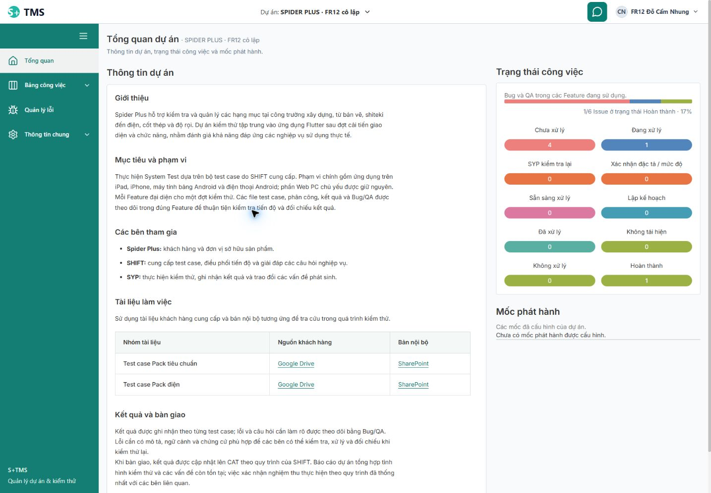

# Rà soát lại toàn hệ thống và sửa phạm vi màn Tổng quan — 19/10/2026

Yêu cầu mới: rà lại toàn bộ một lượt; màn Tổng quan **chỉ thay khối Công việc gần đây bằng Thông tin dự án**, giữ các phần còn lại. Đã sửa phần Tổng quan theo yêu cầu này. Không triển khai toàn bộ kế hoạch sửa 15 task chỉ từ yêu cầu rà soát.

## Kết quả chính

- Màn vẫn là **Tổng quan dự án**: thông tin dự án ở vị trí khối công việc gần đây; **Trạng thái công việc** và **Mốc phát hành** được khôi phục bên cạnh ở desktop, xếp dưới ở mobile. Nội dung Spider Plus vẫn chỉ gắn với đúng mã dự án; các dự án khác dùng mô tả của chính dự án.
- Trạng thái lấy số lượng Bug/QA từ API Feature Issue hiện hành; không dùng số mẫu hoặc tổng công việc legacy. Nút trạng thái có projectId và status, mở đúng bảng danh sách. Mốc phát hành giữ tên/hạn đã cấu hình; không dựng phần trăm hoặc nút lọc milestone chưa được board hiện hành hỗ trợ.
- Toàn bộ frontend hiện tại **985/985 test, 106 file PASS**, không skip; build Vite PASS. Đây là kiểm chứng tự động, không phải mọi nút/state đã qua browser.
- Cả **14 finding UX-001–014 của audit trước vẫn còn mở** trong source. Lượt này không sửa các lỗi đó. Có thêm các khoảng trống/rủi ro source được liệt kê dưới đây; không gọi chúng là lỗi browser đã tái hiện.
- Không sửa backend, không migration/restart dịch vụ, không ghi nghiệp vụ lên main hoặc fixture trong lượt này, không gửi dữ liệu thật vào AI, không commit/push/merge/deploy.



## Phạm vi rà lại và kết quả từng nhóm

Đối chiếu lại toàn bộ 92 mục route/biến thể/component/adapter trong [ma trận gốc](2026-10-19-uiux-system-coverage.md), theo ba nhóm source. Những mục chỉ đọc source vẫn là SOURCE_REVIEW; các nhánh NOT_RUN từ audit trước không tự chuyển PASS trong lần này. Chỉ root điều khiển Chrome; reviewer không dùng browser/API/DB.

| Nhóm | Rà lại source/control/state | Kiểm tra mới | Finding/risk còn lại |
| --- | --- | --- | --- |
| Auth/Admin/General |34 mục gốc;138 file trong phạm vi +11 dependency trực tiếp đối chiếu baseline không đổi trước sửa Tổng quan. Auth/account, project/member, devices, lifecycle, audit, Note, Rules, Handbook, picker/dialog dùng chung |60/60 test trong 11 file dùng mock/jsdom PASS | UX-002/003/010/011/014 giữ nguyên. Lưu thành viên/bàn giao máy **chưa thực thi lại bằng browser** trong lượt này; test mock không thay thế tích hợp thật |
| Testing/Issue |32 mục gốc;94 file đối chiếu hash không đổi. Feature/files/import/ranges/Status/case/Issue/board/router/history và scope backend | Lượt tập trung đầu 87/88, lỗi focus; rerun đúng file 4/4; cuối lượt **full 985/985 PASS** có cả file đó | UX-001/005/006/007/008/009/013 vẫn mở. Khoảng trống source bổ sung ở 409 Feature, liên kết case nguồn và ưu tiên/lịch sử Issue |
| Reports/AI/Shell |26 mục gốc; summary/report editor/download/AI proposal; chat presets/scope/history/pending/retry; source/provider/OAuth; menu và state ownership |81/81 test trong 4 file dùng mock/jsdom PASS | UX-004/012 và rủi ro chat/request báo cáo chưa thay đổi. Live AI/OAuth/probe không chạy |
| Tổng quan được sửa | Caller DashboardPage→ProjectOverview; đối chiếu HEAD cũ có HomePage hai cột và source/API hiện hành | RED 5→GREEN 10 ở 3 file overview; browser Admin main và Tester fixture,320/390/768/1440; nút trạng thái click/Enter | UX-015 về phạm vi thay thế đã sửa; các giới hạn số liệu/mốc bên dưới vẫn ghi rõ |

Không cộng các lượt 60/81/87/4/10 với 985 để nói có nhiều test khác nhau: chúng chồng phạm vi. File/test không được đọc hoặc thực thi trong ma trận gốc không được coi là đã hoàn tất chỉ vì suite đầy đủ đạt.

Checkpoint reviewer chi tiết:

- [Admin/Auth/General](../../var/uiux-recheck-2026-10-19/admin-general-recheck.md), [receipt](../../var/uiux-recheck-2026-10-19/admin-general-tests.json).
- [Testing/Issue](../../var/uiux-recheck-2026-10-19/testing-issues-recheck.md), [lượt87/88](../../var/uiux-recheck-2026-10-19/testing-tests.json), [lượt focus4/4](../../var/uiux-recheck-2026-10-19/testing-focus-rerun.json).
- [Reports/AI/Shell](../../var/uiux-recheck-2026-10-19/reports-ai-recheck.md), [receipt81](../../var/uiux-recheck-2026-10-19/reports-ai-mocked-tests.json).

## UX-015 — Thay cả màn Tổng quan thay vì chỉ khối công việc gần đây

**Mức/nhóm:** P2, requirement/visual/navigation; **trạng thái:** FIXED_SCOPED_VERIFIED, không đóng UX-001–014.

**Trước sửa:** `ProjectOverview.jsx` chỉ render heading “Thông tin dự án” và ProjectInformation; toàn bộ dashboard bị thay. So với code HEAD cũ, khối trạng thái và mốc phát hành đã bị loại khỏi route. Các test cũ chỉ đòi có bài giới thiệu và không đọc legacy, chưa bảo vệ phần màn cần giữ. Bằng chứng trước sửa cũng nằm ở screenshot/snapshot overview của [audit trước](2026-10-19-uiux-system-audit.md).

**Expected:** giữ heading Tổng quan dự án và phần trạng thái/mốc; thay duy nhất khối Công việc gần đây bằng nội dung dự án đã chốt. **Sau sửa:** root render hai vùng: thông tin chính và vùng trạng thái/mốc bên cạnh. H1 là Tổng quan dự án, các heading nội dung dùng H3 trong khối H2; ProjectInformation ở caller khác vẫn mặc định H2, không thay nội dung toàn hệ thống.

**Files thay đổi:**

- `Frontend/src/app/modules/ProjectOverview.jsx`: composition và trạng thái đọc độc lập cho trạng thái/mốc; link project/status; guard project/loading/error, abort/cleanup ngăn response cũ.
- `Frontend/src/app/features/projects/ProjectInformation.jsx` và `project-information.css`: hỗ trợ heading con khi nhúng trong khối, giữ nguyên nội dung và liên kết đúng mã dự án.
- `Frontend/src/app/styles/project-overview.css`: tái dùng layout hai cột, panel nội dung; mobile theo thứ tự Thông tin→Trạng thái→Mốc, không cuộn ngang cả trang.
- Hai file test overview cũ bổ sung mock đọc API tại đúng điểm nối; thêm `ProjectOverview.layout.test.jsx` cho composition, điều hướng theo status, error/retry, empty, chuyển project.

**Đường dữ liệu có chủ đích:**

1. Không gọi `workItemsApi.overview` vì service cũ đếm tất cả work_items, có thể trộn các loại công việc hoặc dữ liệu legacy. Không đọc management report để lách quyền worker hoặc lấy count có scope khác.
2. Dùng `featureIssuesApi.list` theo từng status với page 0, size 1, lấy **totalItems từ server**, không dùng số row của trang. Query hiện hành lọc Bug/QA + context Feature + file/Feature đang hiển thị + soft delete. Tối đa 10 GET theo danh sách status, không tải hết Issue/case. Mỗi số là count server của request đó; **không phải snapshot nguyên tử** nếu có thay đổi đồng thời. Chưa đo latency; endpoint aggregate duy nhất có thể là cải tiến tương lai, không giả là đã có.
3. Mốc đọc `projectsApi.listCatalog(projectId,'milestones')`, hiển thị tên/ngày thực, loại archived; không dùng tổng/done legacy để dựng progress. DTO hiện tại không có progress/linkIssue; vì vậy không khôi phục CTA `/board/list?milestone=...` mà route hiện không lọc. Đây là bảo toàn khối đọc được; không giả các Issue mới đã được gắn mốc.
4. Trạng thái lỗi và mốc lỗi có retry riêng; phần thông tin dự án vẫn hiện khi API phụ lỗi. Không fallback về dữ liệu mẫu hoặc biến lỗi thành count 0.

**Test RED→GREEN:**5 test mới thất bại trước sửa: thiếu heading/regions, navigation, retry/empty/đọc project hiện tại. Sau sửa,10 test/3 file overview đạt. [Receipt](../../var/uiux-recheck-2026-10-19/overview-test-cycle.json). Test chuyển project có trì hoãn catalog; chưa trực tiếp kiểm từng nhánh hủy request trạng thái, nên không suy coverage phần này từ tên test. [Review độc lập về implementation](../../var/uiux-recheck-2026-10-19/overview-independent-review.md).

## Browser thực trên bản đang chạy

Không restart: Vite đang chạy nạp source qua HMR; backend giữ 8080/8081. Main dùng `localhost:5173`, preview dùng `127.0.0.1:5174` và database fixture hiện có. Chỉ GET nghiệp vụ; có login/logout phiên của auditor.

| Kiểm tra | Kết quả quan sát | Bằng chứng |
| --- | --- | --- |
| Main/Admin, Spider Plus 12, viewport thực≈1381×862 | H1 là Tổng quan dự án; vùng thông tin bên trái 730.6 px, trạng thái bên phải 393.4 px, mốc ở bên phải. Có thông báo 0 Issue và mốc trống. Không đổi dự án khác thành Spider Plus | [main-after](../../var/uiux-recheck-2026-10-19/overview-main-after.json) |
| Nút trạng thái 0 trên main | Mở board/list với projectId 12, status open; bộ chọn hiển thị Chưa xử lý đúng | [mainlink](../../var/uiux-recheck-2026-10-19/overview-main-status-link.json) |
| Tester fixture 156/1440×1000 | Tổng 6 Issue: open 4, progress 1, closed 1;1/6=17% ở trạng thái Hoàn thành. Không hiện menu báo cáo quản trị nhưng vẫn đọc được tổng quan Issue theo quyền project | [desktop](../../var/uiux-recheck-2026-10-19/overview-tester-1440.json) |
|390×844 | Các vùng cùng tồn tại, xếp một cột; pageWidth 385≤390. Capture đầu sau resize còn giữ scroll nên dùng bản 390-top để đọc đầu trang | [390top](../../var/uiux-recheck-2026-10-19/overview-tester-390-top.json) |
| Enter vào Chưa xử lý 4 | Điều hướng đúng project 156/status open; list tải xong có đúng 4 Issue, không chỉ đổi URL | [loadedlink](../../var/uiux-recheck-2026-10-19/overview-tester-keyboard-link-loaded.json) |
|768×1024 | Thông tin và trạng thái/mốc xếp một cột trong workspace; pageWidth 762≤768; controls tồn tại | [768](../../var/uiux-recheck-2026-10-19/overview-tester-768.json) |
|320×844 | pageWidth 314≤320; heading/content xuống dòng, tài liệu có vùng cuộn riêng; trạng thái/mốc nằm dưới thông tin, không bị loại bỏ | [320](../../var/uiux-recheck-2026-10-19/overview-tester-320.json) |

Lượt này chỉ chạy browser với Admin trên main và Tester trên preview. PM/Dev có bằng chứng source, API authorization dùng chung và mock test; không gọi đó là lượt browser mới với bốn role. Component test có mốc/ngày đã cấu hình; hai project đã kiểm trên browser đều chưa có mốc, nên mốc có dữ liệu/danh sách dài/keyboard trên danh sách mốc vẫn **BROWSER_NOT_RUN**. Chưa AT/touch thật/zoom 200%/bàn phím ảo. Không truy cập link Drive/SharePoint hoặc gửi AI.

## Khoảng trống mới phát hiện khi rà source

Các ID RC dưới đây là ghi chú của lượt rà lại, **chưa cộng vào 14 finding gốc như thể tất cả đã tái hiện**. Cần kiểm thử regression/fixture phù hợp trước khi nâng trạng thái hoặc đóng.

| Mục | Source và ảnh hưởng | Hướng kiểm/sửa sau |
| --- | --- | --- |
| RC-TI-01 — cùng nhóm phục hồi 409 của UX-003 | `FeatureForm.jsx:12` luôn gửi `feature.version`; lỗi 409 giữ nháp nhưng không có reload/so sánh version. Phải đóng rồi mở lại để lấy bản mới, làm mất nháp cục bộ. Backend kiểm version là đúng | Bổ sung module bị ảnh hưởng cho task phục hồi; dùng fixture hai writer, so sánh bản mới nhất với nháp trước retry; chưa tái hiện lại trên browser |
| RC-TI-02 — điều hướng về case nguồn | Chi tiết Issue chỉ in Feature/file/case dù DTO có ID; mở từ board toàn dự án không có đường trực tiếp về case nguồn. Đây là nhánh khác với tạo Issue → đóng về grid đang hoạt động | Link đúng project/Feature/document/row identity; không chỉ về Feature. Có phản hồi cho missing/archived/denied, không map theo tên |
| RC-TI-03 — priority và thay đổi trong lịch sử | Priority lưu/sửa được nhưng phần tóm tắt, card và list không hiện; Dev không có canAssign nên không thấy mức ưu tiên. Lịch sử UPDATE giữ priority/assignee nhưng renderer không hiện before→after của hai field | Đối chiếu cách trình bày với yêu cầu xử lý Issue; test manager đặt HIGH → Dev đọc, đổi người/priority có lịch sử đúng; không thêm trạng thái/schema ưu tiên mới |
| RC-RA-01 — phạm vi file đã ẩn trong Analysis | `ManagementReportService.summary:39` đếm Issue chưa lọc file archived như FeatureIssue.list. Report và board có thể lệch sau khi ẩn file | Fixture cô lập: ẩn document → so summary/list/AI context. Chưa ẩn/tái hiện trên browser/DB; không kết luận dữ liệu thật hiện đang lệch |

Một rủi ro cũ được thu hẹp: `refreshProjects` tự catch và có thể clear currentProject; không mặc định catch của General nhận lỗi hoặc luôn hiện hai notice. [Admin recheck](../../var/uiux-recheck-2026-10-19/admin-general-recheck.md) lưu điều chỉnh này. Không sửa stale version bằng cách ghi đè mù quáng, hoặc bỏ scope/permission guard để nút bấm được.

## Lệnh kiểm chứng và cách đọc kết quả

Từ Frontend:

```text
rtk proxy npm.cmd test -- src/app/modules/ProjectOverview.layout.test.jsx
rtk proxy npm.cmd test -- src/app/modules/ProjectOverview.layout.test.jsx src/app/modules/ProjectOverview.test.jsx src/app/modules/ProjectOverview.permissions.test.jsx
rtk proxy npm.cmd test -- --reporter=json --outputFile=../var/uiux-recheck-2026-10-19/frontend-full-tests.json
rtk proxy npm.cmd run build
```

- RED 5/5 thất bại đúng phạm vi; GREEN 10/10; full 985/985 test trong 106 file PASS,0 skip; build exit 0,1696 modules. [JSON full](../../var/uiux-recheck-2026-10-19/frontend-full-tests.json).
- Lượt Testing tập trung từng có một lỗi focus: page/linked row đã render đúng nhưng assertion nhận body. Rerun file đạt 4/4, rồi full 985 cũng đạt. Giữ JSON thất bại, không xóa bằng chứng; **chưa xác định nguyên nhân gốc**. Tiếp tục theo dõi test có thể không ổn định, không đổ lỗi sản phẩm hoặc tự chỉnh test chỉ để xanh.
- Chưa đo coverage mới; không suy từ 985 test. Lint/typecheck chưa được cấu hình. Backend không đổi nên không chạy lại suite Java/native/database để tạo bằng chứng không liên quan.
- [Kiểm bảo toàn/diff/link cuối](../../var/uiux-recheck-2026-10-19/final-verification.json) ghi hash, file đã sửa, health và receipt. Các folder/evidence cũ được giữ, không reset repository.

## Skill → việc đã áp dụng → bằng chứng

| Skill | Áp dụng thật | Bằng chứng/giới hạn |
| --- | --- | --- |
| using-superpowers/systematic-debugging | Đối chiếu yêu cầu mới, HEAD cũ và composition hiện tại; xác định vì sao cả trang đã bị thay | UX-015, RED thất bại đúng phạm vi; không vá triệu chứng bằng đổi heading |
| test-driven-development | Kiểm hành vi giữ bố cục, data/link/retry/empty/scope trước khi sửa source | RED 5→GREEN 10→full 985; network trong test dùng mock, không thay xác nhận trên browser |
| frontend-patterns | Component sở hữu state, lỗi query độc lập, project key/cleanup, giới hạn dữ liệu count | ProjectOverview và review độc lập |
| frontend-ui-engineering/code-review | Review geometry, heading, responsive/caller/API/route và controls của ba nhóm | Browser 320/390/768/1440, checkpoint source; AT/zoom vẫn NOT_RUN |
| api-design/security-review | API đọc theo quyền project, count Feature Issue có lọc; không mở báo cáo quản trị cho Tester hoặc dùng gate legacy | Chuỗi gọi API trong source và Tester browser có count 6; không thay quyền backend |
| dispatching-parallel-agents | Dùng lại ba reviewer theo phạm vi đã được cho phép ở audit; root điều khiển browser duy nhất | Ba checkpoint; các reviewer không sửa ứng dụng |
| requesting-code-review/receiving-code-review | Đối chiếu implementation Tổng quan qua reviewer độc lập; giữ lưu ý 10 GET/không nguyên tử/danh sách mốc dài | overview-independent-review.md; không tuyên reviewer đã chạy browser |
| verification-loop/verification-before-completion | Full tests/build mới, UI main/fixture thật, kiểm hash và tài liệu cuối | Receipt và final verification; không đóng 14 finding cũ |

## Trạng thái bàn giao

Tổng quan đã sửa đúng phạm vi.14 finding cũ vẫn **OPEN**;12 nhóm rủi ro cũ được giữ, còn các ghi chú rà lại mới có nguồn và cách xác minh. Browser upload/download, lưu thành viên/handover/return/publish/lock/grant, live AI/UAT/AT/thiết bị thật còn NOT_RUN theo ma trận, không bị ẩn đi.

Không có quyết định nghiệp vụ mới cần đoán. Chính sách Admin xác nhận ngoại lệ có lý do cho cycle/retest legacy đã chốt trước đó vẫn là kế hoạch chưa thực hiện. Không commit/push/merge/deploy. Giữ S11/FR-12 IN_REVIEW.
