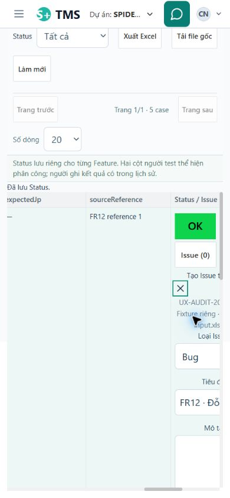

# Audit UI/UX toàn hệ thống — 19/10/2026

Trạng thái: **DOCUMENTED_WITH_EXPLICIT_GAPS — có lỗi cần sửa, chưa nghiệm thu toàn bộ UI**. Đợt này chỉ audit; không sửa ứng dụng, không triển khai kế hoạch bên dưới.

Tài liệu đi cùng: [ma trận kiểm kê/coverage](2026-10-19-uiux-system-coverage.md), [kế hoạch sửa theo finding](2026-10-19-uiux-system-repair-plan.md).

## Kết luận dựa trên bằng chứng

Ứng dụng đã có nhiều luồng hoạt động thật: phân công dải case, vòng Status, tính tiến độ với P/NA, tạo Issue từ case, Dev ghi chú Issue, PM lưu Note và báo cáo. Tuy nhiên, **chưa đủ điều kiện khẳng định tất cả nút và chức năng đều hoạt động**. Có lỗi chặn thao tác quan trọng ở hộp Issue; một số đường phục hồi lỗi, giữ nháp và điều hướng chưa hoàn chỉnh. Đây là vấn đề về hành vi và cách ghép component, không chỉ khoảng cách hay màu sắc.

Danh mục chính gồm **14 finding: 2 P1, 11 P2, 1 P3**. Trong đó 11 có quan sát browser liên quan, 1 được xác nhận bằng API + source nhưng browser upload chưa thực hiện được, 2 là khoảng cách UI với hành vi/quyền đã có ở server. Mỗi finding giới hạn kết luận theo đúng bằng chứng, không có nghĩa mọi biến thể của finding đã được chạy. Ngoài ra có **12 nhóm rủi ro/chưa tái hiện** được tách riêng; không cộng vào 14 lỗi như thể đã xảy ra trên dữ liệu thật. Không phát hiện P0 trong phạm vi đã kiểm; đây không phải chứng nhận không tồn tại P0 ngoài phạm vi đó. UX-014 được bổ sung trong lượt đối chiếu quyền cuối, sau bản nháp danh mục 13 mục.

Ba vấn đề nên sửa trước:

1. **UX-001:** hộp tạo/xem Issue dùng CSS phụ thuộc ancestor cũ. Trên route mới nó thành nội dung thường dưới danh sách hoặc ngay trong ô bảng; nút và nội dung bị khuất.
2. **UX-002:** lưu trữ dự án vẫn yêu cầu hoàn tất đợt kiểm thử/retest cũ dù UI và public write API của luồng đó đã ngừng. Admin cần cơ chế ngoại lệ được kiểm soát theo quyết định mới của người dùng.
3. **UX-003/004:** Note gặp 409 không có đường retry giữ nháp hữu dụng; nháp báo cáo mất khi chuyển màn và quay lại.

Không gọi các lỗi này là “hồi quy do commit X”: chưa có so sánh trước/sau đủ để xác định thời điểm phát sinh. Chúng là lỗi/gap đang tồn tại trong source và runtime được đối chiếu ngày audit. Nhận định “không còn P1/P2” trong review trước chỉ thuộc phạm vi review trước; danh mục mới này là checkpoint mở bổ sung.

## Phạm vi, môi trường và cách lấy bằng chứng

Đã đọc AGENTS/RTK, planning README/STATUS/execution guide/development-skills, FixReports, clarification, implementation plan và các checkpoint cuối của implementation/UI follow-up. Quyết định mới trong clarification được ưu tiên so với workflow cũ. Không có PRODUCT.md/DESIGN.md hoặc tài liệu design system riêng được tìm thấy trong repository; dùng hệ thống component, tokens và CSS hiện hữu làm chuẩn, giữ bản sắc teal và bảng quản trị có mật độ vừa phải.

| Hạng mục | Kết quả xác định trong đợt này |
| --- | --- |
| Workspace/nhánh | `D:\DCN\KTN_11235645_DoCamNhung`, `system-design`, HEAD `caf075af7231f207259b6a62808bff5c8445f6af`; có nhiều thay đổi chưa commit từ trước. HEAD không đại diện đầy đủ working tree |
| Main | `localhost:5173` / `127.0.0.1:5173` → backend 8080, native MySQL 3307/schema `tms`, Flyway V33, health UP khi lấy baseline; chỉ đọc dữ liệu nghiệp vụ |
| Thử ghi | `127.0.0.1:5174` →8081, schema cô lập `tms_docstest_2060e04c986c`, V33. Dùng danh tính/dự án giả đã có và fixture audit riêng |
| Source/runtime | Sourcemap của AppEntry và AppRouter từ cả 5173/5174 khớp local; immutable jar 8081 khớp SHA manifest. Đây là bằng chứng xác định các điểm vào và artifact, không phải chứng minh từng module backend khớp từng dòng working tree |
| Browser | Chrome thật qua CUA extension; một người điều khiển browser. Ba reviewer chỉ đọc source, không chạy browser song song |
| Viewport | Preview thực đo 320,390,768,1440 CSSpx; Chat thêm 320×568. Main có origin zoom riêng, default thực đo khoảng 1381×862. Không thay browser zoom; tên ảnh không thay thế số đo JSON |
| Input | Chuột, double click, chọn native select, nhập/paste, Tab/Enter/Escape và cuộn đại diện; không giả là physical touch hoặc screen reader |
| API | GET main readiness; isolated summary/download/capabilities/role denials. Setup import và Note competing-write riêng được ghi rõ là API, không phải browser E2E |

Bằng chứng runtime/source: [environment.json](../../var/uiux-audit-2026-10-19/environment.json), [baseline.json](../../var/uiux-audit-2026-10-19/baseline.json), [browser ledger](../../var/uiux-audit-2026-10-19/browser-ledger.json), [HTTP read proof](../../var/uiux-audit-2026-10-19/http-read-proof.json). JSON geometry ghi controls có bounding box; một control nằm trong scrollport nhưng ngoài phần đang nhìn thấy không tự chứng minh không thể truy cập.

Kiểm kê có **92 mục route/biến thể/shared component/adapter**, không phải 92 màn hình độc lập. Ma trận ghi nguồn, quyền, controls, states và trạng thái cho từng mục; các mục chưa chạy browser vẫn hiện rõ. Mẫu chọn theo cấu trúc khác nhau: AdminFormDialog, ex-modal, td-case-dialog và d-modal Issue được đánh giá riêng. Không suy một hộp đúng thành mọi hộp đúng, hoặc một role đúng thành bốn role đúng.

## Danh mục finding

| ID | Mức | Nhóm | Vấn đề | Mức bằng chứng |
| --- | --- | --- | --- | --- |
| UX-001 | P1 | visual/interaction/responsive/accessibility | Issue Modal mất layout khi dùng ngoài ancestor cũ | Browser 390/768/1440 + computed styles + source + independent review |
| UX-002 | P1 có điều kiện | interaction/data-state/content | Archive readiness yêu cầu hoàn tất workflow đã ngừng | Main GET/modal chứng minh có gate; source chứng minh writes 410; chưa archive thành công/thất bại thực tế |
| UX-003 | P2 | data-state/interaction | Tải lại Note sau 409 không phục hồi phiên bản editor | Browser với hai writer riêng + API fixture + source |
| UX-004 | P2 | data-state/interaction | Nháp báo cáo mất khi rời route | Browser away/back + textarea.value + source |
| UX-005 | P2 | content/API contract | Preview Excel dùng sai tên field ID nguồn | API response thật + source; browser preview NOT_RUN |
| UX-006 | P2 | navigation/data-state | Filter Issue mất khi reload; link thiếu project identity | Browser filter reload + source; copied-link sau đổi project chưa tái hiện |
| UX-007 | P2 | interaction | Trước/Tiếp trong chi tiết case luôn bị khóa | Browser file 60 case + caller/source |
| UX-008 | P2 | accessibility/interaction | Popover Issue không có đường focus trực tiếp từ trigger | Tab/blur thực + portal/source |
| UX-009 | P2 gap UI | interaction/content | Không có lối xem lịch sử thay đổi phân công | Full active caller search + API/storage source; dữ liệu không bị mất |
| UX-010 | P2 | permission/content | Admin vẫn mở form ghi trên dự án đã lưu trữ | Main browser mở form không lưu + backend source từ chối 409 |
| UX-011 | P2 | content/contract | Rules còn dạy/publish contract Bug cũ | Main Admin đọc existing DEMO + independent source review |
| UX-012 | P2 | content/data-state | Filter Feature và bảng tiến độ dùng phạm vi khác nhưng không ghi rõ | Browser PM + summaryAPI; công thức 3/5 đúng |
| UX-013 | P3 | content/permission | Lý do Status disabled quy tất cả về quyền/phân công | Pending browser + source title/disabled branches |
| UX-014 | P2 gap UI | permission/interaction | PM được cấp quyền tạo Tester nhưng không có entry/form để dùng quyền | Full active caller search + spec/API/guard source + independent review; browser NOT_RUN |

### UX-001 — Hộp Issue trở thành nội dung thường, bị cắt hoặc nằm dưới danh sách

**Vị trí/điều kiện:** `/issues` → Ghi lỗi monkey; `/board`, `/board/list`, `/board/issue/:id` → chi tiết/expand; document grid → tạo Issue từ case. A/P/T/D tùy capability. Preview 5174; trực tiếp quan sát monkey 768×1024, case-create 390×844 và detail/comment 1440×900.

**Tái hiện:** mở Quản lý lỗi; bấm Ghi lỗi monkey; chọn Feature. Hoặc Tester mở file giả 267, case 1 → tạo Issue. Xem vị trí tiêu đề, form và nút lưu. Trong detail bấm phóng to.

**Expected:** modal/drawer có khung và lớp nền đúng, nội dung cuộn trong vùng giới hạn, heading/actions truy cập được; expand thay đổi kích thước. **Actual:** backdrop và panel `position:static`. Monkey bắt đầu sau bảng ở y≈744.8; nút lưu y≈1583.6 trong viewport cao 1024. Case-create bị đặt trong ô bảng, panel rộng≈131.2 px, x≈296..427 vượt viewport 390; body đã khóa cuộn. Expand đổi class nhưng panel vẫn rộng 536 px ở 768 px, không trở thành màn hình mở rộng. Một số thao tác hoàn thành được bằng keyboard workaround; không kết luận “không bao giờ lưu được”.

**Nguyên nhân đã xác nhận:** `Frontend/src/app/features/work-items/components.jsx:189` xuất `.d-modal*`, nhưng layout trong `work-items.css:1455`/`work-items-live.css:52` đòi ancestor `.work-items`; current `FeatureIssuesPage.jsx:37` và document route không có ancestor đó. Expanded selector tại `Frontend/src/app/styles/work-board.css:253` còn đòi `.dashboard-board.work-items`. Không phải thiếu import CSS đơn thuần. Các lỗi create/detail/expand này tính **một nguyên nhân**, không nhân thành nhiều P1.

**Bằng chứng:** [computed position](../../var/uiux-audit-2026-10-19/issue-modal-computed.json), [monkey geometry](../../var/uiux-audit-2026-10-19/monkey-dialog-768.json), [independent review](../../var/uiux-audit-2026-10-19/independent-testing-review.md).

**Ảnh hưởng/hướng sửa:** phá hành trình ghi/xem Bug/QA và che actions. Cho Modal sở hữu scope/layout độc lập, đánh giá portal nếu cần thoát clipping của grid; kiểm lại mọi caller cũ/mới, layer và focus. Không sửa bằng global `.d-*` tràn lan. **Nghiệm thu:** ba entry create/detail/monkey, expand, long content ở 320/390/768/1440 và low-height; actions truy cập được, background lock chỉ khi overlay thực sự hiển thị, Tab/Escape/return focus đúng; zoom 200% cần kiểm thêm bằng công cụ phù hợp.

### UX-002 — Lưu trữ dự án bị buộc hoàn tất đợt/retest cũ không còn đường thao tác

**Vị trí/role:** Admin → `/admin/projects/:id` → Kiểm tra lưu trữ, main 5173 default. **Tái hiện an toàn:** mở readiness của project 1 hoặc 3, không xác nhận lưu trữ. Project 1 có `UNFINISHED_CYCLES:2` cùng máy/công việc; project 3 có `UNFINISHED_CYCLES:3`, `OPEN_RETESTS:2` cùng công việc. UI hướng dẫn hoàn tất các luồng cũ.

**Expected:** tồn cũ được giữ lịch sử và có cách xử lý được hỗ trợ theo policy hiện tại. **Actual:** readiness vẫn bắt buộc hoàn tất chúng, trong khi `/tests/**` chỉ dẫn tới Feature; `LegacyTestingWrites` chặn public mutations cũ bằng 410. **Không kết luận bỏ gate cũ là hai project này lập tức archive được**: còn blocker độc lập. Chưa tạo fixture chỉ có một legacy blocker để chứng minh exclusive causation; không submit archive trên main.

**Quyết định người dùng trong đợt audit:** “**Admin xác nhận ngoại lệ có lý do**”. Phạm vi là đợt kiểm thử/retest cũ đang chặn; không tự suy thành quyền bỏ qua máy đang bàn giao, Issue hiện hành hoặc mọi blocker. Source/plan phải lưu actor, lý do, thời điểm, blocker được ngoại lệ và lịch sử nguyên vẹn. File session cũ và những loại blocker chưa được xác nhận cần phân loại trước khi mở rộng ngoại lệ.

**Nguồn:** `Backend/src/main/java/vn/syp/tms/admin/ProjectLifecycleService.java:34`, `Frontend/src/app/features/admin/AdminProjectLifecycle.jsx:8`, `LegacyTestingWrites.java:26`. [Main dialog](../../var/uiux-audit-2026-10-19/main-archive-readonly.json), [GET proof](../../var/uiux-audit-2026-10-19/http-read-proof.json), [review độc lập phân loại blocker](../../var/uiux-audit-2026-10-19/independent-admin-review.md). Ảnh main-archive crop sai do tọa độ/zoom, **không dùng làm bằng chứng visual**.

**Nghiệm thu:** disposable project có cycle/retest cũ → Admin xem rõ blocker, nhập lý do và xác nhận ngoại lệ → archive/reopen được, lịch sử cũ không đổi; thiếu lý do, không phải Admin, stale version và blocker hiện hành vẫn xử lý đúng. Không mở lại UI chạy đợt/retest đã bỏ, không force-complete/migrate hàng loạt chỉ để vượt gate.

### UX-003 — Note 409 giữ nháp nhưng “Tải lại Note” không cho lưu lại hữu dụng

**Vị trí:** `/settings/notes`, PM dự án 156, preview 768×1024. **Tái hiện:** mở sửa Note 9 phiên bản 0 của fixture, nhập nháp A; phiên API riêng cập nhật Note 9 phiên bản 1; Save →409; bấm Tải lại Note; đợi list cập nhật; Save →409 lần nữa. Nháp vẫn có, list đã hiển thị nội dung phiên khác.

**Expected:** xem/đối chiếu bản mới với nháp và retry có chủ đích. **Actual/nguyên nhân:** `ProjectNotes.jsx:29,42,46` giữ `editor.note.version` cũ, reload chỉ thay list. Không có thao tác so sánh rồi submit version mới mà giữ nháp; phải Hủy/mở lại và tự sao chép. Server từ chối stale version là đúng, không phải lỗi cần bỏ kiểm version. Finding chỉ chứng minh edit 409, không suy delete 409 có cùng lỗi.

**Bằng chứng:** [hai lần lỗi](../../var/uiux-audit-2026-10-19/note-conflict-proof.json), [competing write](../../var/uiux-audit-2026-10-19/note-competing-journal.json), [ảnh/editor sau reload](../../var/uiux-audit-2026-10-19/note-conflict-after-reload-768.jpg).

**Sửa/AC:** dùng seam đọc Note mới sẵn có, hiển thị bản server và nháp, explicit reviewed retry; không tự tăng version để ghi đè. Hai writer, thay đổi tiếp lần 3, Note bị xóa/mất quyền và chuyển project phải giữ đúng nháp/scope, báo bước tiếp theo đúng.

### UX-004 — Nháp báo cáo bị mất khi rời Tổng hợp & Phân tích

**Vị trí:** `/analysis`, PM 156, preview 1440×900. **Tái hiện:** nhập Markdown giả chưa lưu, bấm Tổng quan ở sidebar rồi quay lại Analysis. **Expected:** giữ nháp theo tài khoản/project/report hoặc hỏi discard trước khi mất. **Actual:** không cảnh báo, textarea.value trở về rỗng; đã kiểm bằng DOM property, không dùng attribute value làm kết luận.

**Nguồn/cause:** `ManagementAnalysisPage.jsx:25,33,53` chỉ guard một số hành động nội bộ; route/project navigation ở App/ProjectSelector unmount local editor. Browser mới chứng minh route away/back; project A→B→A và refresh là source risk cùng lifetime, chưa thực thi riêng. [Property proof](../../var/uiux-audit-2026-10-19/report-draft-property-proof.json), [ảnh](../../var/uiux-audit-2026-10-19/report-draft-lost-1440.jpg).

**Sửa/AC:** draft owner theo account/project/report và policy thoát nhất quán; không autosave vào dữ liệu nghiệp vụ. Away/back và A→B→A không mất hoặc lẫn nháp; save thành công clear dirty, save lỗi giữ nháp; account khác không lấy được text tài khoản trước. Refresh/close được chọn và kiểm riêng.

### UX-005 — ID nguồn trống ở preview Excel do contract không khớp

**Role/state:** A/P nhập single/batch; isolated API preview 267, workbook 5 case có ID 1–5. **Tái hiện có thể bàn giao:** import vào Feature → Xem trước → đọc ID nguồn. Browser bước chọn file đã mở nhưng setFiles bị tool từ chối; **chưa nhìn preview trong Chrome**.

**Expected:** ID nguồn đối chiếu đúng Excel. **Actual từ API+source:** API trả `caseNo`; `ExcelImportPreview.jsx:44` đọc `r.sourceCaseKey`; wrapper không chuyển field. [Response/key list thật](../../var/uiux-audit-2026-10-19/import-preview-contract.json). `FeatureService.java:160` là nơi alias SQL hiện tại. Đây là mất thông tin kiểm tra trước import, không bằng chứng mapping commit sai hoặc dữ liệu nguồn hỏng.

**Sửa/AC:** một contract/adapter chuẩn, test với response thực của Feature endpoint và IDs số/chữ/Unicode phân biệt; single/batch/errors view hiển thị đúng ID, không đổi identity hoặc mẫu đã hỗ trợ. Browser import/roundtrip vẫn cần hoàn tất khi công cụ upload hoạt động.

### UX-006 — Filter Issue không bền qua reload; URL không giữ project identity

**Vị trí:** `/board/list`, `/issues`, detail `/board/issue/:id`, mọi reader nhiều project. Preview 768/1440. **Browser tái hiện:** lọc Feature 261 và keyword UX-AUDIT; URL vẫn chỉ page/size; reload→Feature và keyword rỗng. [Before/after](../../var/uiux-audit-2026-10-19/issue-filter-reload.json).

**Expected:** refresh/back/copy link duy trì context thích hợp. **Actual/source:** `FeatureIssuesPage.jsx:30–31,48` state filters/page phần lớn local; URL tạo mở/đóng Issue bỏ projectId. ProjectProvider chọn theo query hoặc project lưu của tài khoản. Copied URL sau đổi stored project có thể gọi Issue dưới project khác và 404; **chưa tái hiện riêng scenario đó**, không kết luận lộ dữ liệu. Ảnh tên `issue-detail-context-loss-768` thực tế vẫn đúng project tại thời điểm mở; không dùng tên ảnh để nâng bằng chứng.

**Sửa/AC:** route builder giữ projectId + filter/page/view; deliberate sync URL/back/reload. Dùng hai project fixture, mở copied link khi project khác đang chọn vẫn trở về đúng project/Issue hoặc từ chối rõ; không hiện frame dữ liệu cũ và không mở rộng quyền.

### UX-007 — Trước/Tiếp trong chi tiết case luôn disabled

**Vị trí:** document → bấm ID case; Admin preview 390×844, file 155 có 60 case. **Tái hiện:** mở case 1, Tiếp bị khóa; source cho thấy mọi vị trí đều như vậy. **Expected:** nếu hiển thị navigation thì đi được tới case kế bên; chỉ khóa ở biên hoặc bỏ navigation không hỗ trợ. **Actual/cause:** `TestingDocumentPage.jsx:58` không truyền callbacks mà `DocumentCaseDialog.jsx:12` luôn render hai nút disabled khi callback thiếu.

[Browser snapshot/geometry](../../var/uiux-audit-2026-10-19/case-detail-390.json), [review bác bỏ suy đoán footer](../../var/uiux-audit-2026-10-19/independent-testing-review.md). Đây là lỗi caller/navigation, khác UX-001. Rect footer ngoài viewport có thể nằm trong body overflow:auto; chưa có bằng chứng footer không cuộn được nên không thêm lỗi clipping.

**Sửa/AC:** nối navigation theo thứ tự filtered/current data, xử lý biên/trang và contextStatus, hoặc bỏ nút khi không hỗ trợ. Kiểm đầu/giữa/cuối, filter, close/return focus; không khôi phục màn chạy test cũ chỉ để lấy callback.

### UX-008 — Popover Issue mở theo focus nhưng không dẫn keyboard vào nội dung

**Vị trí:** document caseIssue trigger, Tester preview 390×844. **Tái hiện:** Tab tới Issue(1) → popup mở; Tab tiếp→Lịch sử Status, popup đóng sau blur trước khi focus vào các link/action trong popup. `aria-expanded=true` nhưng chưa có aria-controls. [Chuỗi focus](../../var/uiux-audit-2026-10-19/issue-preview-keyboard.json).

**Expected:** có đường bàn phím dễ tìm, ổn định từ trigger tới Issue/create/paging rồi quay lại. **Cause xác nhận:** portal ở cuối body + không chuyển focus/keyboard action; `CaseIssueAction.jsx:19,27–33`. Không khẳng định mọi hành động hoàn toàn không thể tới bằng Tab cả trang hay tuyên bố đã chứng nhận fail WCAG toàn hệ thống.

**Sửa/AC:** thiết kế keyboard entry/relationship rõ, Escape/return focus; không phụ thuộc timing/hover; thử middle-row có nhiều row, đúng Feature/doc/row, chuột và keyboard; touch cần kiểm bổ sung. Eager requests mỗi row là rủi ro R09 riêng, không gộp hiệu năng chưa đo vào severity finding này.

### UX-009 — Lịch sử phân công có ở server nhưng không có entry UI

**Vị trí/role:** grid/file/case assignment, mọi reader có quyền. C03 giữ first/latest assignee **và lịch sử thay đổi**; tên assignee không phải bằng chứng người thực thi. **Bằng chứng source:** `featuresApi.history`/FeatureController assignment-history có sẵn; `FeatureService.java:195,209` lưu/đọc actor,time,previous/new membership. Full active source search không thấy consumer; UI chỉ mở Lịch sử Status.

**Expected:** người quản lý có thể xem các lần A→B→C và ai phân công; **Actual:** chỉ first A/latest C, không có đường xem B trong UI hiện hành. Đây là UI access gap, không phải mất history hoặc thiếu backend. Browser chưa tạo A→B→C và mở timeline vì entry chưa tồn tại. [Review độc lập](../../var/uiux-audit-2026-10-19/independent-admin-review.md).

**Sửa/AC:** action lịch sử trong context file/case dùng endpoint hiện có, hiển thị tên có nghĩa kể cả membership cũ, actor khác assignee, time/version/before/after; cursor/retry/archive read đúng quyền. Vị trí action là lựa chọn UI, không có quyết định đã chốt bắt buộc thêm cột mới hoặc workflow retest.

### UX-010 — Form ghi vẫn mở cho Admin trên dự án đã lưu trữ

**Tái hiện:** main Admin → `/board/testing?projectId=11&workspace=1`; banner chỉ đọc hiện nhưng Tạo Feature enabled, bấm mở form được. Không nhập/lưu. [Artifact](../../var/uiux-audit-2026-10-19/main-archived-create-enabled.json).

**Expected:** active/readonly state thống nhất, không mời nhập form chắc chắn bị backend từ chối. **Actual/cause:** `TestingFeaturesPage.jsx:19` và `TestingFeaturePage.jsx:19` dùng ADMIN-or-helper nên bypass project archived ở nhánh Admin; server `FeatureService.writer:36–40` vẫn 409. Không có bằng chứng quyền Admin bị mất ở project active hoặc có privilege escalation.

**Sửa/AC:** project active phải bao ngoài điều kiện ADMIN/PM hoặc capability từ server được dùng thống nhất. Admin/PM của dự án đã lưu trữ đọc/export/history được, không cho phép create/import/edit/hide; reopen→quyền đúng trở lại. Bảo toàn toàn quyền Admin trên project active, không yêu cầu membership.

### UX-011 — Rules còn mô tả/publish mô hình Bug cũ không được Issue hiện tại áp dụng

**Điều kiện:** `/settings/rules`, main Admin, project 1 có ruleset INTERNAL_DEMO. Empty fixture 156 chỉ có nút tạo, không hiện cùng paragraph. Reader không có form không bị quy là đã thấy toàn bộ nội dung này.

**Tái hiện đọc:** mở existing DEMO Rules với PM/Admin; form nói bắt buộc build/môi trường/thiết bị, liên kết case/lần chạy và ngoại lệ PM; nội dung thông báo publish nói áp dụng cho Bug mới. **Expected:** hướng dẫn/policy UI đúng Feature Bug/QA hiện tại hoặc được gắn nhãn lịch sử, không áp dụng hiện tại. **Actual:** payload và `InternalRulePolicy` vẫn yêu cầu contract cũ; DTO/service của Feature Issue hiện tại không dùng rule đó. Chỉ sửa câu chữ client bỏ field có thể làm request lưu không hợp lệ; cần xử lý cả contract/phạm vi publish.

**Nguồn:** `RulesPanel.jsx:5,30–37`, `InternalRulePolicy.java:11,29`, `FeatureIssueService.java:120–140`. [Quan sát tối thiểu main](../../var/uiux-audit-2026-10-19/main-rules-observation.json), [review chain cũ410](../../var/uiux-audit-2026-10-19/independent-admin-review.md). Không publish hoặc ghi main. Không nói Bug hiện tại thực sự bị gate build/device vì màn Rules này.

**Sửa/AC:** giữ lịch sử DEMO; phân biệt policy lịch sử với phần áp dụng hiện hành; action publish không hứa tác dụng chưa triển khai. Menu/deep link/reader/PM/Admin/copy/payload cùng nghĩa, không khôi phục prerequisite/run đã bị yêu cầu bỏ.

### UX-012 — Filter Feature không diễn giải rõ bảng đang so sánh toàn dự án

**Vị trí:** Analysis PM 156,1440×900. **Tái hiện:** chọn Feature 261. Metric 3/5=60%, Bug 1 đúng scope, nhưng bảng Feature vẫn 5 row của mọi Feature; heading chỉ “Tiến độ theo Feature”. **Expected:** mọi khối nói rõ áp dụng filter nào. **Actual/cause:** `ManagementReportService.java:34–39` trả toàn catalog để làm dropdown; `ManagementAnalysisPage.jsx:85,107` dùng mảng đó làm table không nhãn phạm vi. Không phải lỗi công thức P/NA.

[Ảnh](../../var/uiux-audit-2026-10-19/analysis-feature-scope-1440.jpg), [API summary](../../var/uiux-audit-2026-10-19/http-read-proof.json). **Sửa/AC:** giữ catalog dropdown nhưng table theo Feature đang chọn, hoặc gắn heading rõ là so sánh toàn project không áp dụng filter. Hai Feature có số liệu khác nhau, whole/specific/empty; summary, Issue, AI proposal và báo cáo đã lưu scope phải đúng và dễ nhận biết.

### UX-013 — Lý do khóa Status không phản ánh đúng trạng thái

**Vị trí:** document grid, Tester A đã được giao,390×844; quan sát ngay lúc lưu một Status. **Actual:** các button tạm disabled; caller luôn truyền lý do cần phân công/PM/Admin dù `disabled` còn do pending,error,loading,archive. `ResultCycleButton` chủ yếu đặt lý do ở title. Source `TestingDocumentPage.jsx:39,55` và `ResultCycleButton.jsx:12–14` xác nhận các nhánh bị gộp.

**Expected/sửa:** nêu đang lưu, cần tải lại sau lỗi, trạng thái lưu trữ chỉ đọc hoặc thiếu phân công đúng nguyên nhân; nơi cần phải đọc được không chỉ hover disabled. [Pending capture](../../var/uiux-audit-2026-10-19/tester-status-390.json). **AC:** mock/browser test từng lý do, tài khoản manager không bị nhắc xin quyền đã có; vòng Status và quyền server giữ nguyên.

### UX-014 — PM đã được cấp quyền tạo Tester không có nơi thao tác

**Điều kiện/role:** PM có capability `users:create` do Admin cấp riêng; không áp dụng cho mọi PM. AGENTS và `docs/business/permissions.md:75,86–93` vẫn cho PM được cấp tạo TESTER, tách khỏi quyền quản lý membership hoặc toàn bộ Admin. Clarification mới không hủy quyền này.

**Tái hiện dự kiến, BROWSER_NOT_RUN:** đăng nhập PM có quyền, mở menu tài khoản thấy “Được cấp quyền tạo tài khoản Tester”; tìm entry tạo Tester không có; đi `/admin/users` bị guard Admin chặn. Không tạo hoặc cấp quyền tài khoản nào chỉ để xác nhận finding trong audit này.

**Expected:** capability đã được cấp có điểm mở form sử dụng được, giới hạn TESTER. **Actual/cause từ source:** `AccountMenu.jsx:21` chỉ hiển thị thông báo. Full search `Frontend/src` cho thấy chỉ `AdminUsers.jsx:21` gọi `adminApi.createUser`; route bị `AdminApp.jsx:19` chặn PM, không có entry thay thế trong router/sidebar. Backend `IdentityService.java:26–29,59–63` và `SecurityConfig.java:53–55` vẫn cho POST được ủy quyền, đồng thời giới hạn GET/PATCH và role được tạo. Đây là gap nối capability với UI; không phải backend từ chối sai hoặc lỗi hồi quy đã được xác định thời điểm.

**Bằng chứng:** [review độc lập capability/caller](../../var/uiux-audit-2026-10-19/independent-identity-review.md). Biến thể PM được cấp đã được kiểm kê trong account menu AG-I02; không phát minh thêm một màn đang hoạt động để tăng số mục inventory.

**Sửa/AC:** điểm mở form theo capability, role TESTER cố định và backend vẫn enforce; không mở danh sách/khu Admin cho PM, không cho tạo ADMIN/PM/DEV hoặc tự thêm membership. PM chưa cấp, TESTER/DEV không có action; thu hồi quyền khi form đang mở, validation/duplicate/network error giữ nháp và giải thích đúng. Kiểm API/form bằng fixture cô lập khi được giao triển khai; không thêm quyền để vượt thiếu UI.

## Rủi ro source và phần cần tái hiện trước khi nâng kết luận

Các hàng dưới là **SOURCE_RISK / chưa tái hiện đầy đủ**. Mức ưu tiên là triage dự kiến, không phải số lỗi browser được xác nhận.

| ID | Cơ chế/source | Ảnh hưởng có thể có và phép kiểm còn thiếu |
| --- | --- | --- |
| R01 | Issue Modal callers không truyền trạng thái busy/dirty của form con; monkey đổi Feature unmount form. Admin/Feature/assignment/cell đóng idle cũng hủy state cục bộ | Đã quan sát Admin create nhập text→Escape→mở lại trống; thao tác Hủy chủ động có thể hợp lý. Chưa slow-write/uncertain commit. Cần dirty/pending close policy theo từng form, không quy mọi thao tác Hủy là bug |
| R02 | `DocumentAssignments.jsx:30` reload mới chỉ cập nhật version/key, không hiển thị `latest.items`; chọn range dựa snapshot row cũ | Cần hai writer gây 409, hiển thị ownership mới và draft; chưa chứng minh đã ghi đè công việc người khác |
| R03 | `useTestingQuery.load` bắt lỗi đọc và resolve; onSaved có thể close sau khi ghi thành công nhưng refresh thất bại | Có lỗi đọc nhưng không nói rõ đã ghi thành công; cần giả lập GET thất bại sau request ghi thành công, kiểm đúng một request ghi và retry chỉ đọc |
| R04 | Feature/file/device list không clamp mọi page sau archive/hide/return | Cần fixture ở trang cuối; có Previous để phục hồi, không gọi toàn bộ danh sách là ngõ cụt |
| R05 | File “Xóa khỏi danh sách” lưu trữ mềm ngay, thiếu xác nhận/undo/lối khôi phục trong UI đang hoạt động | Không khẳng định xóa cứng/mất dữ liệu. Chưa bấm ẩn file đang dùng. Cần làm rõ phạm vi thao tác, Hủy và phục hồi theo yêu cầu bảo toàn dữ liệu |
| R06 | AiChat thêm lịch sử cũ vào đầu danh sách, nhưng effect theo turns/busy/outgoing tự cuộn xuống cuối | Cần thread có nhiều trang; chưa đo anchor. Không lấy lịch sử trống để nói bug đã xảy ra |
| R07 | AiChat bắt lỗi GET khi mở lại, gộp lỗi tạm thời với từ chối quyền và xóa turns | Cần NETWORK/503 một lần→retry cùng thread;403/404 vẫn phải xóa nội dung riêng tư; không sửa thành giữ nội dung bất chấp quyền |
| R08 | Tạo báo cáo thủ công không có intent key; đã ghi thành công nhưng mất response rồi retry có thể tạo báo cáo khác | Khóa double click có sẵn. Chưa có duplicate thật; cần kiểm thử cô lập việc mất response sau commit/idempotency |
| R09 | CaseIssueAction gọi list ngay mỗi row; tối đa 100 row đang hiển thị thì có thể 100 request list | Số request tăng theo row trong source đã xác nhận, latency/waterfall/ảnh hưởng production **NOT_MEASURED**; ưu tiên đo rồi mới chọn batch/cache/lazy |
| R10 | Chuỗi dài không khoảng trắng có thể spill; vị trí popover chỉ tính lúc mở | Cần URL giả dài + cuộn ngang/dọc/resize. Không coi overflow source là lỗi visual đã đo |
| R11 | caseId hợp lệ nhưng không có row có thể không báo; absent/deep link sai cú pháp có nhiều nhánh | Chưa thử ID hợp lệ đã cũ runtime; router kiểm tra cú pháp trong source có; cần thông báo và phục hồi ngữ cảnh |
| R12 | Handbook focus khi thêm phiên bản/project dropdown lồng trong modal Admin/chat kết hợp modal cần kiểm keyboard | Source đủ đưa vào khoảng trống coverage; chưa có fixture có nhiều phiên bản và chưa kiểm đầy đủ thứ tự Tab; không kết luận focus trap hỏng chỉ từ role=dialog lồng nhau |

Đề xuất tùy chọn, chưa coi là bug: đồng nhất token cho các bề mặt cùng ý nghĩa sau khi đo; tối ưu toolbar 390 nhưng giữ yêu cầu controls ở trên và dưới chỉ cuộn case; bổ sung bar ở danh sách file nếu đối chiếu xác nhận tiến độ dạng text chưa đáp ứng cách trình bày đã chốt. Không thay palette/font/spacing toàn cục hoặc bỏ Kanban chỉ vì hai view cùng dữ liệu: Kanban 1440 đã thể hiện cột status, list là table, có mục đích khác nhau.

## Đánh giá đủ 14 nhóm checklist

| Nhóm | Kết quả và tác động | Giới hạn còn lại |
| --- | --- | --- |
| 4.1 Design system/tỷ lệ | Dùng component/token hiện có; form Admin 320 rộng 296 px, Issue từ case 390 chỉ 131.2 px chứng minh mismatch cấu trúc UX-001; không áp số spacing tùy ý | Chưa đo mọi margin/gap/border ở mọi state; detector không thay đánh giá giao diện |
| 4.2 Typography/text | Tiếng Việt/narrative/Markdown giả đã hiển thị; chú thích UX-011/013 sai nghĩa. Cỡ token chữ 12/13/15/18 px trong source tương ứng caption/body/section/title | Tên dài/URL không ngắt, tăng cỡ chữ, mọi ellipsis và biên ngày theo timezone còn thiếu;02:08 của fixture đã đối chiếu đúng UTC→Việt Nam, không phải lỗi |
| 4.3 Button/icon/link | Có bằng chứng vòng Status 5 click, tạo Issue, Dev ghi chú, lưu Note/báo cáo, phục hồi từ NotFound và login/logout. UX-007 có nút disabled và UX-010 có affordance sai trạng thái | Handover/member-save và nhiều destructive/pending/retry state chưa bấm lại; xem ma trận |
| 4.4 Form/input | Note 409 giữ text nhưng stuck; nháp báo cáo mất; cell doubleclick mở đúng editor; Unicode/Markdown an toàn | IME trên browser thật/bàn phím ảo chưa; Chat IME có mock test; validation mọi form không được suy từ label trong source |
| 4.5 Modal/drawer | Bốn cấu trúc modal được kiểm riêng. UX-001 và R01; Admin/modal khác không cùng nguyên nhân gốc | Chưa đủ kiểm tra focus trap lồng nhau, cuộn body chi tiết case xuống cuối và nhiều overlay đồng thời |
| 4.6 Dropdown/popover | Native Feature select/chọn project đã dùng; UX-008 Tab/blur thực | Chưa đủ touch, menu dài, cập nhật anchor khi cuộn và picker lồng nhau |
| 4.7 Tables/grid | Cuộn bảng 390/768/1440 có vùng riêng; header/Status, badge Issue của case và phân công range đã quan sát | Không đủ checkbox xuyên trang, mọi biến thể sorting, file rất lớn và trang cuối thu hẹp; UX-005/007/009 |
| 4.8 Colors/states | Giữ palette người dùng; Status có chữ + màu; legend báo cáo không chỉ dựa vào màu. Đã đọc computed foreground/background | Chưa thực hiện kiểm kê contrast đầy đủ/disabled/focus/selected compositing; không kê lỗi từ phỏng đoán |
| 4.9 Dashboard/progress | Fixture 5 case: OK 1/P1/NA 1/U 2→tested 3/5=60, NA trong mẫu số; UI nói 100% không là nghiệm thu. UX-012 có phạm vi lẫn nhau | Không kiểm mọi aggregates/dự án main thực tế hoặc mọi filter/trạng thái rỗng và 0 độc lập |
| 4.10 Navigation | Unknown→overview hoạt động; retired/tests giải thích Feature. UX-006 filter/reload, UX-002 còn yêu cầu luồng cũ | Copied Issue link sau đổi project đã lưu/mọi alias/deep link chưa runtime |
| 4.11 Async/feedback | Note concurrency thật; Chat có mock pending/retry/late owner; key/abort request đọc trong source có; không dùng mock fallback che lỗi thật | Không có network throttle; mất response sau commit/refresh thất bại chỉ được đọc source. Browser upload/download chưa hoàn thành |
| 4.12 Roles | Bốn role theo hành trình; TESTER/DEV summary 403, PM ngoài project 404, DEV document capability false; Admin active không cần membership. UX-014 là gap UI của PM có quyền tạo Tester | Toàn bộ API write theo bốn role, thu hồi quyền trong form và expired session chưa chạy lại browser; UX-014 mới xác nhận source |
| 4.13 Responsive/accessibility | CSSpx 320/390/768/1440 và Chat 320×568; focus popover bằng keyboard thực; accessible labels/semantics đọc | Chưa physical touch/AT/zoom 200%/tăng cỡ chữ/landscape/reduced motion emulation; không chứng nhận WCAG |
| 4.14 Hiệu năng cảm nhận | UI pending/feedback có quan sát; R09 fan-out/R06 scroll được đặt đúng nhóm rủi ro | Không Lighthouse/CLS/LCP/network trace/load test/latency production; không lấy số local phỏng đoán |

Về tiêu chuẩn: SC 2.1.1 yêu cầu chức năng có đường keyboard thích hợp; finding UX-008 là bằng chứng tương tác cần sửa, chưa là đợt đánh giá tuân thủ đầy đủ. [W3C Keyboard](https://www.w3.org/WAI/WCAG22/Understanding/keyboard.html). SC 2.5.8 dùng 24×24 CSSpx kèm ngoại lệ; không áp 44×44 như nghĩa vụ chung và không tuyên nút đóng case 18 px fail trước khi đo spacing. [W3C Target Size Minimum](https://www.w3.org/WAI/WCAG22/Understanding/target-size-minimum.html). Bảng có thể cần cuộn hai chiều; overflow bảng không tự là lỗi reflow. [W3C Reflow](https://www.w3.org/WAI/WCAG22/Understanding/reflow.html). Contrast text thông thường 4.5:1, chữ lớn 3:1 với các ngoại lệ; đợt này không đo hết nên không tuyên contrast PASS/fail toàn bộ. [W3C Contrast Minimum](https://www.w3.org/WAI/WCAG22/Understanding/contrast-minimum.html).

## Những hành trình đã thực thi và phần bị ngắt

| Hành trình | Bằng chứng mới | Kết luận đúng phạm vi |
| --- | --- | --- |
| Login → project → màn theo role | Bốn role fixture, main Admin chỉ đọc; cuối đợt logout session audit | PARTIAL, không gồm hết expired/error/role change |
| Admin → Feature → file → assign | UI tạo Feature 261; API tạo document 267; UI giao 1–3; Tester của fixture cập nhật Status | PARTIAL; **browser import chưa đạt**, phần tạo bằng API được ghi riêng |
| Tester → Status → Issue → về case | U→OK→NG→P→NA→U và đặt OK/P/NA; tạo Issue 7; về document 267 có badge 1 | Luồng cốt lõi có hoạt động, nhưng giao diện modal UX-001 lỗi; chưa bấm lại tự nhận range |
| Issue → Dev xử lý | Dev mở Issue 4 giả được giao, thêm một ghi chú giả thành công | Chưa submit mọi nhánh transition/edit/delete; không gọi toàn bộ luồng Dev là PASS |
| Search/filter/detail/back | Filter board/list, mở detail; reload mất filter | FAIL_UX-006 khi reload; ngữ cảnh copied link chưa kiểm runtime |
| Note | Tạo Note 9 → writer khác sửa →409 → reload →409; giữ nháp | FAIL_RECOVERY_UX-003 |
| Báo cáo | PM tạo report 6, HTML literal/Markdown có javascript không thực thi; HTTP download đúng 140 byte và SHA | Chờ browser download timeout: NOT_CONFIRMED; chưa edit 409/AI proposal |
| Chat | Mở/scope/config/lịch sử trống/thu nhỏ ở 320, chiều cao 568; provider không sẵn sàng có lý do | Live AI/send/probe/OAuth NOT_RUN; mock test không thay provider E2E |
| Admin users/devices/audit | Mở list/create forms/filters/readiness chỉ đọc; không ghi nghiệp vụ lên main | “Lưu thành viên đã chọn”, “Bàn giao máy đã chọn” **chưa thực thi lại** trong audit; không xác nhận đã hết lỗi |

## Kiểm chứng tự động, detector và review độc lập

Đã chạy mới đúng ba file test hiện có bằng `rtk proxy npm.cmd test -- src/app/features/ai/AiChat.test.jsx src/app/features/projects/ProjectNotes.test.jsx src/app/features/reports/ManagementAnalysisPage.test.jsx` tại Frontend: **78/78 test, 3/3 file PASS, exit 0**. [Receipt](../../var/uiux-audit-2026-10-19/focused-tests.json). API trong các file này dùng mock, không gọi live provider/DB thật. **Coverage mới: NOT_MEASURED. Build không chạy lại vì không sửa source; lint/typecheck chưa được cấu hình trong package.** Không biến số 980/645 của đợt trước thành kết quả mới của audit này.

Kiểm tra bảo toàn cuối đối chiếu baseline 2.686 file: **725 file Frontend/Backend/scripts có hash không đổi**, không có thay đổi ngoài tài liệu planning/review và thư mục evidence audit đã xác định. `git diff --check` đạt; các liên kết cục bộ và số cột trong ma trận hợp lệ; không phát hiện chuỗi API key theo mẫu scan trong tài liệu/evidence được quét. Main và schema cô lập vẫn V33, không có migration thất bại; health cả bốn địa chỉ 8080/8081/5173/5174 UP. Đây là kiểm source/artifact và trạng thái cuối, không chứng minh mọi hành vi UI đạt. [Kết quả kiểm chứng cuối](../../var/uiux-audit-2026-10-19/final-verification.json), [biên nhận fixture cuối](../../var/uiux-audit-2026-10-19/fixture-final-receipt.json).

Impeccable Operate: chạy context một lần bằng binary đã cài và offline detector một lần; không init/overlay/inject hoặc đổi cấu hình. Detector trả 12 entry/exit 2; review độc lập phân loại **6 lựa chọn chấp nhận được trên route active, 6 mục thuộc phần đã ngừng hoặc selector không khớp, 0 lỗi mới**. Không gọi 12 warning thành 12 lỗi người dùng. [Detector](../../var/uiux-audit-2026-10-19/impeccable-detector.json), [phân loại từng entry](../../var/uiux-audit-2026-10-19/detector-review.md).

Ba reviewer đọc source toàn module theo phạm vi, có review chéo modal, Note, Rules, archive, contract preview và lịch sử phân công. Đã bác bỏ/thu hẹp các nhận định chưa đủ căn cứ:02:08 không phải lỗi timezone; rect footer ngoài viewport chưa chứng minh clipping; dữ liệu cũ được giữ không tự là lỗi; Rules không chặn Bug hiện tại;100 request theo row không tự chứng minh production chậm. [Review Testing](../../var/uiux-audit-2026-10-19/independent-testing-review.md), [Review Admin](../../var/uiux-audit-2026-10-19/independent-admin-review.md).

## Nguyên nhân chung và hướng sửa có giới hạn

1. **CSS/component ownership:** Modal phụ thuộc ancestor route cũ, nhưng unit test chỉ phủ `.ex-modal` hoặc component không có đúng ancestor của route. Sửa tại ranh giới Modal và kiểm từng caller/layer, không vá CSS global.
2. **Vòng đời state và phục hồi:** nháp/phiên bản editor gắn với instance; tải lại list không tương đương cập nhật editor trên bản mới; guard dirty nội bộ không bảo vệ việc rời route. Giữ nháp đúng tài khoản/phạm vi và làm rõ conflict/kết quả chưa xác định.
3. **Contract không đồng bộ:** tên field preview, contract Rules cũ và archive blocker chưa đồng bộ với luồng Feature. Cần UI/API test cùng hình dạng dữ liệu thực và policy hiện tại; giữ history, không mở lại workflow đã bỏ.
4. **Context/capability:** query của route và điều kiện gộp role trên UI chưa mang đủ project scope/trạng thái lưu trữ. Giữ server enforcement và permission guard; không dùng UI enabled để kết luận quyền server.
5. **Thiếu kiểm tra ngoài luồng thành công:** test hiện có chưa phủ CSS trên route mới, cuộn/focus popover, phục hồi version Note, nháp khi unmount route và mất response sau commit. Khi triển khai kế hoạch, bổ sung test hành vi tại điểm phù hợp, không viết test chỉ để assert một literal CSS.

Thứ tự: Modal/lifecycle → Note/nháp → preview/route/history → keyboard/capability → phạm vi/copy → rủi ro async và hoàn thiện visual có đo. Chi tiết task, file, skill, dependency, risk, test và AC nằm trong [kế hoạch sửa](2026-10-19-uiux-system-repair-plan.md). Kế hoạch này chưa được thực thi.

## Skill đã áp dụng → công việc → bằng chứng

| Skill | Công việc thực sự | Bằng chứng/giới hạn |
| --- | --- | --- |
| using-superpowers | Chọn skill, ranh giới audit và thứ tự ưu tiên yêu cầu | Context/method; không kích hoạt implementation |
| dispatching-parallel-agents | Ba nhóm độc lập Admin/Testing/Report AI; chỉ root điều khiển browser | Ba checkpoint source; không vượt ba agent phụ |
| impeccable — Operate; reference audit/critique phù hợp | Đánh giá phân cấp, mật độ, geometry và feedback theo giao diện quản trị hiện có; context và detector trong lượt giới hạn | Ảnh/geometry UX-001, checklist 4.1–4.14, detector review. Không chấm điểm thẩm mỹ/init/redesign |
| ui-ux-pro-max | Reviewer tra cụ thể focus-not-obscured và phản hồi form, đối chiếu với ứng dụng | `reports-ai-source.md` ghi query/giới hạn; không chọn palette/font mới |
| frontend-ui-engineering | Reviewer đọc semantics/focus/overflow/dialog; root xác nhận keyboard/geometry | UX-001/007/008, inventory primitive dùng chung; không tuyên đã kiểm AT |
| frontend-patterns | State/router/abort/draft/conflict/pending ownership | UX-003/004/006, R01–R08 |
| grill-with-docs + grilling khi cần | Đối chiếu spec/source; hỏi một policy archive còn thiếu | UX-002: người dùng chọn ngoại lệ Admin có lý do; không hỏi lại C01–C14 |
| codebase-design | Lập bản đồ route/CSS chung/điểm nối API và gom nguyên nhân gốc | Coverage 92 mục; không nhân số lỗi UX-001 |
| code-review | Review toàn component đang hoạt động, không chỉ git diff | Ba báo cáo source; phân biệt lỗi/risk/file đã ngừng dùng |
| systematic-debugging | Tái hiện → đo → truy caller/CSS/version/route; dừng trước sửa | UX-001/003/004; không phỏng đoán từ ảnh |
| computer-use + e2e-testing | Hành trình Chrome thật với bốn role trên fixture, chỉ đọc main | Browser ledger/HTTP proof; ghi đúng khoảng trống upload/download do công cụ |
| api-design | Hình dạng preview thực,409,capability,paging/history/readiness | UX-005/009/010; không đổi API trong audit |
| security-review | Role/scope, Markdown, state riêng theo tài khoản, ranh giới archive | TESTER/DEV 403, PM ngoài scope 404, DEV capability false, Markdown an toàn; không pentest |
| requesting-code-review + receiving-code-review | Giao review độc lập; kiểm chứng để chấp nhận/thu hẹp/bác bỏ | Review độc lập và detector review; không tính agent review là browser PASS |
| to-spec | Chuyển finding thành hành vi/AC trong repository |14 finding và kế hoạch sửa; người dùng cấm publish nên không đăng issue tracker hoặc chạy setup tracker |
| writing-plans | Lập task theo nguyên nhân, dependency, file, test và risk | Kế hoạch sửa; ưu tiên yêu cầu lưu tại docs/reviews và không implement/commit |
| verification-loop + verification-before-completion | Phân biệt PASS/FAIL/NOT_RUN; test tập trung mới và kiểm hash/link/diff cuối | focused-tests/final-verification; không tuyên build/coverage chưa chạy |
| handoff | Giữ phạm vi, evidence, khoảng trống và bước tiếp theo cho agent sau | Handoff trong TEMP, tham chiếu ba tài liệu; không chép credentials |

`browser-testing-with-devtools`: không có dedicated DevTools MCP trong inventory công cụ nên không dùng skill này để giả tuyên đã đo network/performance; dùng CUA đúng API. `brainstorming`: không mở đợt thiết kế mới; các lựa chọn UX được giữ trong kế hoạch, policy duy nhất cần chốt đã được hỏi cụ thể. `implement`/TDD/code-simplification: **chưa kích hoạt** vì audit không sửa code. Đã đọc reference domain-modeling để dùng thuật ngữ, không thay domain model. Reference Impeccable thuộc skill đó, không đếm thành skill độc lập.

## Fixture, bảo toàn và việc chưa hoàn tất

Tất cả thao tác ghi của audit nằm ở schema 206/8081: Feature 261; document 267/5 case từ workbook giả; giao 1–3 cho Tester A; Status cuối OK/P/NA/U/U; Issue key SPIDER-PLUS-7 từ case 1; report 6; Note 9 phiên bản 1 và nháp conflict đã hủy; một ghi chú giả trên Issue giả có sẵn SPIDER-PLUS-4 (route ID 63). Không xóa fixture sau audit, không xóa cứng hoặc đổi dữ liệu thật. Không thêm account/grant/membership/device allocation hoặc gửi dữ liệu thật vào AI. Phần tạo import bằng API không được gọi là browser import PASS. [Fixture manifest](../../var/uiux-audit-2026-10-19/audit-fixture.json), [import journal](../../var/uiux-audit-2026-10-19/fixture-import-journal.json).

Main chỉ được đọc readiness/Rules/affordance lưu trữ/handbook/adapter đã ngừng/NotFound/overview; có login/logout session thông thường, **0 thao tác ghi nghiệp vụ**. Không restart/migration/deploy/cài cấu hình/hook/MCP hoặc commit/push/merge. Baseline hash và kiểm chứng cuối phân biệt file đã dirty từ trước với tài liệu mới của audit. [Phiên browser đã logout và reset viewport](../../var/uiux-audit-2026-10-19/browser-session-final.json).

Các gate chưa đóng: công cụ vẫn từ chối setFiles khi browser upload dù người dùng xác nhận file URL access ON; không đổ lỗi cho người dùng. Browser tải Markdown hết thời gian chờ; HTTP đúng byte không thay xác nhận trên browser. Chưa bấm lại các nhánh handover/lưu thành viên/return/lock/grant/publish/destructive; ma trận còn SOURCE_ONLY. Live AI/OAuth/probe/lịch sử dài, AT/touch/IME thật/zoom 200%/bàn phím ảo/thiết bị thật/UAT/NFR production chưa đạt. Một số state có mock test chỉ phủ một điểm nối, không được biến thành live PASS.

Audit hoàn thành ở mức **kiểm kê + báo cáo bằng chứng + kế hoạch có khoảng trống được ghi rõ**. Chưa tuyên ứng dụng đạt toàn bộ UI/UX; các finding trên **chưa được sửa trong đợt này**.

## Checkpoint rà lại sau khi người dùng đính chính phạm vi Tổng quan

Xem [báo cáo rà lại và sửa Tổng quan](2026-10-19-uiux-recheck-and-overview-correction.md). Đã sửa thêm UX-015: chỉ thay khối công việc gần đây, giữ màn Tổng quan cùng trạng thái công việc và mốc phát hành. Đây là lần sửa sau audit, không thay lịch sử “audit chỉ đọc” ở trên. UX-001–014 vẫn còn mở; các test mới985/985 và build không được coi là mọi nút đã đạt. Sourcegap mới và giới hạn được ghi ở checkpoint mới.
