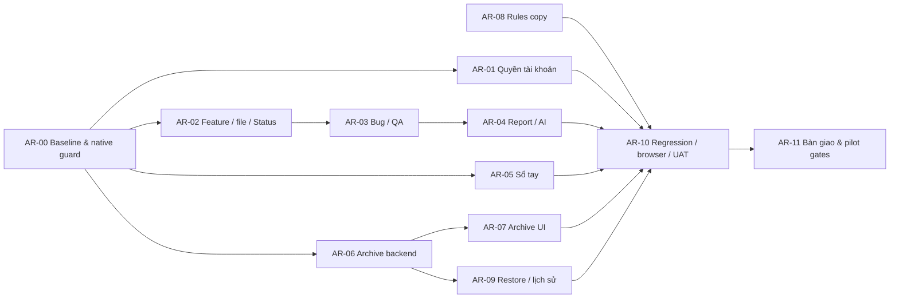

# Arena follow-up — Implementation Plan

> **For agentic workers:** REQUIRED SUB-SKILL: Use superpowers:subagent-driven-development (recommended) or superpowers:executing-plans to implement this plan task-by-task. Steps use checkbox (`- [ ]`) syntax for tracking.

**Goal:** Áp dụng kết luận Arena còn phù hợp vào hệ thống hiện tại, khép các thiếu sót có căn cứ và tạo bằng chứng nghiệm thu xuyên màn hình/API/database trên cùng baseline.

**Architecture:** Giữ React JavaScript + Spring Boot + MySQL/Flyway và luồng Feature → file → Status → Bug/QA → báo cáo Markdown. Tách kế hoạch kiểm chứng luồng hiện hành khỏi sửa lưu trữ/cách diễn đạt cấu hình; dùng API, capability và lịch sử sẵn có. Không khôi phục execution/run/retest hay loại công việc cũ để đáp ứng một báo cáo trên source cũ.

**Tech Stack:** React JavaScript/Vitest; Java/Spring Boot/Maven; MySQL native/Flyway; PowerShell/Node cho công cụ kiểm thử.

**Spec:** [Bản chốt Arena a016](../../../.arena/run-20261024-131934-s399645/BAO-CAO-DANH-GIA.md), [quyết định FixReports C01–C14](../../planning/2026-10-19-fixreports-clarification.md), [contract hiện hành](../../api/fixreports-contract.md), [RX-02/RX-10](../../reviews/2026-10-19-uiux-system-repair-plan.md), và xác nhận trực tiếp của người dùng ngày 25/10: **“Giữ luồng hiện tại, đối chiếu và áp dụng Arena (đề xuất)”**.

## Global Constraints

- **Tái phân tích sau pull 25/10:** baseline đối chiếu mới `a45974a`; checkpoint `cde58ad` bên dưới là lịch sử. Đọc [báo cáo tái phân tích](../../reviews/2026-10-25-arena-plan-reanalysis.md) trước triển khai. Source có V34 demo; migration archive dự kiến V37, phải kiểm lại cả Java/SQL và mọi location. Ma trận bổ sung U23–U26; tất cả vẫn NOT_RUN trong chiến dịch Arena.
- Quyết định thành viên 25/10 ưu tiên mô tả cũ: không chọn/đổi vai trò membership; ADMIN vẫn là tài khoản ADMIN, hiển thị `ADMIN · Làm PM`; PM chỉ thêm DEV/TESTER của dự án mình quản lý, Admin thêm mọi nhóm. Không đồng nhất quyền thêm thành viên với quyền tạo tài khoản.

- “Người dùng xác nhận chỉ giữ Bug/QA trên toàn hệ thống” — C06. Không tự đổi TASK/REQUEST/IMPROVEMENT cũ thành Bug/QA.
- “Trao đổi DEV/khách hàng và xác minh lại là quy trình bên ngoài; người dùng yêu cầu không đưa quy trình đó thành workflow code mới.” — C07.
- “Đổi nhãn cột iPad thành Status; giữ vòng trạng thái Unexecuted → OK → NG → P → NA → Unexecuted.” — C05. Đã test gồm OK/NG/P/NA, mẫu số gồm NA; 0 case hiển thị 0%, không tự coi hoàn thành.
- Mỗi Feature giữ bản file/nội dung độc lập; phân công đầu tiên/gần nhất không đồng nghĩa người đã ghi kết quả. Không tạo run chỉ vì đổi người.
- PM được cấp `users:create` chỉ tạo TESTER; không mở khu Admin, không tạo ADMIN/PM/DEV hoặc cấp quyền tiếp. Quyền AI đọc liên dự án của PM không mở quyền CRUD/báo cáo quản trị ngoài dự án.
- ADMIN có quyền nghiệp vụ đã chốt nhưng vẫn chịu project scope, expected version, idempotency và ranh giới lưu trữ. Ngoại lệ lưu trữ chỉ bỏ qua `UNFINISHED_CYCLES`/`OPEN_RETESTS`, ADMIN xác nhận có lý do; đây là quyết định đã có, không hỏi lại.
- Bàn giao máy cho PM; không tạo luồng PM chia máy cho member. Tester không cần máy đứng tên để sửa Status theo quyền.
- Giữ màu Unexecuted/Chưa chạy `#C0C0C0`, chữ `#333333`; không thiết kế lại toàn bộ giao diện trong kế hoạch này.
- Bảo toàn dữ liệu hiện có, file gốc, lịch sử, archive Arena và thay đổi người dùng. Không tự xóa/reset test schema, không đưa fixture vào `tms`, không chạy migration hoặc restart main từ lệnh kiểm thử.
- Làm trên `system-design`; `develop` vẫn là nhánh tích hợp. Không tự commit/push/merge/deploy. Bước commit trong skill chỉ thực hiện nếu người dùng cho phép riêng cho tác vụ triển khai tương ứng.
- Mọi lệnh terminal qua `rtk`; không ghi credential/token/cookie hoặc dữ liệu riêng vào báo cáo/Git. Đọc `AGENTS.md`, `RTK.md`, README/STATUS/execution-guide trước khi triển khai.
- Tác vụ hiện tại **chỉ lập kế hoạch**. S11/FR-12 giữ `IN_REVIEW`; kế hoạch không phải kết quả test hoặc ký UAT.

## Review Focus

1. Báo cáo đánh giá source cũ: không làm lại F6 hoặc mở lại API đã nghỉ; AR-00/AR-03 kiểm baseline và HTTP 410 không ghi dữ liệu.
2. Thu quyền giữa lúc đang nhập/gửi: server từ chối, nháp không rò sang tài khoản khác, quyền không hồi sinh sau reauth; AR-01/AR-05/AR-10.
3. Lặp lệnh, phản hồi bị mất, bản ghi đổi nhưng tổng số blocker giữ nguyên: không ghi trùng/ghi đè/bỏ qua blocker mới; AR-02/AR-03/AR-06/AR-07.
4. Mẫu Excel giống nhau, trang đang lọc, trạng thái P/NA/0 case: độc lập Feature, xuất đủ dữ liệu đúng phạm vi và số liệu 3/5 = 60%; AR-02/AR-04.
5. Test chạy nhầm database hoặc restore thiếu blob: từ chối trước mutation, chứng minh DB+storage cùng snapshot, không coi exit 0 nhưng toàn SKIP là đạt; AR-00/AR-09/AR-10.

## 1. Căn cứ, phạm vi và phương án đã chọn

Đây là kế hoạch liên module dựa trên tài liệu đã chốt, không phải yêu cầu thiết kế lại nghiệp vụ. Đích là giúp ADMIN/PM/TESTER/DEV hoàn thành luồng hiện hành và phân biệt rõ lỗi, chức năng đã có, giới hạn được chấp nhận và điều kiện pilot.

| Mốc | Giá trị và cách sử dụng |
| --- | --- |
| Source Arena thực sự đánh giá | `caf075af7231f207259b6a62808bff5c8445f6af`, từ `.arena/execution-manifest.json` |
| Bản chốt | `run-20261024-131934-s399645/BAO-CAO-DANH-GIA.md`, `winner.txt`: a016; `r6/r6-m01.verdict.json` là căn cứ lựa chọn |
| Source đọc khi lập kế hoạch | `cde58ad`, nhánh `system-design`; commit pull thêm archive Arena, sản phẩm hiện hành kế thừa `77b05e8` |
| Cảnh báo đường dẫn | `.arena/LATEST` ghi đường dẫn máy cũ `E:\KLTN\System\...`; dùng archive tương ứng **trong repository**, không sửa chứng cứ gốc |
| Ý nghĩa điểm 91–87,5 | Chấm chất lượng báo cáo trong Arena; không phải độ hoàn thiện hay phần trăm test đạt của hệ thống |
| Quyết định mới | Người dùng ngày 25/10 đã chọn giữ Feature/Bug–QA và đối chiếu lại Arena; quyết định này ưu tiên các đề xuất phục hồi luồng cũ |

Các hướng đã cân nhắc:

1. **Đối chiếu rồi áp dụng, đã được chọn:** xác minh chức năng có sẵn, sửa khoảng trống còn đúng, chạy UAT theo luồng hiện hành. Ít thay đổi nghiệp vụ, nhưng phải giữ ma trận truy vết đầy đủ.
2. Làm nguyên các đề xuất trên `caf075a`: lặp form PM, khôi phục lifecycle cũ và công thức báo cáo cũ; trái quyết định mới nên không chọn.
3. Chỉ bổ sung báo cáo kiểm thử: dễ làm nhưng để nguyên thiếu sót archive và nhãn Rules đang gây hiểu sai; không đủ mục tiêu.

Kế hoạch chia hai phần có thể review độc lập:

- [A — Luồng hiện hành, kiểm thử và bàn giao](2026-10-25-arena-current-workflow.md).
- [B — Lưu trữ dự án và phạm vi Rules](2026-10-25-arena-lifecycle-settings.md).
- [Ma trận nghiệm thu và gate pilot](../../planning/2026-10-25-arena-acceptance-matrix.md).

## 2. Đối chiếu từng phát hiện của bản chốt

`IMPLEMENTED_UNVERIFIED` nghĩa là tìm thấy implementation/test nguồn, **không phải PASS ngày 25/10**. `HISTORICAL` nghĩa là không thực hiện như tính năng đang dùng; vẫn bảo toàn dữ liệu và ranh giới đã nghỉ.

| Arena | Hiện trạng đối chiếu | Quyết định kế hoạch | Task / bằng chứng nguồn |
| --- | --- | --- | --- |
| F1 — nghiệm thu toàn chuỗi | Vẫn thiếu một gói bằng chứng mới thống nhất với source/schema hiện tại | Viết và chạy chuỗi Feature/import/assignment/Status/Bug–QA/report, 4 role, lỗi/retry/concurrency; tách pilot | AR-00–AR-11; `AppRouter.jsx`, `FeatureController.java`, `FeatureIssueService.java`, `ManagementReportService.java` |
| F2 — quyết định khách hàng | Không được đồng nhất mặc định nội bộ với hợp đồng khách | Gate mẫu Excel/người duyệt, mapping/quyền Redmine, evidence, quy mô/RPO/RTO, người ký | AR-11; ma trận G01–G06 |
| F3 — 5.000/10.000 run | `ReportingController` cũ đã trả `410 USE_FEATURE_REPORTS`; số liệu mới là Feature/Markdown | Không tăng limit, không thêm hướng dẫn lọc cycle vào màn mới; chỉ xét hiệu năng/export sau khi có quy mô | AR-03/AR-04/G05; giữ test service lịch sử khi còn có ích |
| F4 — iPad và execution | Cột hiện hành là Status của row thuộc Feature; run không còn là đường ghi mới | Kiểm độc lập Feature và thống nhất file/Feature/analysis; giữ dữ liệu cũ, không đồng bộ hai chiều hay thêm nguồn kết quả | AR-02/AR-04; C02/C03/C05 |
| F5 — inbox trống | `ActionInbox` còn source nhưng không là điểm đến của router hiện hành | Không phát triển inbox cũ hoặc notification mới; board hiện hành nói đúng Bug/QA; tồn đọng loại cũ vẫn phải được ghi nhận ở archive | AR-03/AR-06; quyết định dữ liệu cũ khác nằm ở G07 |
| F6 — PM không tạo được Tester trên web | **IMPLEMENTED_UNVERIFIED**: `AccountMenu` mở `UserCreateDialog testerOnly`; có kiểm quyền, nháp, revoke | Không thêm form/API; chạy lại FE/HTTP/browser, bổ sung ca revoke khi reauth và HTTP từ chối DEV | AR-01; `account-create-tester.test.jsx`, `IdentityIntegrationTest.java` |
| F7 — actor xác nhận QA do PM tạo | Luồng `QaService`/answer-confirm cũ đã nghỉ; nonGET `/qa/**` trả 410. QA mới chuyển trạng thái thủ công qua capability | Không thêm hướng dẫn “ADMIN confirm answer” vào QA mới; kiểm PM/DEV/cross-project/version/comment theo API hiện hành | AR-03; `FeatureIssueLegacyWrites.java`, `NativeFeatureIssueIntegrationTest.java` |
| D bổ sung — Rules V1/V2 pin BUG | `RulesPanel` còn công bố “cho bug mới”, nhưng `FeatureIssueService` không dùng `RuleService` | Sửa diễn đạt phạm vi lịch sử, giữ versions/API cũ; không gắn rule cũ vào Bug mới. Hai-version pin là kiểm lịch sử, không AC cho Feature mới | AR-08; RX-10 |
| D bổ sung — Sổ tay hai tab | Chức năng hiện hành có revision/expectedCurrentRevisionId | Kiểm conflict, mất quyền, archive, plain text/history ở API và browser | AR-05 |
| D bổ sung — NA/khôi phục scope, CLOSE/REOPEN cycle | Đã được thay bằng Status và Feature/project archive; không chạy lifecycle cũ qua API công khai | Kiểm NA trong tiến độ; legacy write 410; archive ngoại lệ không tự đóng cycle/retest hay xóa lịch sử | AR-02/AR-03/AR-06–07 |
| D bổ sung — TASK/REQUEST/IMPROVEMENT, batch | Đã bỏ khỏi luồng dùng; tồn tại dữ liệu cũ không phải quyền tự chuyển đổi/xóa | Giữ hard blocker `OPEN_WORK_ITEMS`; không mở lại UI để “dọn” tự động. Kiểm atomicity trên batch phân công/thiết bị đang hoạt động | AR-02/AR-06/AR-10/G07 |
| B/D — bốn đầu ra Excel | Luồng mới có original XLSX, current XLSX và Markdown đã lưu; execution/report Excel cũ không là đầu ra hiện hành | Đối chiếu ba artifact đang dùng; ghi legacy read/export nào còn được phép và endpoint nào 410, không hứa bốn nút xuất cũ | AR-02/AR-04/AR-09 |
| B/D — upload/evidence/restore | Màn Feature Issue không dùng EvidencePanel; legacy upload/delete bị 410; GET/download còn bảo vệ dữ liệu cũ | Kiểm đọc/download/quyền/503 và restore DB+blob cô lập. Không thêm upload mới chỉ để tái dùng kịch bản Arena | AR-09 |
| F — live AI/OAuth/Redmine, tải, restore | PASS cũ hoặc mock không chứng minh hiện tại | Tách từng lớp bằng chứng; live/khách cần điều kiện riêng, không kết luận từ offline test | AR-04/AR-09/AR-10/G02–G06 |

Đường dẫn code đầy đủ nằm trong từng task. Dữ liệu cũ được giữ không có nghĩa mọi API cũ phải tiếp tục cho ghi. Không xóa service/component cũ theo một chiến dịch cleanup ngoài phạm vi.

## 3. Thứ tự thực hiện và đầu ra

| Task | Đầu ra review độc lập | Phụ thuộc | Ưu tiên / cỡ tương đối | Trạng thái |
| --- | --- | --- | --- | --- |
| AR-00 | Baseline, runner test native hiện hành an toàn, manifest | Không | P0 / M | PLANNED |
| AR-01 | Bằng chứng PM được cấp tạo TESTER, revoke/reauth | AR-00 cho native; offline làm song song | P1 / S | PLANNED |
| AR-02 | Chuỗi Feature/import/assignment/Status/export nhất quán | AR-00 | P1 / M | PLANNED |
| AR-03 | Bug/QA đúng capability, legacy retirement giữ nguyên | AR-00, fixture AR-02 | P1 / S–M | PLANNED |
| AR-04 | Report/AI text/scopes và số liệu xuyên màn hình | AR-02/03 | P1 / M | PLANNED |
| AR-05 | Sổ tay revision/concurrency/history | AR-00 | P1 / S | PLANNED |
| AR-06 | Backend/migration ngoại lệ archive có snapshot/audit | AR-00 | P1 / M | PLANNED |
| AR-07 | UI archive xác nhận rõ, retry/conflict và lịch sử | AR-06 contract | P1 / S–M | PLANNED |
| AR-08 | Rules nói đúng phạm vi lịch sử, không hứa áp dụng Bug mới | Không; kiểm native dùng AR-00 | P1 / S | PLANNED |
| AR-09 | Bảo toàn legacy/evidence, restore cô lập có đối chiếu | AR-00; chạy với schema cuối AR-06 | P1 / M | PLANNED |
| AR-10 | Regression, browser 4 role và toàn chuỗi trên baseline cuối | AR-01–09 | P1 / M | PLANNED |
| AR-11 | Báo cáo truy vết, gate pilot/người ký, quyết định còn mở | Chuẩn bị song song; bàn giao sau AR-10 | P1 / S + chờ bên ngoài | PLANNED |

**Điều chỉnh thứ tự sau tái phân tích:** AR-00 và AR-11 (đối chiếu baseline/gate) trước; nhánh AR-04 chẩn đoán timeout/cấu hình có thể làm độc lập ngay, không chờ dữ liệu AR-02/03. AR-01 bổ sung thành viên/hồ sơ đã có, chỉ kiểm chứng hồi quy. AR-06/07 vẫn là thay đổi nghiệp vụ chính; AR-08 sửa cách diễn đạt có thể làm độc lập. Sau đó AR-02/03/05 và phần số liệu AR-04 → AR-09 → AR-10 → AR-11 bàn giao. Không đổi mọi task thành P0 hoặc để công cụ kiểm thử mới chặn kiểm thử offline sẵn có.

AR-06 cần kiểm thêm `OPEN_WORK_ITEMS` đối với Bug Monkey đã xóa mềm và Issue thuộc Feature/file đã ẩn (U26). Không tự coi chúng là cycles/retests để miễn blocker. Phải phân biệt phát hiện tĩnh, lỗi đã tái hiện và quyết định nghiệp vụ chưa chốt.

S/M chỉ độ lớn tương đối, không là cam kết ngày hoặc giờ. Thiếu credential/schema/người ký chỉ chặn lớp test tương ứng; tiếp tục offline/doc và báo `BLOCKED` ở đúng dòng nghiệm thu.

Không cho nhiều agent cùng sửa file contract/migration/STATUS. Chốt contract AR-06 rồi mới giao UI AR-07. Mỗi task sửa lỗi: có test hành vi RED → sửa tối thiểu → GREEN; task xác minh code đã có có thể GREEN ngay, ghi `CONFIRMED_EXISTING`, không tạo thay đổi để giả lập RED.

## 4. Skill và chứng cứ

Skill thực sự đã dùng trong lượt **lập kế hoạch**:

| Skill đã đọc | Dùng cho việc gì | Kết quả/bằng chứng |
| --- | --- | --- |
| `brainstorming` — `C:/Users/admin/.codex/skills/brainstorming/SKILL.md` | Đối chiếu ý định/bản chốt với baseline, phân rã liên module, hỏi đúng mâu thuẫn nghiệp vụ | Quyết định người dùng 25/10 giữ luồng hiện tại; mục 1–2 và các giới hạn không khôi phục luồng cũ |
| `writing-plans` — `C:/Users/admin/.codex/skills/writing-plans/SKILL.md` | Chia task theo phụ thuộc, chỉ rõ file/interface/test/gate và tự review | Hai subplan, AR-00–11, ma trận U01–U22/G01–G07 và checklist dưới |

Khi **triển khai**, đọc SKILL.md tương ứng rồi ghi vào receipt của task, không ghi “đã dùng” chỉ vì có bảng này:

| Task | Skill dự kiến | Mục đích / chứng cứ phải lưu |
| --- | --- | --- |
| AR-00 | `tdd-workflow`, `security-review`, `verification-loop` | Guard fail-before-connect; negative tests; manifest schema/source |
| AR-01 | `security-review`, `tdd-workflow`, `frontend-patterns` | Ma trận quyền/revoke, UI draft, số bản ghi user/audit |
| AR-02/03 | `api-design`, `tdd-workflow`, `frontend-patterns`, `security-review` | Contract/version/idempotency, source IDs, workbook hashes, role/race receipts |
| AR-04 | `api-design`, `security-review`, `tdd-workflow` | Phạm vi report/AI trước retrieval, text round-trip, không sửa số liệu nguồn |
| AR-05 | `tdd-workflow`, `frontend-patterns`, `security-review` | Hai tab conflict, draft, actor/revision/plain text |
| AR-06/07 | `api-design`, `security-review`, `tdd-workflow`, `frontend-patterns` | Snapshot contract, migration preservation, race/idempotency, confirmation UI |
| AR-08 | `frontend-patterns`, `tdd-workflow` | Câu chữ đúng phạm vi và test không thay luật Feature Issue |
| AR-09/10 | `verification-loop`, `browser-testing-with-devtools` hoặc skill browser thực tế của môi trường | Phân biệt mock/native/browser/live; restore hashes; screenshot/DOM/network đã làm sạch secret |
| AR-11 | `writing-plans`, `verification-loop` | Truy vết từng task/AC, giới hạn bằng chứng và gate ký nghiệm thu |

Vị trí skill theo `docs/development-skills.md` và catalog của phiên thực thi. Không tự cài công cụ hoặc đổi stack nếu một skill nêu ví dụ Node/Docker không phù hợp. Nếu skill thiếu, ghi rõ và dùng quy trình tương đương trong task; không giả vờ đã đọc/dùng.

## 5. Định nghĩa hoàn tất và tự review kế hoạch

- [ ] AR-00–11 có receipt: skill → hành động → assertion/command → kết quả → artifact → phần còn thiếu.
- [ ] U01–U26 có kết quả trên source/schema cuối; tách automated/browser/human, không suy coverage từ số test PASS.
- [ ] Migration mới đạt fresh + upgrade fixture + bảo toàn snapshot; không dùng dữ liệu main để thử.
- [ ] Không còn lỗi nghiêm trọng đã tái hiện trong phạm vi; lỗi mới được định danh và sửa/test hoặc nêu rõ chưa hoàn tất, không tự hạ thành “giới hạn”.
- [ ] G01–G07 được ghi đúng trạng thái; gate chưa chốt không làm cản các task nội bộ độc lập, nhưng chặn tuyên bố pilot ready tương ứng.
- [ ] Chỉ người có trách nhiệm ký UAT; S11/FR-12 không tự DONE do test xanh.

Tự review của người lập kế hoạch ngày 25/10 (khác checklist triển khai):

- [x] Bao phủ A–G của Arena: F1–F7 và các nhánh Rules/Handbook/NA/CLOSE/ordinary work/evidence/export đều có disposition ở mục 2; không bỏ im lặng các yêu cầu không còn áp dụng.
- [x] Các task có file, interface, assertion và lệnh dự kiến; hành vi có sẵn dùng verification-first, thay đổi thật phải có RED.
- [x] `legacyExceptionFingerprint` của readiness và `legacyException: {acknowledged, snapshotFingerprint}` của command nhất quán giữa backend/UI/AC; giữ digest/constructor lệnh cũ.
- [x] Năm Review Focus có task và ca nghiệm thu sở hữu.
- [x] Chỉ mô tả ranh giới cần quyết định, không chép toàn bộ thân hàm hoặc xây nền tảng test tổng quát; tài liệu chia hai phần thực thi được review độc lập.

**Trạng thái bàn giao kế hoạch:** đã lập và tự review; chưa triển khai, chưa chạy test/build/browser/database/provider trong lượt này. Bằng chứng 19–20/10 là lịch sử tham khảo, không chuyển thành PASS mới. Phương án triển khai đề xuất: subagent theo task có reviewer, vì quyền/transaction/migration và UI phải khớp contract; chỉ bắt đầu khi người dùng yêu cầu triển khai kế hoạch.

Kiểm tra tài liệu ngày 25/10: bốn tài liệu mới không có link nội bộ hỏng hoặc whitespace cuối dòng; đủ định nghĩa AR-00–AR-11 và dependency hợp lệ. JSON STATUS parse được; các field/trạng thái/notes cũ giữ nguyên, chỉ thêm mục kế hoạch và ngày cập nhật. `rtk proxy git diff --check` đạt; `rtk proxy git diff --exit-code HEAD -- Backend Frontend scripts .arena` không có thay đổi. Các đường dẫn chưa tồn tại trong plan đều là file được đánh dấu **Create**, không là khẳng định đã triển khai.

Review bổ sung đã được xử lý: cô lập attachment storage trước Spring startup (cleanup startup không phụ thuộc cron); phân biệt revoke trước/sau authorization của request đang chạy; loại `SettingsReviewTest` dùng Testcontainers/legacy HTTP khỏi lệnh offline. Đây là kiểm tra kế hoạch/source, không phải kết quả thực chạy hệ thống.
