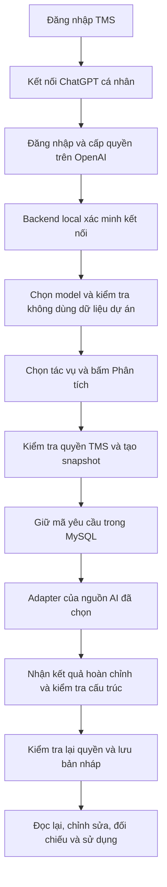

# Kết nối ChatGPT cá nhân với Trợ lý AI TMS

Ngày: 10/10/2026 · Nhánh khảo sát: `system-design` · Baseline: `66eeaf0`.

**Trạng thái: APPROVED_FOR_IMPLEMENTATION — ngày 10/10 người dùng yêu cầu thực hiện đề xuất, bổ sung đầy đủ lựa chọn ChatGPT/API/Ollama và chat nổi như Messenger. Phần dưới là thiết kế nền; mở rộng sau đây được ưu tiên khi khác phạm vi đề xuất ban đầu.**

## 0. Phạm vi đã mở rộng ngày 10/10

- Triển khai dropdown nguồn AI ngay trong khung “Bạn cần hỗ trợ việc gì?”, dùng được cho tác vụ hiện có. Bao gồm ChatGPT cá nhân, API hệ thống và Ollama local; nguồn chưa cấu hình hiển thị lý do/hướng dẫn, không giả nội dung AI.
- Chat nổi trên các màn hình đã đăng nhập: mở/thu nhỏ, lịch sử, tạo hội thoại mới, gửi bằng Enter (Shift+Enter xuống dòng), trạng thái gửi và lỗi, sao chép câu trả lời. Mobile có khung vừa viewport, cuộn riêng tin nhắn; không che modal nghiệp vụ.
- Hội thoại chung chỉ trả lời kiến thức/hướng dẫn, không tự lấy dữ liệu dự án. Người dùng chọn rõ ngữ cảnh dự án/tác vụ/nguồn theo quyền hiện có; hội thoại gắn cố định nguồn AI/model/ngữ cảnh. Đổi phạm vi mở hội thoại mới, không lẫn dữ liệu giữa dự án hay tài khoản.
- Lưu câu hỏi và câu trả lời AI trong MySQL, TTL 7 ngày, chỉ owner có quyền còn hiệu lực. Input tối đa 2000 ký tự/lượt, tối đa 10 lượt gần nhất trong ngữ cảnh; giới hạn request theo UTF-8 và giới hạn số lượt. Nội dung model chỉ hiển thị text; không tự chạy công cụ, sửa dữ liệu hoặc gửi thông báo.
- Không tự động đăng nhập thay người dùng, mua credit, chia sẻ token hoặc đổi provider khi lỗi. Bản local ChatGPT chỉ được nghiệm thu sau thao tác đăng nhập/cấp quyền của người dùng. Không coi việc có Plus/Pro là đủ bằng chứng inference.
- Lựa chọn thực hiện: native repository `system-design`, workflow subagent-driven-development cho các task độc lập theo thứ tự, controller kiểm thử tích hợp. User đã yêu cầu thực hiện, không chờ một lượt duyệt chung mới; quyền truy cập tài khoản cá nhân được thực hiện ở bước đăng nhập chính thức.

### Chốt cách triển khai local

Giữ cơ chế request đồng bộ có deadline để tái sử dụng pipeline bản nháp hiện tại: nguồn mới có tối đa 25 giây cho refresh và inference, API hiện tại tối đa 30 giây; frontend giữ timeout 35 giây và tra lại cùng request key khi mất phản hồi. Không giữ transaction database trong thời gian gọi model. Thiết kế worker 90 giây ở phần nền là phương án sau nếu đo thực tế thấy cần tác vụ dài.

Metadata kết nối ChatGPT, phiên bản, model đã kiểm tra, khóa idempotency và hạn mức probe được lưu cùng credential trong kho runtime mã hóa và giới hạn quyền file; không tạo thêm bảng kết nối/probe trong MySQL ở bản local này. Các kết quả phân tích và hội thoại vẫn được lưu vào MySQL theo yêu cầu. Pending probe sau khởi động lại chuyển thất bại, không tự gọi model lại.

## 1. Mục tiêu và phạm vi

Người dùng đã có tài khoản ChatGPT trả phí và credit, muốn tận dụng trong TMS để phân tích dự án, báo cáo, phân công và hỗ trợ ticket. Nội dung AI vẫn phải lưu tạm vào database. Quyền Admin/PM/Tester/Dev đã chốt vẫn áp dụng.

Giả định cho bản đầu: một người dùng TMS kết nối tài khoản ChatGPT của chính mình trên bản TMS chạy ở máy cá nhân. Đây là đề xuất phạm vi, chưa phải xác nhận TMS đã đủ điều kiện sử dụng dịch vụ.

Tài khoản trả phí không đồng nghĩa chỉ đăng nhập là chạy được: cần tài khoản/gói đủ điều kiện, quyền sử dụng gói được cấp cho ứng dụng và một yêu cầu model hoàn tất. Hướng tích hợp công khai dành cho ứng dụng mã nguồn mở/dự án cá nhân local; ứng dụng trả phí hoặc được host cho người khác sử dụng cần xin quyền truy cập phù hợp. Không bật cơ chế local trên máy chủ dùng chung chỉ bằng một cờ cấu hình rồi coi là đủ điều kiện. [OpenAI: phạm vi tích hợp](https://developers.openai.com/cookbook/articles/sign-in-with-chatgpt), [Quickstart](https://developers.openai.com/siwc/quickstart).

Không dùng tài khoản ChatGPT của Admin làm nguồn tiêu thụ chung mặc định cho các tài khoản TMS khác. Tài khoản ChatGPT được liên kết bổ sung sau khi đăng nhập TMS, không thay thế đăng nhập TMS, không tự nâng quyền và không tự liên kết chỉ vì trùng email.

## 2. Các phương án

| Phương án | Lợi ích | Đánh đổi | Đề xuất |
| --- | --- | --- | --- |
| OAuth ChatGPT trực tiếp từ backend local tới Responses API | Dùng gói/credit của người đã cấp quyền; giữ pipeline dữ liệu TMS | Cần quản lý kết nối, refresh và streaming; có điều kiện triển khai | Làm bản đầu |
| Nhúng Codex app-server | Hợp nếu cần agent với công cụ, hội thoại và thao tác mã nguồn | Thêm process/protocol/lifecycle; vượt nhu cầu tổng hợp báo cáo hiện tại | Chưa thêm |
| API tổ chức hoặc model local | Hướng độc lập cho hệ thống nhiều người; có thể giữ cách dùng hiện tại | API cần ngân sách riêng; model local cần phần cứng và đánh giá chất lượng | Giữ API hiện có; Ollama là phạm vi sau |

TMS chỉ cần sinh nội dung theo dữ liệu đã giới hạn, nên adapter Responses trực tiếp là lựa chọn gọn hơn cho bản này. Không tạo endpoint nhận prompt tùy ý hoặc cho AI chạy shell.

## 3. Hiện trạng đã đối chiếu code

- `AiAssistantPage.jsx`: `/ai` và `/admin/ai`, nút **Phân tích**, nguồn đối chiếu, sửa/sao chép và lịch sử của chủ sở hữu.
- `AiContextService.java` / `AiAccess.java`: giới hạn tác vụ và dữ liệu theo role, dự án, nguồn; hiện `metadata.enabled` phụ thuộc cấu hình API key.
- `AiDraftService.java`: phụ thuộc trực tiếp `OpenAiResponsesClient`, gọi provider ngoài transaction rồi kiểm tra/lưu kết quả.
- `OpenAiResponsesClient.java`: API key của backend, xử lý JSON hoàn chỉnh, có `max_output_tokens`; chưa có OAuth hoặc parser SSE.
- `AiDraftStore.java` / V23: bản nháp riêng theo owner/project, request key, JSON gốc, bản sửa/version, token usage, TTL mặc định 7 ngày. Bản GENERATING quá 2 phút được chuyển FAILED khi kiểm tra lại.
- `Frontend/src/app/services/api/ai.js`: timeout 35 giây; gửi lại cùng request key để kiểm tra, tránh gọi trả phí lần hai.

Do đó chỉ thay API key bằng token ChatGPT là chưa đủ. Cần tách adapter và cơ chế kết nối; giữ các quy tắc dữ liệu, quyền và duyệt nội dung đang có.

## 4. Thiết kế giao diện

### Kết nối AI của tôi

Nút **Kết nối AI** luôn mở được từ trang Trợ lý AI, kể cả chưa chọn dự án. Hiển thị trong một panel quản lý kết nối riêng; phần chọn dự án hiện có không bị trộn vào tài khoản ChatGPT.

```text
Trợ lý AI                                      [Kết nối AI]

Nguồn AI       [ChatGPT cá nhân                    ▾]
Tài khoản      n•••@example.com · Không gian đã chọn
Trạng thái     Chưa xác minh khả năng phân tích

[Continue with ChatGPT]   [Kiểm tra kết nối]
[Quản lý mức sử dụng]     [Ngắt kết nối]

Dự án          [Mã · Tên dự án                     ▾]
Tác vụ         [Tác vụ theo vai trò                ▾]
Nguồn          File/ticket nếu tác vụ yêu cầu

[Phân tích]
Kết quả sẽ được lưu trong 7 ngày, chỉ bạn được xem.
```

Đây là wireframe, không phải ảnh kết nối đã thành công. Dùng nhãn **Continue with ChatGPT** và tài sản thương hiệu theo hướng dẫn OpenAI. Nút liên kết hiển thị khi chưa kết nối/cần cấp quyền lại; nút kiểm tra xuất hiện sau khi đã có quyền sử dụng gói. [Hướng dẫn UI](https://developers.openai.com/siwc/ui-ux-guidelines).

- Hai lựa chọn khả dụng: **ChatGPT cá nhân** và **API của hệ thống**. Không hiển thị Ollama như tính năng đã có.
- Dòng thông tin ngay cạnh nguồn: “Sử dụng gói/credit ChatGPT của bạn” hoặc “Sử dụng ngân sách API của hệ thống”. Không tự đổi nguồn khi lỗi.
- Không hiển thị số credit tự suy đoán từ token. Nút **Quản lý mức sử dụng** mở trang Usage chính thức, nơi người dùng kiểm soát mức dùng và quyền dùng thêm credit. TMS không bật tự nạp tiền hoặc sửa hạn mức trên ChatGPT. [Quản lý usage](https://learn.chatgpt.com/docs/sign-in-with-chatgpt).
- Kết quả/lịch sử có nhãn nguồn AI, model, thời điểm và hạn lưu. Nút **Lưu chỉnh sửa** giữ hành vi hiện tại; không tự cập nhật ticket/kết quả test/phân công.
- Giữ thang chữ hiện hành: nội dung 13px, tiêu đề 15–18px; điều khiển mobile 44px, ô nhập mobile 16px. Desktop hai cột nội dung/lịch sử, màn hẹp xếp dọc. Tên tài khoản/model dài được xuống dòng; không tạo bảng rộng cho phần kết nối.
- Không thêm màn hình kiểm tra backend/MySQL/Flyway vào giao diện nghiệp vụ.

### Trạng thái và thông báo

| Trạng thái kết nối | Cách hiển thị và hành động |
| --- | --- |
| Chưa liên kết | “Kết nối ChatGPT để sử dụng gói của bạn” |
| Đang đăng nhập | Có trạng thái chờ và Hủy; không ghi đè kết nối cũ đang dùng |
| Đã xác thực danh tính, thiếu quyền dùng gói | “Đã đăng nhập. Cần cấp quyền sử dụng gói ChatGPT” |
| Đã cấp quyền, chưa kiểm tra | “Chưa xác minh khả năng phân tích” + Kiểm tra kết nối |
| Probe đã hoàn tất hợp lệ | “Đã kiểm tra thành công lúc …” với model đã kiểm tra; không cam kết vô thời hạn |
| Phiên không làm mới được/bị thu hồi | “Cần kết nối lại ChatGPT”; giữ bản nháp đã lưu |
| Hết hạn mức gói/credit không được phép dùng | “ChatGPT đang giới hạn mức sử dụng. Mở Quản lý mức sử dụng để kiểm tra” |
| Tài khoản/ứng dụng không được phép | Nêu cần kiểm tra điều kiện tài khoản/ứng dụng; không khuyên nạp tiền API cho lỗi này |
| API key thiếu quota | “API chưa đủ số dư hoặc đã chạm hạn mức. Kiểm tra Billing và Limits” |
| Mạng/stream gián đoạn | “Chưa nhận được kết quả hoàn chỉnh”; không trình bày phần dở dang như bản đã lưu |

Trạng thái xác thực, quyền dùng gói và lần kiểm tra model là ba thông tin riêng. HTTP 200 hoặc model xuất hiện trong danh sách chưa đủ để báo AI đã hoạt động.

## 5. Luồng kết nối và xử lý



1. Backend tạo phiên OAuth ngắn hạn gắn người dùng TMS đang đăng nhập; mỗi lần thử có state, nonce và PKCE riêng. Host ID ổn định theo cài đặt local. Callback bind loopback `127.0.0.1`; không dùng callback local để phục vụ trình duyệt ở máy khác.
2. Xác minh callback và ID token, kiểm tra scope thực được cấp. Chỉ thay kết nối cũ sau khi kết nối mới đã được xác minh. Phiên callback hết hạn/đã dùng lại, đổi user TMS giữa chừng hoặc sai state phải bị từ chối.
3. Dùng đăng ký và token exchange theo hợp đồng chính thức; không đọc cookie ChatGPT, không lấy token từ thư mục Codex và không giả danh client có sẵn. [Hợp đồng đăng nhập](https://developers.openai.com/siwc/token-sharing-open-source/sign-in).
4. Lấy model được tài khoản cung cấp. Người dùng chọn model; không ép model API key hiện tại vào tài khoản ChatGPT. Nút **Kiểm tra kết nối** thông báo sẽ dùng một yêu cầu AI nhỏ, chỉ gửi dữ liệu mẫu cố định. Probe phải dùng cấu trúc đầu ra TMS và kiểm tra kết quả; không gửi dự án/ticket thật trong probe.
5. Chỉ đánh dấu đã xác minh cho đúng kết nối/phiên/model sau khi nhận sự kiện hoàn tất và nội dung hợp lệ. Đổi model hoặc kết nối phải kiểm tra lại. Việc kiểm tra không chứng minh chất lượng nghiệp vụ; còn UAT với dữ liệu người dùng cho phép.
6. Khi Phân tích, source/model/phiên kết nối được chốt cùng request key. Gửi lại cùng key chỉ đọc yêu cầu cũ. Dùng key cũ cho nguồn/model/đối tượng khác trả xung đột; không âm thầm tính phí nguồn khác.
7. Với tác vụ dài, backend trả Draft đang xử lý bằng HTTP 202 sau khi reserve; frontend dùng GET theo draftId để cập nhật. Không giữ transaction database trong lúc chờ model. Cả provider API và ChatGPT dùng cùng vòng đời để UI nhất quán.
8. Chỉ lưu READY sau khi stream hoàn tất, schema và ID nguồn hợp lệ, quyền còn hiệu lực. Đứt mạng, refusal, incomplete hoặc terminal failure là FAILED, dù trước đó đã có text delta. [Hợp đồng inference](https://developers.openai.com/siwc/token-sharing-open-source/models-and-inference).

Thông số đề xuất cho bản local: callback chờ tối đa 5 phút; mỗi user một tác vụ đang chạy, toàn process tối đa hai, không xếp hàng vô hạn; deadline provider tối đa 90 giây, stream tổng tối đa 1 MiB. Input giữ giới hạn UTF-8 16 KiB hiện có. Giới hạn 20 yêu cầu/dự án/ngày và TTL 7 ngày hiện có được giữ; probe có giới hạn riêng 5 lần/user/ngày. Đây là mặc định đề xuất cần đưa vào cấu hình/test, chưa phải rule đã triển khai.

Worker giữ prompt/snapshot trong bộ nhớ trong thời gian tác vụ; database giữ định danh và trạng thái. Nếu process chết, không tự phát lại request đã gửi; yêu cầu đang xử lý chuyển FAILED theo mốc 2 phút hiện có. Frontend poll khi đang xem, dừng khi đổi trang; mở lại vẫn tra cứu được trạng thái bằng GET.

## 6. Backend, quyền và lưu trữ

### Thành phần

- `AiProvider`/`AiProviderRouter` (mới): hợp đồng Output/Failure chung, chọn nguồn do backend xác thực. `OpenAiResponsesClient` giữ nhánh API key; `ChatGptPlanClient` mới cho OAuth/SSE.
- `ChatGptConnectionService` + controller (mới): bắt đầu/hủy OAuth, xác minh, model/probe, ngắt kết nối. Tất cả thao tác gắn owner TMS; Admin không được mượn kết nối cá nhân của người khác.
- `ChatGptCredentialVault` (mới): token trong kho runtime local được bảo vệ, tách khỏi database backup thông thường; database chỉ giữ credential reference. Quyền file chỉ cho danh tính chạy backend; bí mật mã hóa không nằm cùng bản sao dữ liệu. Thiếu kho bảo vệ hợp lệ thì tính năng không bật.
- `AiDraftService`, `AiDraftStore`, `AiAssistanceService`, `AiContextService`: nhận nguồn đã xác thực, tách readiness khỏi cờ API key, hỗ trợ worker và bảo toàn quy tắc existing.
- `AiConnectionPanel.jsx` (mới), `AiAssistantPage.jsx`, API client: quản lý kết nối, lựa chọn nguồn, thông báo và polling.

Refresh được tuần tự hóa theo phiên, lưu token thay thế an toàn. Không đưa token vào frontend/localStorage/log/analytics. Ngắt kết nối xóa credential local và chặn request mới; thu hồi bên OpenAI thất bại phải được báo rõ kèm liên kết ngắt quyền ở ChatGPT. [Bảo vệ phiên và refresh](https://developers.openai.com/siwc/token-sharing-open-source/profiles-and-sessions).

Adapter ChatGPT dùng `store:false`, `stream:true`, bỏ các tham số route này không hỗ trợ, gồm `max_output_tokens`; giới hạn output của TMS là giới hạn tiếp nhận, không phải cam kết trần chi phí OpenAI. Không tái sử dụng parser JSON non-stream hiện tại. [Giới hạn preview](https://developers.openai.com/siwc/token-sharing-open-source/preview-limitations).

### Contract dự kiến, chưa triển khai

| Endpoint | Trách nhiệm |
| --- | --- |
| `GET /api/v1/me/ai-connections` | Chỉ thông tin kết nối của người hiện tại, scope/state/last verification; không token |
| `POST /api/v1/me/ai-connections/chatgpt/authorizations` | Bắt đầu attempt với CSRF, trả attemptId và URL authorization đã kiểm soát |
| `GET /api/v1/me/ai-connections/chatgpt/authorizations/{id}` | Theo dõi attempt của owner, không token/code |
| `DELETE /api/v1/me/ai-connections/chatgpt/authorizations/{id}` | Hủy attempt, không ảnh hưởng kết nối cũ |
| `GET /api/v1/me/ai-connections/{id}/models` | Catalog bằng credential của đúng owner |
| `POST /api/v1/me/ai-connections/{id}/probes` | Probe idempotent cho model đã chọn, không có dữ liệu dự án |
| `DELETE /api/v1/me/ai-connections/{id}` | Ngắt đúng connection version; không xóa bản nháp nghiệp vụ |
| `POST /api/v1/projects/{id}/ai-drafts` | Thêm lựa chọn provider/connection/model; giữ requestKey, trả Draft READY/FAILED hoặc 202 GENERATING |
| Các GET/PUT ai-drafts hiện có | Giữ quyền owner/nguồn/TTL/version; bổ sung nhãn provenance an toàn |

Client cũ không gửi provider tiếp tục dùng API hệ thống; không tự ưu tiên một tài khoản cá nhân mới kết nối. OAuth callback là listener loopback chuyên biệt, không phải REST endpoint công khai có thể truyền tùy ý owner/redirect/provider URL.

### Database dự kiến

Migration bổ sung sau V23, chỉ chọn số version tiếp theo lúc triển khai; không sửa V23 đã chạy.

- `ai_connections`: owner FK, provider, host ID, tài khoản/workspace được xác minh, issued client ID, granted scopes, credential reference, state/version, model đã kiểm tra, verifiedAt, createdAt/updatedAt. Một kết nối ChatGPT hoạt động mỗi owner/host trong bản đầu; liên kết workspace khác là thao tác thay kết nối rõ ràng.
- `ai_connection_probes`: owner/connection/version/model, request key, trạng thái, mã lỗi chuẩn hóa, timestamp; dùng để deduplicate và ghi bằng chứng kết nối. Không lưu token/raw error.
- `ai_generated_drafts`: thêm provider và connection/version/model provenance vào request identity/hash; backfill bản cũ `OPENAI_API`. Giữ JSON gốc, text sửa, token usage và TTL hiện tại. Ngắt kết nối không cascade xóa draft, provenance không cần credential tồn tại để đọc lại.
- Nếu provider không trả usage, biểu diễn “Không có số liệu”, không bịa số token 0 hoặc quy đổi credit; điều chỉnh constraint/mapping bằng migration được kiểm thử trước khi hỗ trợ trường hợp này.

Sinh nội dung và chỉnh sửa vẫn chỉ chủ sở hữu có quyền đọc/ghi. Mất quyền dự án, bị chuyển ticket, bị khóa account hoặc nguồn bị lưu trữ phải được kiểm tra lại ở điểm phát request và trước khi commit kết quả. Kết nối GPT không mở rộng quyền TMS. AI chỉ đề xuất, không tự đổi trạng thái test, phân công, đóng bug hoặc gửi Redmine.

## 7. Tiêu chí nghiệm thu

1. Tài khoản trả phí nhưng không cấp quyền dùng gói: hiện đúng trạng thái, không báo sẵn sàng.
2. Kết nối hợp lệ, catalog tải được nhưng inference bị từ chối: probe không PASS.
3. Probe và ít nhất một tác vụ Admin/PM/Tester/Dev theo quyền thực tế: complete → validate → lưu DB → reload đọc lại. Quyền nghiệp vụ không thay đổi.
4. Hai user TMS không đọc/sử dụng connection hoặc draft của nhau; Admin không mượn connection cá nhân. Ticket chuyển người, account bị khóa giữa lúc chạy đều bị chặn khi hoàn tất.
5. Scope/callback/state/nonce/PKCE sai hoặc replay, đổi user/session giữa OAuth: từ chối; không thay kết nối cũ.
6. Hai request refresh đồng thời và reconnect/disconnect khi job đang chạy: không khôi phục token cũ, không commit kết quả từ connection version đã bị ngắt.
7. Double-click, timeout trình duyệt, reload/poll và key tái sử dụng: không tạo lần inference thứ hai; khác provider/model với cùng key trả 409.
8. Stream có text rồi failed/incomplete/mất kết nối/quá kích thước: không lưu READY hay cho copy nội dung dở dang như kết quả hoàn chỉnh.
9. Lỗi quota API, quota ChatGPT, tốc độ, phiên hết hạn và lỗi mạng có thông báo/hành động riêng; không tự chuyển nguồn tính phí.
10. Native MySQL test schema riêng: migration fresh/upgrade từ V23, backfill draft cũ, TTL, FK, connection version và concurrency. Không thử ghi/xóa trên database sử dụng.
11. Chrome 1366/1024/375px, keyboard và focus panel; popup bị chặn vẫn có liên kết tiếp tục, giữ nội dung đã nhập khi hủy kết nối/lỗi.
12. Kiểm tra live chỉ sau khi người dùng đăng nhập/cấp quyền chính thức; probe không có dữ liệu dự án. Ghi rõ model, thời gian và kết quả, không kết luận dùng được chỉ vì tài khoản trả phí.

## 8. Thứ tự triển khai đề xuất

1. Xác minh quyền dùng route local bằng probe chính thức trên tài khoản người dùng; kết quả là cổng quyết định có triển khai adapter ChatGPT tiếp hay không.
2. Hoàn thiện kết nối, kho credential, model và thông báo. Giữ API hệ thống hoạt động.
3. Tích hợp adapter/worker/provenance với bản nháp và kiểm thử quyền, idempotency, stream.
4. Kiểm nghiệm chất lượng tác vụ TMS với dữ liệu được phép; bàn giao hướng dẫn và giới hạn đã đo.

Ollama và triển khai hosted nhiều người là phần mở rộng riêng, không đưa vào bản đầu. Chưa đặt thời gian cam kết trước khi vượt qua bước xác minh tài khoản/ứng dụng.

## 9. Bằng chứng của lần thiết kế này

- Đã đọc planning README/STATUS/execution-guide, đặc tả AI và code frontend/backend/V23; đối chiếu tài liệu OpenAI chính thức ngày 10/10/2026.
- Skill áp dụng: `brainstorming` cho phạm vi/phương án/trạng thái/nghiệm thu, `OpenAI Docs` cho hợp đồng và giới hạn. Đã đọc `writing-plans`; kế hoạch implementation chi tiết sẽ được lập sau khi bản thiết kế được chốt.
- Tự review: tách login khỏi inference, giới hạn local khỏi shared-hosted, giữ quyền và TTL, không có fallback trả phí âm thầm, xử lý failure sau text delta, không dùng token chung cho các vai trò.
- Chỉ thay tài liệu. Chưa chạy OAuth/probe/live AI, chưa nghiệm thu chất lượng model; tests/build không chạy lại vì không đổi sản phẩm. Coverage không đo. S11 và gate cũ giữ nguyên.
